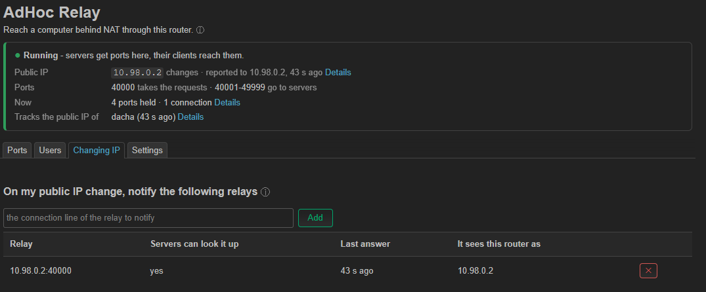
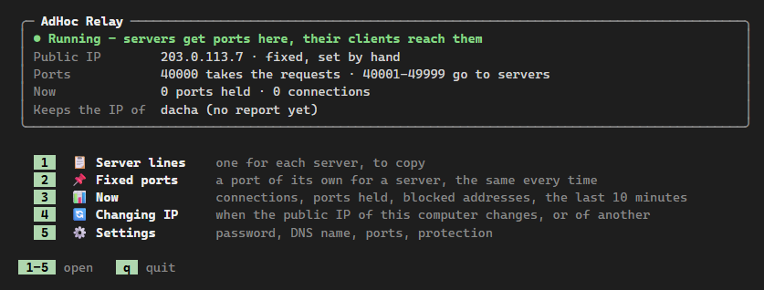
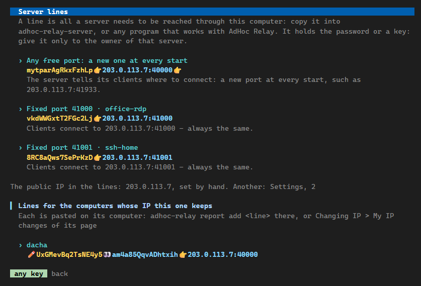

# AdHoc Relay

## TL;DR

**A relay for thousands of connections on a home router - at the cost of a forwarded port.**

- Two computers behind NAT - a server and its client - connect through a relay both can reach. Both only dial out; nothing is
  forwarded at their homes.
- **No program carries the traffic.** AdHoc Relay sets up the kernel of the relay - rules of nftables - so that the two
  connections meet there and pass as one, exactly as through a forwarded port. No byte goes up to a program and down again: no
  daemon in the way, no VPN, no TURN server, no copying.
- **So the relay costs what port forwarding costs:** a record of a few hundred bytes per connection in the kernel, and the forwarding
  a router does anyway, at its full speed. A small OpenWrt router of a home, or the cheapest Linux server, carries thousands of
  them.
- **The client needs nothing:** Remote Desktop Connection, ssh, a browser - it dials an address and a port. The server needs one
  line from the relay and a small script, or a few lines in its own program.
- **Only the one with the key waits at a port.** A port of meeting opens to a knock with the password or the key, and only the
  address that knocked can take the place of the server: a stranger, a scanner of the internet, never stands in for it.
- **The address of the relay may change:** another relay keeps it, and the servers follow it. Nothing outside: no DNS, no
  service of anyone else.

Two computers at two homes cannot connect to each other directly: each sits behind a NAT, its home router, and a NAT lets
nothing in that its own computer did not ask for. AdHoc Relay connects them through a **relay** both can reach: an
OpenWrt router or any Linux computer. The relay joins their two connections once, and from then on passes the traffic
the way a router passes a forwarded port: in the kernel, with no program in between.

What a TURN server or a VPN does for two computers behind NAT, with the load of a forwarded port. Both computers only dial out,
as any program does; AdHoc Relay makes their two dialings one connection.

Not every relay needs an address that never changes: one whose address the provider changes writes it into a
**record** kept by another, of a fixed address, and the server reads it there by itself. Nor does the server get a new port at
each start, when it is not to: a **fixed port** is always the same, for one key. Both need nothing outside AdHoc Relay: no DNS,
no service of anyone else.

**Nothing is copied.** A TURN server or a proxy receives every byte into a program and sends it again; a VPN encrypts and decrypts every
byte. AdHoc Relay does neither: once the two connections meet, the relay does for them exactly what a router does for a
forwarded port - the kernel rewrites the addresses of each packet as it passes, and that is all. No program reads the data, no
buffer holds it, no byte goes up to a program and down again. So the relay costs what a forwarded port costs: a record
of a few hundred bytes per connection in the table of the kernel, and the forwarding a router does anyway, at its full speed. A
small home router that forwards ports well serves as many meetings as it would serve forwarded ports.

| | Needs a forwarded port at the home of the server | The traffic passes through a program | Load on the middle |
|:--|:--|:--|:--|
| Port forwarding | yes | no | none |
| A TURN server, a proxy | no | yes: every byte is received and sent again | high: CPU and memory for every byte |
| A VPN | no | yes: every byte is encrypted and decrypted | high: CPU for every byte |
| **AdHoc Relay** | **no** | **no: the kernel forwards it, nothing copied** | **as for a forwarded port** |



| | The server | The client |
|:--|:--|:--|
| What it is | The computer with the service: Remote Desktop of Windows, SSH, a web server, a program of its own | The computer with the program that connects: Remote Desktop Connection, ssh, a browser |
| What it does | Asks the relay for a port, opens it, and waits there | Connects to that port, as to any address |
| What it needs | The password of the relay; the script of AdHoc Relay, or a few lines of code | Only the line: the relay and the port. Nothing installed |

## What it does

- **Two NATs, no forwarded port.** The server waits behind its NAT, the client dials it from behind its own; they meet at a port
  of the relay, and get one TCP connection.
- **No program in the traffic, nothing copied.** After the meeting the kernel rewrites the addresses, as for a forwarded port:
  one record per connection, the data never read nor held by a program. The speed is the speed of the router forwarding, its
  load the load of a forwarded port: a weak router carries many connections at once.
- **Small.** A table of nftables rules, and one small script that answers the requests for a port: ucode on OpenWrt, about
  1.5 MB of memory, perl on a Linux computer.
- **Many at once.** As many servers wait at once as there are ports of meeting: 9999 by default.
- **A password, and guessers stopped.** 16 characters get and open a port; after 5 wrong tries an address is blocked for 10
  minutes, and a wrong one gets no answer at all.
- **Guessers of Remote Desktop and SSH stopped too.** A password tried and refused is a short connection: an address with more
  than 5 of them at a port is blocked there, in the kernel. A setting turns it off.
- **Fixed ports.** A port set aside for one key of 16 characters: the server knocks the key at it and waits, asks nothing; the
  client's line is the same at every start of the server, `router.example.org:41000`.
- **A relay whose address changes.** It writes its address into a record of a relay of a fixed address, every
  60 seconds and at once when it changes; the server reads it there, with a key of its own, and follows it to the new address,
  its port kept. No DNS, no service of anyone else: AdHoc Relay and AdHoc Relay.
- **A page in LuCI.** The lines for the servers, each copied with one button; who is connected, who waits, who is blocked, the
  records and the reports, the tries of the last 10 minutes; the settings; Uninstall.
- **A command on a Linux computer.** `sudo adhoc-relay`: the same as the page, in the console - the lines, what happens, the
  fixed ports, the records, the reports, a new password.
- **For any program.** Only the server needs a few lines for it; the client dials as it always does.

| Section | |
|:--|:--|
| [Quick start](#quick-start) | Install, the password, uninstall |
| [Step by step: Remote Desktop](#step-by-step-remote-desktop) | Two whole examples: through one relay, and through a relay whose address changes |
| [Words used here](#words-used-here) | NAT, the server and the client, relay, ports, knock, hold, keys, records |
| [How it works](#how-it-works) | The meeting step by step, with pictures |
| [The lines](#the-lines) | What the server gets, part by part |
| [Fixed ports](#fixed-ports) | The same port at every start, for one key |
| [Users](#users) | Keys given to others in place of the password or a key: until a day, counted, limited, taken away; tags |
| [A relay whose address changes](#a-relay-whose-address-changes) | Records and reports: the server finds it at its new address |
| [Install](#install) | On an OpenWrt router, on a Linux computer |
| [Update](#update) | The installer of the new release, the settings kept |
| [The page in LuCI](#the-page-in-luci) | What the page shows and does |
| [The command adhoc-relay](#the-command-adhoc-relay) | The same on a Linux computer, in the console |
| [Settings](#settings) | Password, ports, times, the block of guessers, fixed ports, records, reports |
| [Uninstall](#uninstall) | Everything erased, the settings too |
| [Any port of the server](#any-port-of-the-server) | Remote Desktop, SSH, VNC, a web server, any port: one script on the server, the program of that service on the client |
| [Directly, when the two can](#directly-when-the-two-can) | The traffic between the two, not through the relay; the relay when that fails |
| [In your own program](#in-your-own-program) | The server |
| [API](#api) | `adhoc-relay api get \| set`: the same JSON on a router and on a Linux computer, for a program that sets relays up over SSH |
| [Safety](#safety), [When something goes wrong](#when-something-goes-wrong), [Limits](#limits) | |
| [Folders](#folders) | What is where; the pictures of this page |

## Quick start

The relay is either of two, with a public address or the range of ports forwarded to it:

| | An OpenWrt router | A Linux computer: Debian, Ubuntu, Fedora, Arch and others |
|:--|:--|:--|
| **1. Install** | By its web page alone: **System > Backup / Flash Firmware > Restore backup** with `adhoc-relay-openwrt.tar.gz`; or download the installer of one file into `/tmp` of the router and run it there: see [Install](#on-an-openwrt-router) | Download the installer of one file and run it with `sudo`: see [Install](#on-a-linux-computer-or-server) |
| **2. The password** | The installer prints it. Later: the web interface of the router, **Services > AdHoc Relay**, with the settings and what happens now: who is connected, who waits, who is blocked | The installer prints it. Later: `sudo adhoc-relay lines`, and `sudo adhoc-relay` for what happens now |
| **3. The server** | Gets one line with everything it needs: **Ports**, **Copy**, on the same page | Gets one line with everything it needs: `sudo adhoc-relay` - its menu, **1** - or `sudo adhoc-relay lines` prints it |
| **4. Uninstall** | **Uninstall AdHoc Relay** at the bottom of the same page | `sudo sh adhoc-relay-linux.sh remove` |

The line is the password, 👉, the public address or a name in DNS, `:`, the port of requests, 👉 - an answer comes:
`Tr7kQ2xZp4Lm9sWd👉203.0.113.7:40000👉`.
Nothing else is to be given or typed: the server takes it where it asks for the relay. A fixed port and a relay whose address
changes have lines of their own: see [The lines](#the-lines).

## Step by step: Remote Desktop

Two whole examples, from nothing to the desktop of a Windows computer on another screen. In each there are three computers:

- **the relay** - an OpenWrt router or a Linux computer the internet reaches;
- **the server** - the Windows computer to be reached, behind the NAT of its home, Remote Desktop on;
- **the client** - a laptop anywhere, with Remote Desktop Connection (`mstsc`) of Windows. Nothing is installed there.

Both examples give the server a [fixed port](#fixed-ports): the client keeps the same address in Remote Desktop Connection, once.

### Example 1: one relay, its address does not change

The relay is an OpenWrt router whose public address does not change: `203.0.113.7`, or a name in DNS such as
`router.example.org`.


**On the relay**

1. Install AdHoc Relay: [On an OpenWrt router](#on-an-openwrt-router) - `wget` the installer into `/tmp` of the router and run it.
   It prints the password; the page keeps it too.
2. Open the web interface of the router, **Services > AdHoc Relay**. On top: **Running**, and **Public IP** - the
   address, **fixed**.
3. Tab **Ports**, ⚓ **Fixed ports**: **+ Add**. A name, `office-rdp`, and a free port from the list, `41000`; **Add**: its key is
   made and applied at once.
4. **Copy** in its row. It is in the clipboard:

   ```text
   Fx2pL8wNq7Rk3mZa👉203.0.113.7:41000
   ```

   Send it to the owner of the server, privately: the key is in it.

A Linux computer as the relay: `sudo adhoc-relay`, **2**, **a**, Enter for the port it offers, a name; then **Esc** and **1**
shows the line. Or at once: `sudo adhoc-relay fixed add 41000 office-rdp` prints it.

**On the server, the Windows computer**

5. Remote Desktop on: **Settings > System > Remote Desktop** (Windows Pro or above). The account to log in with has a long
   password of its own.
6. Download [`adhoc-relay-server-windows.zip`](https://github.com/AdHoc-Protocol/AdHocRelay/releases/latest/download/adhoc-relay-server-windows.zip),
   unpack it into a folder, and double-click `adhoc-relay-server.cmd`.
7. It asks what to open: **1**, Remote Desktop of Windows. Then the relay: paste the line of step 4, Enter.
8. It shows the line for the client, and copies it: `203.0.113.7:41000`. It waits there, as long as its window is open; the
   computer must not sleep.

Next time: a double click, Enter, Enter - it keeps the answers.

**On the client**

9. Remote Desktop Connection (`mstsc`): **Computer** `203.0.113.7:41000`, **Connect**, then the name and the password of the
   account of the server.

The relay joins the two connections in its kernel, and from then on Remote Desktop Connection talks to the server as through a
forwarded port. The line of the client never changes: save it in Remote Desktop Connection.

✓ No fixed port wanted: in step 4 copy the line **A port given at each start**, `Tr7kQ2xZp4Lm9sWd👉203.0.113.7:40000👉`. The server
then shows another line for the client at each start of the script.

### Example 2: the address of the relay changes, another relay keeps it

The relay **D** is the OpenWrt router of a home: its address is public, but the provider changes it now and then. Another relay,
**S**, has an address that never changes: a small Linux server, a VPS, `198.51.100.9`. D writes its address to S; the server
reads it there. The meetings happen at D, as in example 1: S only keeps the address.


**On S, the Linux server of a fixed address**

1. Install AdHoc Relay: [On a Linux computer or server](#on-a-linux-computer-or-server).
2. `sudo adhoc-relay`, **4** - Changing IP -, **a** - track the IP of a computer -, a name for D: `home`. It prints the line for D:

   ```text
   ✏️Wk3vB9xQm5Tz2Lpe👀Rk8mP2qLx3Vb7NtY👉198.51.100.9:40000
   ```

   ✏️ the write key - D writes its address with it -, 👀 the read key - the servers read the address with it -, 👉 where: S and
   its port of requests. An OpenWrt router as S: **Changing IP > Track the public IP of other relays**, a name, **Add**, **Copy** in its row.

**On D, the router whose address changes**

3. Install AdHoc Relay, as in step 1 of example 1.
4. **Services > AdHoc Relay**, tab **Changing IP**, **On my public IP change, notify the following relays**: paste the line of step 2, **Add**. Within 20 seconds its table
   says **Last answer** - S has the address - and on top **Public IP** says **changes**.
5. Tab **Ports**, ⚓ **Fixed ports**: **+ Add**, the name `office-rdp`, the port `41000`, **Add**.
6. **Copy** in its row: the line looks the address up at S now:

   ```text
   Fx2pL8wNq7Rk3mZa🌐Rk8mP2qLx3Vb7NtY👉198.51.100.9:40000🌐41000
   ```

   Between the 🌐: where the address of D is read - the read key, S and its port. After the last 🌐: the port at D.

**On the server**: steps 5-8 of example 1, with this line. The script reads the address of D at S, shows
`<the address of D now>:41000`, and reads it again every 30 seconds.

**On the client**: Remote Desktop Connection to the line the server shows. When the address of D changes, D writes the new one
to S at once, the server reads it within 30 seconds, shows the new line and copies it again: the client connects to the new
address, the same port.

✓ D needs a public address, even one that changes: the internet must reach it. Behind the NAT of its provider - an address of
`100.64.0.0/10` on its wan - it is not reachable, and S is the relay to use itself, as in example 1.

## Words used here

| Word | What it means | Example |
|:--|:--|:--|
| **NAT** | A device that hides the computers of a home behind one address. It lets in only answers to what they sent out | A home Wi-Fi router |
| **The server** | The computer with the service. It asks for a port of meeting, opens it, and waits there for the client | A computer with Remote Desktop or SSH |
| **The client** | The computer that connects to the port the server opened: it only dials | Remote Desktop Connection; ssh; a browser |
| **Relay** | The router or computer with AdHoc Relay, reachable by both | An OpenWrt router with a public address, or a rented Linux computer, a VPS |
| **Port of requests** | The first port of the range. The server asks it for a port of meeting | 40000 |
| **Port of meeting** | A port the relay gives the server, one nobody else holds; the server and the client both dial it | 41933 |
| **Password** | 16 letters and digits of the relay: whoever knows them can get and open a port of meeting | `Tr7kQ2xZp4Lm9sWd` |
| **Id** | 8 random bytes the server picks for itself and sends after the password: the port of meeting is given to them, not to an address | 8 bytes |
| **Knock** | The UDP packet with the password and the id that opens a port of meeting | 24 bytes |
| **Hold** | The password, the id and one byte more: the port stays given to the server, closed | 25 bytes |
| **Fixed port** | A port of meeting set aside for one key: the key alone knocks at it. The same at every start of the server | 41000 |
| **Key of a fixed port** | 16 letters and digits that open that one port, and nothing else | `Fx2pL8wNq7Rk3mZa` |
| **S** and **D** | Two relays: D has an address the provider changes, S one that does not change. D writes its address, S keeps it | |
| **Record** | What S keeps of D: its address, when D wrote it last. Not its ports: they are in the lines of its servers | `dacha`: 198.51.100.20 |
| **Write key** | 16 letters and digits with which D writes its record on S. Only D has it | `Wk3vB9xQm5Tz2Lpe` |
| **Read key** | 16 letters and digits with which a server reads the record on S. A record has one or more | `Rk8mP2qLx3Vb7NtY` |
| **Report** | The setting of D: where it writes its address - S, the write key: the line S gave | |

## How it works


1. **The server gets a port.** It sends the password and its id to the port of requests. The relay answers with a port of
   meeting nobody else holds, 2 bytes, and gives it to that id: from then on only knocks with it open the port, from whatever
   address they come. A NAT that gives the server another address, or another port for each packet, does not take the port from it.
   No answer means the request or the answer was lost, and the server asks again with the same id: it gets the same port. A wrong password
   gets no answer at all, and an address that sends wrong ones too often is blocked for a while.
2. **The server opens the port: it knocks.** One UDP packet with the password and its id, to its port of meeting. A rule of the relay checks
   both, and opens the port. A wrong password opens nothing, and nor does another id. A server that shows its port to a
   person and waits for a yes holds the port instead: the password, the id and one byte more keep it given to it and closed.
   The relay notes the address the knock came from: only that address may wait at the port. The server knocks from the local
   port it dials from: a NAT that keeps the port - most do - shows the relay one port in both, and the relay knows the server by
   its address and that port. Another computer behind the same NAT is then a client like any other, never taken for the server.
3. **The server waits, dialing.** It dials the port - a try waits up to 3 s, the system sends its SYN again within it -, always from the same local port, and knocks every 20 s. The relay drops these
   attempts without an answer, and notes where they come from. A SYN from an address that did not knock is dropped and noted
   nowhere: a stranger that dials the open port before the server can never take its place.
4. **The client connects.** It dials the same port, as any program dials an address.
5. **The relay sends the attempt of the client on to the server,** with the addresses rewritten so that it comes from
   exactly the address the server is dialing.
6. **The server answers.** It was waiting for an answer from that address, and here it is. TCP is made for this case: two sides that dial
   each other at once get one connection ("simultaneous open").
7. **The connection is set up.** The port of meeting closes for anyone else. It stays given to the server: its next knock opens it for
   the next client. A client that comes in the moment right after, before the server dials again, waits for it at the relay: the
   next SYN of the server is sent to it, the meeting the other way round. Clients one right after another meet at once.
8. **The data flows.** The relay rewrites the addresses of every packet in the kernel, exactly as for a forwarded port.

### Why the NAT of the server lets the connection in

A NAT lets a packet in only if it looks like an answer: it must come from the address the computer behind it sent to. The server
has been sending to the port of meeting all along, so its NAT expects answers from there. The relay gives the attempt of
the client exactly that address:



The NAT of the client needs no trick: the client itself dialed the relay, so whatever comes back from there is an answer.

### What it costs the relay

- **The meetings are a table of nftables rules in the kernel.** One small script, `give`, waits for the requests for a port:
  ucode on OpenWrt, about 1.5 MB of memory, perl on a Linux computer. It does not touch the traffic: it answers a request with a
  port, once per server, and sleeps otherwise. Only the right password reaches it, a few requests a second from an address
  at most.
- **While the server waits:** a few small records per port of meeting, and one dropped packet a second.
- **After the meeting:** one connection record, as for any forwarded connection. The CPU work is the work of forwarding.
- **The records of relays whose address changes:** a line of memory each; one packet each 60 seconds from each such
  relay, one each 30 seconds from each server that reads.
- **A meeting [directly](#directly-when-the-two-can):** two STUN answers of `give`, and a call of 38 bytes and its answer of 30
  that the kernel sends on, as it does a meeting: no program of the relay wakes for it. Then nothing: the traffic does not pass
  the relay, and it holds no record of it.
- **The meetings it carries take the fast path of the kernel:** once set up, a meeting goes into a flowtable of AdHoc Relay on
  the devices of the way out, and its packets skip the firewall - the work of a router with flow offloading. With **Network >
  Firewall > Software flow offloading** on - or **Hardware flow offloading**, where the router has it -, fw4 carries them in its
  own instead: only the first packet of a meeting passes the rules of AdHoc Relay in its firewall. A kernel without flowtables
  carries them the slow way, as before; the log says so: `no flowtable in this kernel`. The flowtables are `kmod-nft-offload`
  of OpenWrt: firewall4 brings it, so every router of OpenWrt has it; the installer adds it when it is missing.
- **A router of several cores carries more with Packet Steering on:** **Network > Interfaces > Global network options > Packet
  Steering**, or `irqbalance`. It spreads the forwarding of the meetings over the cores; it is a setting of the router for all its
  traffic, so AdHoc Relay leaves it to its owner.

## The lines

The server gets one line, and the client one shorter line. The page of the relay, or `sudo adhoc-relay lines` on a Linux
computer, makes them: nothing is put together by hand.


**① A port given at each start**, the address of the relay does not change:

```text
Tr7kQ2xZp4Lm9sWd👉203.0.113.7:40000👉
```

The server asks for a port at 40000 and knocks with the password and its id. The client: `203.0.113.7:41933` - another at
each start of the server.

**② A [fixed port](#fixed-ports)**, the same address:

```text
Fx2pL8wNq7Rk3mZa👉203.0.113.7:41000
```

The server knocks with the key at 41000 and asks nothing. The client: `203.0.113.7:41000` - always.

**③ A port given at each start**, the address of the relay [changes](#a-relay-whose-address-changes):

```text
Tr7kQ2xZp4Lm9sWd🌐Rk8mP2qLx3Vb7NtY👉198.51.100.9:40000🌐40000👉
```

The server reads the address of the relay at 198.51.100.9:40000, then does as in ①. The client: `<its address now>:41933`.

**④ A fixed port**, the address changes:

```text
Fx2pL8wNq7Rk3mZa🌐Rk8mP2qLx3Vb7NtY👉198.51.100.9:40000🌐41000
```

The server reads the address at 198.51.100.9:40000, then does as in ②. The client: `<its address now>:41000`.

How to read a line - each 👉 says where what is before it goes:

- **The first 16 characters** are the password of the relay, or the key of a fixed port. **👉**: they go to the relay,
  `address:port`.
- **🌐 instead of 👉**: the address of the relay is read - between the 🌐 is where: a read key, 👉, S and its port. After the last
  🌐, the port of the relay. Several S, each between its 🌐, are asked in turn: when the first does not answer, the next.

```text
Fx2pL8wNq7Rk3mZa🌐Rk8mP2qLx3Vb7NtY👉s1.example.org:40000🌐Hx4nT7wAe2Kq9VsM👉s2.example.org:40000🌐41000
```

- **👉 at the end**: an answer comes - it is the password, the server asks for a port. **None**: the key of a fixed port, the server
  knocks at once.
- **The client's line** is only the address of the relay and the port: what any program dials.

The ports are in the line, and stay: only the address of a relay changes, and only it is read at S.

The rules every program keeps alike:

| Part | Rule |
|:--|:--|
| password, key, read key | exactly 16 letters and digits |
| relay, S | a name or an IPv4 address: no `:` `@` `=` `,` `!` `?` `>` or space in it |
| port | 1…65535. None after the relay of a password: 40000. A fixed port, S and a relay whose address is read name their ports |
| signs | 👉, 🌐, 👀 and ✏️ may be typed as `>`, `@`, `?` and `!`; a 👉 of another colour of skin is the same. Every program keeps, shows and copies the emoji. On a command line the line goes in quotes: `>` is a redirection of the shell |
| spaces | around the line and around each `read key👉S:port` between the 🌐 they go; inside a part they are an error |

The line is one form for all who take it: both scripts of the server, and any program of its own. The cases are in
[`docs/lines.tsv`](docs/lines.tsv): a line, and what it is, or `error`. A program that takes lines reads a copy of that file in its tests;
`sh .github/lines.sh` runs it through both scripts here ( `perl adhoc-relay-server.pl --parse <line>`,
`adhoc-relay-server.ps1 -Parse <line>` print what they make of a line ). A program of your own that takes lines does it right when it
makes of each case what the file says.

## Fixed ports

A port given at each start makes a new line for the client at each start of the server. A fixed port does not: the client
keeps `router.example.org:41000` in Remote Desktop Connection, or in the settings of ssh, once.



| | A port given at each start | A fixed port |
|:--|:--|:--|
| Who picks it | The relay, a free one, when the server asks | The owner of the relay, once, in the settings |
| What opens it | The password and the id of the server: 24 bytes | Its key alone: 16 bytes. The key and one byte more hold it, closed |
| The line of the server | `password👉relay:40000👉` | `key👉relay:41000` |
| The line of the client | New at each start of the server | The same always |
| When the server stops | Given to others a minute later | Kept for its key: nobody else gets it, ever |

To set one up:

| On an OpenWrt router | On a Linux computer |
|:--|:--|
| **Services > AdHoc Relay**, **Ports**, ⚓ **Fixed ports**: **+ Add** - a name, a free port from the list; its key is made and applied at once. **Copy** in its row: its line | `sudo adhoc-relay fixed add`, or `fixed add 41000 office-rdp`: it prints the line. Or the menu: `sudo adhoc-relay`, **2**, **a** |

The server takes the line as any other: the script of [Any port of the server](#any-port-of-the-server), or a program of its own.

✓ The port is one of the range, after the port of requests: 40001-49999 by default.
✓ One key, one server: two servers with the same key take the port from each other.
✗ A port that never changes is easier to find for the programs that try every port of the internet. The [guard](#guard-against-guessing)
stops their guessing, and the password of the service of the server, long and its own, is what keeps them out.

## Users

The password, the keys of the fixed ports and the read keys are the owner's own. To let someone else use the relay for a while, the
owner gives a **user**: a key of 16 of their own, in place of one of them. Its holder uses it as that key - in its line, as it is.

| | |
|:--|:--|
| **Using** | any free port - its holder asks ports and knocks with it, as with the password; a fixed port - it knocks there, as with its key; the IP of a record - it reads the address, as with a read key |
| **Until** | its last day, or always. From the day after it opens nothing: the kernel lets it go itself, at its time |
| **Counted** | what the meetings it opens carry through the relay, in kilobytes, both ways. Kept through reloads and restarts |
| **Limit** | megabytes, or none: past it the packets of its meetings go nowhere |
| **Direct only** | its traffic can be passed via a direct connection only: its clients reach its server by a [call](#directly-when-the-two-can); one that dials the relay is refused at once - a reset -, and nothing of it goes through the relay |
| **Taken away** | it opens nothing; its meetings going on end too |
| **Tags** | up to 8 numbers of 0-255, with names if wanted: choose the users by them, take a group away at once |

On the page: the tab **Users** - the users chosen by tags, with each of them or any of them, what each carried, its line to
copy; **Take away those shown**; their settings; the names of the tags.


In the console:

```text
sudo adhoc-relay user add password 2026-12-31 10240 partner partners,guests     a new key, printed with its line
sudo adhoc-relay user add 41000 - direct petya                                  direct only, at the fixed port 41000
sudo adhoc-relay user with guests                                               those with the tag, what they carried
sudo adhoc-relay user del with any partners,guests                              a group taken away
sudo adhoc-relay tag add 17 guests                                              a name for a tag
```

What it costs the relay - nothing for anyone else:

- **The key** is looked up in a set of the kernel instead of compared: the same for each knock. Its end is the timeout of its
  element.
- **A knock with a user** marks its port with the number of the user: one lookup more, at a knock only. Of one of the direct path
  only, a bit more in the mark: the SYN of a client to that port is refused - one test, at the SYN alone.
- **A meeting of a user** carries the number in its mark; its packets are counted by a quota or a counter of the kernel, one lookup
  each. They stay out of the fast path - a flowtable would carry them past the count -, and with the offloading of fw4 on, one rule
  more for each forwarded packet while there are users of ports. No other meeting, no other packet of the router is looked at.
- **What they counted** is kept in a file when the rules load, stop, and each hour while there are users of ports, written only
  when it changed: `/etc/adhoc-relay.used` on a router, `/var/lib/adhoc-relay/used` on a Linux computer. A router that loses its
  power loses an hour of it at most.
- **The tags** are of the settings alone: the kernel never sees them. To choose, the tags of a user are one number of 8 bytes, and
  a choice compares bytes.

✓ 255 users of ports at most - of the password and of fixed ports -; of read keys, any number.
✓ A user keeps its number while it is there: one taken away or added moves no other, and the number of one taken away comes
back last.

## A relay whose address changes

A home router mostly has a public address that its provider changes: once a day, or at each new connection. A line with that
address stops working when it does. AdHoc Relay solves it with itself only: the router whose address changes, **D**, writes it
into a **record** kept by a relay whose address does not change, **S** - a VPS, the router of a friend, of an office.
The server reads it there and follows D to its new address.


1. **D writes its address.** One UDP packet to S: its write key, nothing else. S keeps the address the packet came from, and
   answers it: the address S saw, 4 bytes - D shows it on its page. D writes again every 60 seconds, and at once when its own
   address changes.
2. **The server reads it.** One UDP packet to S: its read key. S answers the address and how many minutes ago D wrote: 5 bytes.
3. **The meeting, as always**, at that address and the port of the line.
4. **The address of D changes.** D writes at once; S keeps the new address.
5. **The server reads again**, every 30 seconds while it waits.
6. **It knocks at the new address.** D kept its port: a port given at each start stays given to the id of the server, a fixed
   port to its key. The server shows the client its new line, and puts it in the clipboard again.

Only S needs an address that does not change. One S keeps the records of many D, and any relay can be S and D at once.
S knows nothing of the ports of D: they are in the lines of the servers, and stay. One record of D serves every line of D - that
of its password and that of each fixed port.

### To set it up

**1. On S, the relay of a fixed address: keep the address of D.** OpenWrt: **Changing IP > Track the public IP of other relays**, a name, **Add** - the keys
are made, saved, applied -, then **Copy** in its row. Linux: `sudo adhoc-relay record add dacha`, or the menu, **4**, **a**. Either
gives the line for D - ✏️ the write key, 👀 the read key, 👉 where to:

```text
✏️Wk3vB9xQm5Tz2Lpe👀Rk8mP2qLx3Vb7NtY👉198.51.100.9:40000
```

**2. On D, the one whose address changes: paste that line.** OpenWrt: **Changing IP > On my public IP change, notify the following relays**, the line, **Add**. Linux: the
menu, **4**, **p**, or:

```text
sudo adhoc-relay report add '✏️Wk3vB9xQm5Tz2Lpe👀Rk8mP2qLx3Vb7NtY👉198.51.100.9:40000'
```

**3. Both see it work.** S: **Changing IP > Track the public IP of other relays** - the address of D, and how long ago it wrote; `sudo adhoc-relay record`.
D: **Changing IP > On my public IP change, notify the following relays** - when S answered, and the address S sees; `sudo adhoc-relay report`.

**4. On D: the lines for the servers read the address on S now.** **Ports**, **Copy**, and give it to
the server:

```text
…🌐Rk8mP2qLx3Vb7NtY👉198.51.100.9:40000🌐41000
```

✓ Two S for one D: a record on each, a report to each. The line names both, in order: when the first does not answer, the
server asks the second.
✓ A read key for each server, or each person: a record takes more than one - a [user](#users) in place of its read key: **Users**, **+ Add a user**, **Using** **the IP of dacha**; or `adhoc-relay record read dacha`. A read key deleted cuts off that one alone.
✗ The write key stays on D: whoever has it can write another address into the record.

### What the server does with an answer


| The answer | What it does |
|:--|:--|
| Written in the last 2 minutes | Takes it at once |
| Older | Asks the next S; when none has a fresh one, takes the freshest |
| None | S does not answer, or D has never written: it tries again in 5 seconds, and says so |

While it waits it reads every 30 seconds. D writes within 2 seconds of a change of an address it has itself, the address of its
wan, and within 60 seconds of any other; so a server finds D at its new address within a minute.

✓ The client's line changes with the address of D: the server shows the new one and copies it. A client whose line must never
change needs a name in DNS for D, and that is what this way does without.
✓ The server dials on from the same local port at the new address: D knows it by that, as the side that waits.
✗ A client that dials in the first 5 seconds after the server moved may get no answer: D still sends it to where the server
was. It tries again, and meets.

## Install

### On an OpenWrt router

**By the web page of the router alone - no SSH:**

1. Download [`adhoc-relay-openwrt.tar.gz`](https://github.com/AdHoc-Protocol/AdHocRelay/releases/latest/download/adhoc-relay-openwrt.tar.gz)
   to your computer, about 46 KB.
2. In the web page of the router: **System > Backup / Flash Firmware**, **Restore backup**, **Upload archive...**, the file.
3. The page lists the files of AdHoc Relay in it: **Continue**. The router restarts, a minute or so.
4. **Services > AdHoc Relay**: the password is made, the settings are there. Right after the restart it may say **Almost ready**:
   the module `ucode-mod-socket` comes from the packages of OpenWrt as soon as the router reaches the internet, and AdHoc Relay
   starts by itself.

It is a backup of AdHoc Relay alone, not of the router: it adds its files and changes nothing else - no setting of the router, none
of AdHoc Relay. The same file again, of a new release, **updates** it, its settings kept. A flash of the firmware keeps AdHoc Relay
too: its files are among those OpenWrt keeps, and the module comes again by itself. Why not **System > Software > Upload Package**:
OpenWrt 25.12 installs there only packages signed by the keys of OpenWrt.

**Or on the router, download the installer into `/tmp` and run it:**

```sh
ssh root@192.168.1.1
wget -O /tmp/adhoc-relay-openwrt.sh https://github.com/AdHoc-Protocol/AdHocRelay/releases/latest/download/adhoc-relay-openwrt.sh
sh /tmp/adhoc-relay-openwrt.sh
```

The installer is one file of about 86 KB: the script, with the files of the folder [`OpenWRT`](OpenWRT) in it as text, so it can
be read before it runs. Each file is written straight to its place, and at the end the installer erases itself from `/tmp`.

A router without the internet gets it from a computer: download `adhoc-relay-openwrt.sh` from
[the last release](https://github.com/AdHoc-Protocol/AdHocRelay/releases/latest), copy it with `scp -O adhoc-relay-openwrt.sh
root@192.168.1.1:/tmp/` or WinSCP, and run `sh /tmp/adhoc-relay-openwrt.sh` there.

It prints the password and where the page is:

```text
the password of this router: Tr7kQ2xZp4Lm9sWd
LuCI: Services > AdHoc Relay
AdHoc Relay: requests for a port at 40000, ports of meeting 40001-49999
```

That is all. The server gets its line from that page: **Ports**, **Copy**, `Tr7kQ2xZp4Lm9sWd👉203.0.113.7:40000👉`, the password,
the public address of the router and the port of requests in one. The modules of ucode `give` needs are downloaded when the
router has none: `ucode-mod-socket`, 60 KiB, the sockets; `ucode-mod-math`, which the snapshots of OpenWrt do not have. nftables, fw4 and ucode are in OpenWrt already. Running the installer
again updates AdHoc Relay and keeps its settings: see [Update](#update).

The folder `OpenWRT` copied into `/tmp` installs the same way: `sh /tmp/OpenWRT/install.sh`, and its files are erased at the end.

For builders of firmware, the folder is also a package of the OpenWrt SDK: put it into `package/adhoc-relay` and run
`make package/adhoc-relay/compile`; the page is the package `luci-app-adhoc-relay` from `OpenWRT/luci`.

### On a Linux computer or server

Debian, Ubuntu, Fedora, Arch and others with systemd. Install nftables first (`apt install nftables`, `dnf install nftables`,
`pacman -S nftables`); perl is there already on Debian and Ubuntu, elsewhere `dnf install perl`, `pacman -S perl`. Then download
the installer and run it:

```sh
wget https://github.com/AdHoc-Protocol/AdHocRelay/releases/latest/download/adhoc-relay-linux.sh
sudo sh adhoc-relay-linux.sh
```

The installer is one file of about 76 KB: the script, with the files it installs in it as text, so it can be read before it runs.

It prints the password, as on the router, and installs the service `adhoc-relay`, which loads the rules and starts `give` at every
start of the computer, and the command `adhoc-relay`. It also turns on the forwarding of packets, and lets the meetings and the
requests for a port through the firewall of iptables when there is one: Docker and ufw block them otherwise. The server gets one
line, which `sudo adhoc-relay lines` prints: the password, `@`, the public address of the computer, `:`, the first port, such as
`Tr7kQ2xZp4Lm9sWd👉203.0.113.7:40000👉`. To remove, with the settings: `sudo sh adhoc-relay-linux.sh remove`. The whole folder
`AdHocRelay` installs the same way: `sudo sh Linux/install.sh`, and `sudo sh Linux/install.sh remove`.

### On both

✓ The whole range, the port of requests too, must be reachable from the internet: TCP and UDP. Open it in the firewall of the
hosting provider, if it has one. If the router itself is behind the NAT of its provider, forward the range to it.
✗ Do not choose a range that other services of the relay use.

## Update

An update is the installer of the new release run over the installed AdHoc Relay: the same commands as to install. The settings
stay, the password with them; nothing is to be removed first.

On an OpenWrt router:

```sh
wget -O /tmp/adhoc-relay-openwrt.sh https://github.com/AdHoc-Protocol/AdHocRelay/releases/latest/download/adhoc-relay-openwrt.sh
sh /tmp/adhoc-relay-openwrt.sh
```

The installer prints no password: it has one already. Reload the page of LuCI afterwards, so that the browser takes its new
version.

By the web page alone: **System > Backup / Flash Firmware > Restore backup** with `adhoc-relay-openwrt.tar.gz` of the new release,
as to install; the router restarts, the settings kept.

On a Linux computer:

```sh
wget -O adhoc-relay-linux.sh https://github.com/AdHoc-Protocol/AdHocRelay/releases/latest/download/adhoc-relay-linux.sh
sudo sh adhoc-relay-linux.sh
```

`-O` writes over the installer of the last time, which `wget` would keep beside the new one otherwise.

On both, the connections going on go on, and the ports given stay with their servers: the rules are loaded anew with them,
and `give` starts again with its new code. A Linux computer reloads the service `adhoc-relay` for it, not restarts it: the stop of
a restart would take the rules away.

The releases, and what changed in each: [Releases](https://github.com/AdHoc-Protocol/AdHocRelay/releases).

## The page in LuCI

When the router has LuCI, its web interface, the installer adds the page **Services > AdHoc Relay**. A Linux computer has no
page: the command [`adhoc-relay`](#the-command-adhoc-relay) does the same in the console, as a menu.


**On top, what this router is**, renewed every 5 seconds:

| Row | It says |
|:--|:--|
| the first line | **Running** - servers get ports here, their clients reach them. Or why not - **Not running**, **Turned off**, **Not serving** - and what to do; the colour of the card says the same |
| **Public IP** | The address in the lines, and whether it is **fixed** - its DNS name, or found automatically: the public address of its wan, else STUN - or **changes**: which relay this router reports its IP to, and when last. A router behind another, or behind the NAT of its provider, is told to forward the range there |
| **Ports** | The port that takes the requests for a port, and the ports that go to the servers. The router lets them through its own firewall by itself |
| **Now** | How many ports servers hold, how many connections there are; **Details** opens the tab **Ports** |
| **Tracks the public IP of** | Only when it tracks any: the relays whose changing public IP this one tracks, and when each reported last |
| **Get started** | Until the router serves: the steps there, each ticked when done - **Create a password and start**; forward the range on the router in front, when there is one; give a server its line |

Then the tabs:

| Tab | What is there |
|:--|:--|
| **Ports** | ♻️ **Any free port: a new one at every start** - the ports given now: the user it was given by, when it was used last and from where, 🟢 while a client is connected; **Copy** and **New key** of the password on the right. ⚓ **Fixed ports**, by name: the port, when used last, from where, by which user, 🟢; **Copy**, **New key** and ✕ in each row. **+ Add**: a name, a free port from the list; a name opens it to change. The lines are not shown: **Copy** puts one into the clipboard whole. One that would break when the IP changes says so, in yellow, and what to do. Under them the blocked addresses and the last 10 minutes: see below |
| **Users** | The [users](#users), chosen by tags - with each of them or any of them - and **Take away those shown**: the name, what it is using, until when, what its meetings carried of its limit - or **direct only** -, its tags; **Copy**, **New key** and ✕ in each row. **+ Add a user**, or its name to change it: lists to choose from - in place of what, the limit, the tags -, the last day, **Direct only**. Below, the names of the tags |
| **Changing IP** | **On my public IP change, notify the following relays** - for the router whose public IP changes: the line of a router of a fixed IP pasted, **Add** - see below; then the relays it reports to, and their answers; ✕. One line serves every line of the router: the ports stay in the lines of the servers. **Track the public IP of other relays** - for the router of a fixed IP: a name, **Add** - its keys are made, saved and applied - then **Copy** in its row, for the router whose IP changes; the table says when each reported last |
| **Settings** | Everything of the next section, in three tabs, the choices in lists - **Basic**: on or off, the password, the DNS name; **Ports**; **Protection**. **Uninstall** at the bottom: see [Uninstall](#uninstall) |

The page shows names and values; what each is and does is in its tooltip, ⓘ beside it. **Save & Apply** is on **Settings**
alone: everything else saves and applies at once.

**From one router to another** - the one whose address changes, D, and one of a fixed address, S:

| On S: **Changing IP > Track the public IP of other relays** | On D: **Changing IP > On my public IP change, notify the following relays** |
|:--|:--|
|  |  |
| A name for D, **Add**; then **Copy** in its row | The line pasted, **Add**. In 20 seconds S answers: **Last answer**, and the address S sees. The lines of D now read the address at S: give them to the servers once more |

Each **Add** saves and applies at once. The one line pasted makes every line of D read its address at S: that of the password
and that of each fixed port, each with its own port.

Under the ports, on **Ports**:

| Table | One row is | Columns |
|:--|:--|:--|
| ⛔ Blocked addresses - only while there are any | An address that sent a wrong password too often, or guessed passwords at a port | The address; all ports, or the port it guessed at; how long until the block ends |
| The last 10 minutes - folded, a click opens it | A request for a port, a knock, a write or a read of a record, that came to the range, or a SYN to a port given | When, from which address and port, to which port, what it was |

What a port does now is in the tooltip of its number, and how long until it is free again unless its server knocks. A port
given is in one of three states: **Closed · held for its server** (it waits for a yes of its person and holds the port, or
has just met), **Open · the server has not dialed in yet**, or **Open · the server is waiting for a client** (from its address and
port).

**The last 10 minutes** is for finding out why something does not work. It shows the newest 30, and how many there are in all:

| What | It means |
|:--|:--|
| Asked for a port | A request with the right password: `give` answered it |
| Knock by the server of the port | A knock or a hold of the server; at a fixed port, with its key |
| Knock at a port held by another server | The server knocks with another id than it asked with, or its port was given away when it stopped knocking: it must ask again |
| Reported its IP | A relay of a changing address reported it, with the write key of a record |
| A server looked up an IP | A server read a record, with a read key |
| Wrong password or key | A request, a knock, a report or a look-up with a wrong password or key: an old one, or someone guessing |
| Ignored: a blocked address | Too many wrong ones came from this address |
| Ignored: it guessed passwords at this port | Too many short connections came from this address to this port: see Stop password guessing below |
| The server of the port dialed in | A SYN of the server, from an address that knocked with its id |
| Connection from a client, or a stranger | A SYN of anyone else to a port given: the client, or someone who dials it while it is closed |

Each kind keeps up to 256 entries: a flood of wrong passwords does not push out the tries of the computers that work. A SYN to
a port nobody holds is not noted: the scanners of the internet dial every port of every address all day, and the client dials
only a port given.

A key used twice, or the same as the password, is refused when saving, with the two named. **Save & Apply** loads the settings at
once: the connections going on go on, the ports given stay with their servers, the blocks are lifted.

✓ After a new password, give the new lines to every server at once.
✗ Otherwise a server keeps asking and knocking with the old one, and blocks its own address after 5 tries.

## The command adhoc-relay

On a Linux computer the installer puts the command `adhoc-relay`: what the page of LuCI is on a router, in the console. It runs as
root. `sudo adhoc-relay` in a terminal opens its menu: on top, what this computer is - running or not, its address and whether it
stays or changes, the ports, what goes on, whose addresses it keeps -, then a key for each screen, the same as the tabs of the
page: **1** Server lines, **2** Fixed ports, **3** Now, **4** Changing IP, **5** Settings. One key opens a screen, no Enter after it. Each screen is a page of its own: its list, and at the bottom the
keys of what can be done there - **a** to add, **k** a new key, **d** to delete, **Esc** back. It asks what it needs, and offers what it can: the
next free fixed port, the port of the password.

| The menu | Server lines, **1** |
|:--|:--|
|  |  |

From a script, or for one thing at once, the commands - in a pipe or a log, with no colours:

| Command | What it does |
|:--|:--|
| `sudo adhoc-relay` | In a terminal: the menu. In a pipe: `status` |
| `sudo adhoc-relay status` | What this computer is, then what happens now: the connections, the ports servers hold, the blocked addresses, the last 10 minutes |
| `sudo adhoc-relay lines` | The lines to copy, the password and the keys shown: for the servers, and for the computers whose address changes and this one keeps |
| `sudo adhoc-relay settings` | The settings, each with what it is; in the menu, **5**, each changed by its key |
| `sudo adhoc-relay set <setting> <value>` | One of them, checked, saved and loaded: `set wait 120`, `set guard off`, `set password new`, `set address auto` |
| `sudo adhoc-relay password` | The password. `password new`: a new one - give the new lines to every server at once |
| `sudo adhoc-relay fixed` | The fixed ports. `fixed add`: one more, the next free port from the first + 1000 on; `fixed add 41000 office-rdp`: that one - with a new key, it prints the line of its server. `fixed key 41000`: a new key - the old line opens nothing then. `fixed del 41000` |
| `sudo adhoc-relay record` | The addresses this computer keeps for computers whose address changes. `record add dacha`: one more, with a new write key and read key - it prints the line for that computer. `record read dacha`: one more read key. `record del dacha` |
| `sudo adhoc-relay report` | Where this computer reports its own address, and the last answer of each. `report add '<line>'`: the line a computer of fixed address gave - every line of this computer looks its address up there then. `report del 1` |
| `sudo adhoc-relay address [<name> \| auto]` | The address of this computer in the lines: a name in DNS, or an address. `auto`: found - the address an answered report saw, the address of the computer when it is public, or STUN |
| `adhoc-relay help` | Every command |

## Settings

On a router with LuCI, all of them are on its page; on a Linux computer, `adhoc-relay` changes them. Or by hand:

| Setting | Default | What it is |
|:--|:--|:--|
| Password | made by the installer | 16 letters and digits. Whoever knows it can get and open a port of meeting |
| First and last port | `40000`, `49999` | The range: the first port is the port of requests, the others are the ports of meeting |
| Hold, seconds - `wait` | `60` | Seconds a server keeps its port - open, and given to it - after its last knock. Servers knock every 20 s: 30 or more |
| Wrong tries - `tries` | `5` | Wrong knocks and requests an address may make. One more try comes back each minute |
| Block, seconds - `block` | `600` | Seconds an address is blocked after its tries run out: its knocks and requests are ignored, even with the right password. And seconds an address that guessed at a port is kept from that port |
| Stop password guessing - `guard` | on | The guard against guessing passwords: off for a server whose connections are short by nature, a web server of many quick requests |
| Short, seconds - `short` | `20` | Seconds: a connection that the client ends within them is short, a password tried and refused |
| Short connections - `guesses` | `5` | Short connections an address may make to a port. One more comes back each 10 minutes; past them the address is blocked at that port |
| DNS name - `dns`, `ADDRESS` on Linux | empty | Optional: a name of the relay in DNS, for the lines. Empty: its public address, found |
| Fixed ports | none | Each a port of the range and its key of 16 letters and digits, a name for the page |
| Records | none | Each a name, a write key, one or more read keys: a relay whose address changes writes it here |
| Reports | none | Each the line of a relay that keeps a record of this one: where this one writes its address |

On a router they are in `/etc/config/adhoc-relay`:

```sh
uci set adhoc-relay.main.first=20000
uci set adhoc-relay.main.last=29999
uci set adhoc-relay.main.block=300
uci set adhoc-relay.main.guard=0
# a fixed port
uci add adhoc-relay fixed
uci set adhoc-relay.@fixed[-1].name=office-rdp
uci set adhoc-relay.@fixed[-1].port=21000
uci set adhoc-relay.@fixed[-1].key=Fx2pL8wNq7Rk3mZa
# a record, kept for a relay whose address changes
uci add adhoc-relay record
uci set adhoc-relay.@record[-1].name=dacha
uci set adhoc-relay.@record[-1].write=Wk3vB9xQm5Tz2Lpe
uci add_list adhoc-relay.@record[-1].read=Rk8mP2qLx3Vb7NtY
# a report: this router writes its address to that one
uci add adhoc-relay report
uci set adhoc-relay.@report[-1].to='✏️Wk3vB9xQm5Tz2Lpe👀Rk8mP2qLx3Vb7NtY👉198.51.100.9:40000'
# a user: in place of the password, until its last day, 10 GB at most, tags 3 and 17
uci add adhoc-relay user
uci set adhoc-relay.@user[-1].name=partner
uci set adhoc-relay.@user[-1].key=Pa7mL2xR9pTz4WkN
uci set adhoc-relay.@user[-1].of=password
uci set adhoc-relay.@user[-1].expires=2026-12-31
uci set adhoc-relay.@user[-1].limit=10240
uci add_list adhoc-relay.@user[-1].tags=3
uci add_list adhoc-relay.@user[-1].tags=17
# the name of a tag
uci add adhoc-relay tag
uci set adhoc-relay.@tag[-1].id=17
uci set adhoc-relay.@tag[-1].name=guests
uci commit adhoc-relay
/etc/init.d/adhoc-relay reload
```

On a Linux computer, in `/etc/adhoc-relay.conf`; the lists are quoted, their entries separated by spaces:

```sh
PASSWORD=Tr7kQ2xZp4Lm9sWd
FIRST=20000
LAST=29999
WAIT=60
TRIES=5
BLOCK=300
GUARD=1
SHORT=20
GUESSES=5
# port:key[:name]
FIXED="21000:Fx2pL8wNq7Rk3mZa:office-rdp"
# name:write key:read key[,read key...]
RECORDS="dacha:Wk3vB9xQm5Tz2Lpe:Rk8mP2qLx3Vb7NtY"
# ✏️write key👀read key👉relay:port, the line it gave
REPORTS="✏️Wk3vB9xQm5Tz2Lpe👀Rk8mP2qLx3Vb7NtY👉198.51.100.9:40000"
# of:key:until:limit[:name[:tags]] - of: password, a port, @record; until YYYY-MM-DD or -; limit MB or -; tags 3.17
USERS="password:Pa7mL2xR9pTz4WkN:2026-12-31:10240:partner:3.17"
# number:name
TAGS="17:guests"
ADDRESS=
```

then `sudo systemctl reload adhoc-relay`. A fixed port out of the range, or a key used twice or of other than 16 letters and
digits, is left out when the settings load, and the log says so: `journalctl -u adhoc-relay`, on a router `logread -e adhoc-relay`.

The server must use the same password, and the first port as the port it asks for a port of meeting: its line
`Tr7kQ2xZp4Lm9sWd👉router.example.org:20000👉`, as the page copies it.

### Guard against guessing

A port of meeting that leads to Remote Desktop of Windows or SSH is found by the programs of the internet that try every port
of every address, and they guess passwords there. Each guess is one connection: it opens, the password is refused, it closes, a
few kilobytes in a second or two. Someone who works stays minutes and hours. So the relay counts, in the kernel, the
connections that the client ends within **Short** seconds, per address and port of meeting:

| Short connections of one address to one port | What happens |
|:--|:--|
| Up to **Guesses**, 5; one more comes back each 10 minutes | Nothing: someone who mistyped the password, twice or three times, comes in as always |
| Past them | The address is blocked at that port for **Block** seconds: its SYNs to it go nowhere. Other ports of meeting stay open to it |

A guesser gets 5 tries, and then one in 10 minutes: some 150 a day, nothing
against a long password. It is no reason for a short one.

✓ The server that waits at the port is never stopped: the guard looks only at the SYNs of clients. A client behind the NAT of
the server has its address; past its tries it is blocked there as a client, and the server waits on.

The guard is on by default. Turn it off - **Guard** on the page, `uci set adhoc-relay.main.guard=0`, or `GUARD=0` - only for a
server whose connections are short by nature: a web server answering many quick requests, a program that connects for a moment
and goes. The page shows the addresses blocked at a port in **Blocked addresses**, the port beside them.

## Uninstall

Every way erases everything AdHoc Relay installed: the rules, the service, the page in LuCI, the settings with the password.
Connections that met end at once. Nothing is left to clean by hand.

| Where | How |
|:--|:--|
| A router with LuCI | **Uninstall AdHoc Relay** at the bottom of its page, then confirm. The page goes to the overview of the router |
| A router without LuCI | `/usr/libexec/adhoc-relay/uninstall`: the installer put it there |
| A Linux computer | `sudo sh adhoc-relay-linux.sh remove`, or `sudo sh Linux/install.sh remove` from the folder `AdHocRelay` |

Installed as packages of the SDK, the packages are removed as well. To have AdHoc Relay again, install it once more: it starts
with a new password.

## Any port of the server

When the client needs a service of the server - Remote Desktop of Windows, SSH, VNC, a web server, any TCP port - and nothing
more, the server runs one script, and the client uses the program of that service, as with any address: Remote Desktop
Connection, ssh, a VNC viewer, a browser. Nothing is installed on the client. The script asks for a port of meeting, shows the line, and joins each one who comes to the
server: the bytes go as they are, both ways. The server checks who comes, as always.

| The server | Download | Start |
|:--|:--|:--|
| Windows | [`adhoc-relay-server-windows.zip`](https://github.com/AdHoc-Protocol/AdHocRelay/releases/latest/download/adhoc-relay-server-windows.zip): unpack it into a folder | A double click on `adhoc-relay-server.cmd` |
| Linux, macOS | [`adhoc-relay-server.pl`](https://github.com/AdHoc-Protocol/AdHocRelay/releases/latest/download/adhoc-relay-server.pl) | `perl adhoc-relay-server.pl` |

Windows PowerShell of Windows runs the one, the perl of the system the other: nothing else to install. The script asks what to
open, then the relay, as its owner gave it, the line of its page:

```text
 🔌 What should the other computer reach through the relay?

    1  🪟  Remote Desktop of Windows  port 3389 · Remote Desktop Connection ( mstsc ): a long, strong password on the account is a must
    2  🔐  SSH                        port 22 · ssh -p <port> <relay>
    3  🖼️  VNC                        port 5900 · a VNC viewer
    4  🌐  A web server               port 80 · a browser: http://<relay>:<port>
    5  ✏️  Another port               of this computer, or address:port of its network: you type which

 Press 1-5 › 1  🪟 Remote Desktop of Windows
 The relay, as its owner gave it, such as Tr7kQ2xZp4Lm9sWd👉router.example.org:40000👉: Tr7kQ2xZp4Lm9sWd👉router.example.org:40000👉
```

Any of [the lines](#the-lines) goes there: with no 👉 at the end the script knocks at the fixed port and asks nothing; with a read key it reads
the address of the relay first, and again every 30 seconds while it waits. When the address changes, it says so, shows
the new line for the client and copies it again:

```text
 🔀 The relay moved: the line for the client is new
```

The answers are kept beside the script, `adhoc-relay-server.settings`: next time Enter takes each. Then it shows the line for the client,
and puts it in the clipboard:

```text
 💤 To connect later, this computer must stay on and awake while this runs: asleep, it lets nobody in, and a minute later the relay gives its port to others
 🔌 127.0.0.1:3389 answers: whoever comes is joined to it

 📨 Send this line to whoever connects:
    ╭────────────────────────────╮
    │  router.example.org:41933  │
    ╰────────────────────────────╯
 📋 It is in your clipboard already: just paste it into a message
 🖥️ Remote Desktop Connection ( mstsc ) of the other computer: as the computer, router.example.org:41933

 👀 Waiting for whoever connects…
 ✅ Someone came: joined to 127.0.0.1:3389
```

From a console or a script, nothing asked:

```text
powershell -ExecutionPolicy Bypass -File adhoc-relay-server.ps1 -Meet 'Tr7kQ2xZp4Lm9sWd👉router.example.org:40000👉' -Forward 3389
perl adhoc-relay-server.pl --meet 'Tr7kQ2xZp4Lm9sWd👉router.example.org:40000👉' --forward 22
perl adhoc-relay-server.pl --meet 'Fx2pL8wNq7Rk3mZa🌐Rk8mP2qLx3Vb7NtY👉198.51.100.9:40000🌐41000' --forward 3389
perl adhoc-relay-server.pl --meet 'Fx2pL8wNq7Rk3mZa@Rk8mP2qLx3Vb7NtY>198.51.100.9:40000@41000' --forward 3389
```

The last two are the same line: `>` and `@` typed for 👉 and 🌐. `-Forward`, `--forward`: a port of the server, or address:port of a computer of its network, such as `192.168.1.5:80`.

After each connection the script waits again at the same port: the client connects again with the same line, after a break
too, a second client as well. A new start of the script gets a new port, and so a new line - unless the port is fixed.

✓ To connect later, the server stays on and awake, the script running: asleep, it stops knocking, and a minute later the
relay gives its port to others. Windows: **Settings > System > Power**, sleep **Never**. Linux: suspend never, or
`systemd-inhibit perl adhoc-relay-server.pl`. The screen may go dark.
✓ For Remote Desktop of Windows: Windows Pro or above, Remote Desktop on, an account with a password. The script says at its
start when nothing answers at the port.
✗ The port of meeting is open the whole time the script waits, and the program of the client does not knock: whoever dials it reaches the
server, as with a port forwarded on a router. Expect guessing: programs of the internet try every port of every address, and on
one that answers as Remote Desktop or SSH they try names and passwords, thousands of them, day and night. The password of that
server is all that stops them:

- a long password of its own, 16 characters or more, or four or five random words, used nowhere else;
- no account named Administrator, admin, root or user to log in with: those are guessed first;
- for SSH, keys rather than passwords;
- for SSH of OpenSSH 9.8 and later: `PerSourcePenaltyExemptList 127.0.0.1,::1` in `sshd_config`. The script joins every
  connection from 127.0.0.1, so to `sshd` all the clients are one address, and its penalties for connections that log in to
  nothing would shut them all out; the relay guards them by the real address;
- the line kept private, and the script stopped when nobody needs it.

The relay slows the guessers down and blocks them, see [Guard against guessing](#guard-against-guessing): that is the
second line of defense, the password the first.

## Directly, when the two can

When both the server and the client are programs of their own, the traffic need not pass the relay at all. The relay only passes
their call, in its kernel, as it passes a meeting: no program of the relay reads it. They tell each other where they can be
reached, dial each other, and the relay carries nothing. Only when that fails - both behind NATs that change ports and no IPv6, a
firewall in the way - they meet at the relay, as always. The work is theirs; the relay sends on one call and its answer.

1. **Each learns where it can be reached:** STUN at the port of requests of the relay, `stun:relay:40000`, from the local port it
   knocks or calls and will dial from - the address and the port the internet sees; useless when that port is not its local port,
   its NAT changes ports -, its address in its LAN, its IPv6 address. 30 bytes: public IPv4 and port 6, LAN IPv4 and port 6, IPv6
   and port 18; zeros where none.
2. **The server knocks with a key of a call:** the knock and 8 bytes more, the first 8 bytes of SHA-256 of `adhoc-relay call` and
   a token the client has in its line already - the token of the program -, so the line stays as it is. It waits at the relay
   as always.
3. **The client calls at the port of meeting:** the key and its 30 bytes, 38. The kernel of the relay checks the key - one of that
   port, else it counts as a wrong password -, and sends the call on to the server, from the port of meeting, to where the server
   dials from: its NAT lets that in, as an answer to its knocks. The server answers its 30 bytes the same way back.
4. **Both dial each other** from those local ports: over IPv6 when both have it - no NAT there, the firewalls of their routers let
   in what answers their own SYNs -; in their LAN when both are behind one NAT - one public address -; else at their public
   addresses, when both NATs keep the local port. A new SYN each 300 ms while nothing came back, and at once after a refusal: the
   first SYN of one may reach the router of the other before that router saw the SYN of its own side; the next one meets. Not a
   first SYN with a small TTL: the ICMP of its death ends a dialing socket of Linux at once.
5. **The first bytes are the token:** the client keeps the first connection made and writes the token on it; the server takes the
   first connection that brings it, and cuts off anyone else. Encrypting is the business of the two programs, if they want.
6. **Nothing within ~2.5 s, nothing to call with, or refused:** the client dials the port of meeting, and meets the server there.
   The relay refuses a call - an ICMP, at once - when its server does not dial it this moment.

The bench `test/direct.ps1` checks it: B meets the server at its public address; C, behind `masquerade random,fully-random`, has
nothing to call with and meets it through the relay - and over IPv6, with IPv6 on; D, behind the NAT of the server, meets it in
their LAN. The relay holds no connection of theirs, but those through it. `test/direct.pl` is such a server and client, in perl.

✓ Right after a meeting the relay sends calls to the local port the server dialed it from before, up to 5 s: the kernel cannot
change that from the path of a packet. The server keeps the socket it knocked from before 6 s more, and answers calls there too.
A client whose call is refused calls again from another local port: the call before is bound to that old port, for conntrack.
✓ A call lives 2 s in conntrack, not the 30 of UDP: two clients that call one server need the same way back, and the second is
let through once the first is gone. A kernel without timeouts of conntrack keeps a call 30 s; the log says so: `no timeouts of
conntrack in this kernel`. Calls of one address: 10 a second at most, apart from the requests and STUN.
✓ The browser has neither raw UDP nor dialing of TCP both ways: a page meets through the relay, and may go on over WebRTC, with the
STUN of the relay.

## In your own program

Only the server needs code for AdHoc Relay; the client dials as usual. The server takes the one line its owner gives - see
[The lines](#the-lines): the 16 characters, 👉, the relay or where to read it, and 👉 at the end when it is the password. Every packet is UDP, its
payload alone; a port is 2 bytes, high first:


| Packet | To | Payload | Bytes | The answer |
|:--|:--|:--|:--|:--|
| Ask for a port | the port of requests | password + id | 24 | the port of meeting, 2 bytes |
| Knock | the port of meeting | password + id | 24 | none: the port opens |
| Hold | the port of meeting | password + id + 1 byte | 25 | none: the port stays given, closed |
| Knock at a fixed port | the fixed port | its key | 16 | none: the port opens |
| Hold a fixed port | the fixed port | its key + 1 byte | 17 | none |
| Read a record | the port of requests of S | a read key | 16 | the address 4 bytes, the minutes since D wrote 1 - 5 bytes; none while D never wrote |
| Write a record (D) | the port of requests of S | the write key | 16 | the address of the sender, as S saw it, 4 bytes |
| Knock, and let clients call | the port of meeting | password + id + key of a call | 32 | none: the port opens. See [Directly](#directly-when-the-two-can) |
| Knock at a fixed port, and let clients call | the fixed port | its key + key of a call | 24 | none |
| Call (the client) | the port of meeting | key of a call + where it can be reached: public IPv4 + port, LAN IPv4 + port, IPv6 + port | 38 | the answer of the server, 30 bytes: where it can be reached. An ICMP port unreachable: the server does not dial now; none: a wrong key |
| The call, sent on (to the server) | from the port of meeting, to where the server knocks from | the call as it came | 38 | its own 30 bytes, back to the port of meeting |
| STUN Binding Request | the port of requests | RFC 8489, no attributes | 20 | Binding Success Response, XOR-MAPPED-ADDRESS: 32 bytes |

In pseudocode:

```text
udp = a UDP socket                               for the requests and the reads
id = 8 random bytes                              once: a port given is given to them
point = where(line)                              the relay and its port, or read: see below
if the line ends in 👉:                           a port given
    repeat up to 10 times:
        udp.send(point, password + id)           24 bytes, nothing else
        if udp.receive within 1 s gets 2 bytes from point:
            port = those 2 bytes; stop repeating
    knock = password + id
else:                                            a fixed port: nothing to ask
    port = point.port; knock = key
show "address:port" to the person who passes it to the client
until the person says yes, every second:         optional: the port stays given, and closed
    udp.send(address:port, knock + 1 byte)
loop:
    local = a free local port, when none yet:    for the knocks and the dialing both
        knocker = a UDP socket bound to local
    if 20 s since the last knock, or none yet:   the port stays open `wait` s, 60, after it
        knocker.send(address:port, knock)        the knock: from the port it dials from
    tcp = a TCP socket with SO_REUSEADDR, bound to local
    if tcp.connect(address:port) succeeds within 3 s - or the system says the socket is meeting
    ( SYN received, or established: TCP_INFO, SIO_TCP_INFO ) and it succeeds within 2 s more:
        the client has come: serve the connection; the meeting closed the port - knock at once
        to wait for the next client, go on with a new local port - and a new knocker
    refused: the port is not open - knock at once
    else wait what is left of 2 s
    every 30 s, when the line reads: where(line) again; another address -
        a password: ask again there with the same id, the same port comes back; a key: knock there
        show the new "address:port"

where(line): the relay after the first 👉, and its port; or, after 🌐, each read key👉S:port between the 🌐 in turn -
    udp.send(S:port, read key), up to 3 times, 1 s each; 5 bytes back: the address, the minutes since D wrote
    written within 2 minutes: take it; else the next S; none fresh: the freshest. The port: the last of the line
```

✓ Ask, hold and knock with one id.
✓ Dial from the same local port every time: the NAT of the server then keeps expecting answers at the same place. Knock from
that port too - a UDP socket bound to its number: the relay then knows the server by its address and port, and a client behind
the same NAT is never taken for it.
✓ Knock every 20 s, and at once after a meeting, at a new address, or when the port refuses: it keeps the port open and given.
Not more often: each knock carries the password or the key, and fewer of them give a watcher less to see.
✓ Only the address that knocked can be the side that waits at a port: the relay drops the SYN of anyone else before the server
dials. Knock and dial from one computer, behind one NAT.
✓ [Directly](#directly-when-the-two-can), when the client is a program of yours too - the same loop, and:

```text
callkey = the first 8 bytes of SHA-256("adhoc-relay call" + token)   the token the client has in its line
knock = knock + callkey                                              32 bytes; a fixed port: its key + callkey, 24
here(udp, local):                                                    where one can be reached, 30 bytes
    public = STUN at relay:port of requests by udp; none when its port is not local
    lan = the address of the way to the relay; v6 = the IPv6 address of the way out, none of the link only
    public + port 6, lan + local 6, v6 + local 18                    zeros for none
targets(mine, other):                                                where to dial the other
    v6 of the other, when both have IPv6
    the same public address: the lan of the other; else its public address, when both have one
in the loop, after the knock and the first dial of a new local port: me = here(knocker, local)
on knocker - and on the knockers of the local ports before, 6 s each after their meeting:
    38 bytes from address:port of meeting, callkey first                 a call
        send me back to address:port of meeting, by that knocker
        targets = targets(me, the 30 bytes); until = now + 3 s
    while now < until: for each target, punch from local -
        a TCP socket with SO_REUSEADDR, bound to local, not waiting; a new one each 300 ms while it is in SYN_SENT
        ( TCP_INFO ), and at once after a refusal
    a connection made, by punch or tcp: the first that brings the token is the client; cut off the others

the client:
    local = a free local port; udp = a UDP socket bound to local; me = here(udp, local)
    neither public nor v6: dial the relay at once
    udp connected to relay:port of meeting; up to 6 s: send callkey + me, wait 1 s
        30 bytes back: targets = targets(me, them); punch them all from local, up to 2.5 s; the first connected: the token
        on it, close the others
        refused ( ECONNREFUSED ): wait 1 s, a new local port, here() again, call again
    nothing, or not met: connect(relay:port) from any port, the token first - as any client
```

✗ Do not pause long between tries - a try of 3 s, the next at once: the relay forgets where the server is 5 s after it noted it, and gives its port away `wait` seconds
after its last knock.

## API

For a program that sets relays up from afar - over SSH, as the page of LuCI and the command `adhoc-relay` do it by hand. The
same command and the same JSON on an OpenWrt router and on a Linux computer: the program needs not know which of the two a relay
is.

| Command | What it does |
|:--|:--|
| `adhoc-relay api get` | Everything, as JSON: the release, the settings, the fixed ports, the records, the reports, and what it does now |
| `adhoc-relay api set` | Reads JSON from the standard input: the parts to change. A part given replaces that part whole, a part left out stays; the settings are taken one by one. All is checked first - the rules of [Settings](#settings) -, then written and loaded: the meetings going on go on, the ports given stay with their servers. Answers as `api get`; when something is wrong, `{ "error": "..." }` and the code 1, nothing written |
| `adhoc-relay api users [any] <tags>` | The [users](#users) with each of the tags - with `any`, with one of them -, and the kilobytes their meetings carried: a list of JSON. A tag by its number or its name, commas between; no tags - all |

```json
{
  "api": 1, "system": "openwrt", "release": "1.0.0",
  "settings": { "enabled": true, "password": "Tr7kQ2xZp4Lm9sWd", "first": 40000, "last": 49999, "wait": 60, "tries": 5,
                "block": 600, "guard": true, "short": 20, "guesses": 5, "address": "" },
  "fixed":   [ { "port": 41000, "key": "Fx2pL8wNq7Rk3mZa", "name": "office-rdp" } ],
  "records": [ { "name": "dacha", "write": "Wk3vB9xQm5Tz2Lpe", "read": [ "Rk8mP2qLx3Vb7NtY" ] } ],
  "reports": [ "✏️Wk3vB9xQm5Tz2Lpe👀Rk8mP2qLx3Vb7NtY👉198.51.100.9:40000" ],
  "users":   [ { "name": "partner", "key": "Pa7mL2xR9pTz4WkN", "of": "password", "expires": "2026-12-31", "limit": 10240,
                "direct": false, "tags": [ 3, 17 ] } ],
  "tags":    [ { "id": 17, "name": "guests" } ],
  "state": { "running": true, "giving": true, "address": "203.0.113.7", "wan": "192.168.1.2",
             "ports": [], "meetings": [], "blocked": [], "tries_all": 0, "tries": [], "records": [], "reports": [],
             "users": [ { "key": "Pa7mL2xR9pTz4WkN", "name": "partner", "kbytes": 1035, "limit": 10240 } ] }
}
```

| Part | What it is |
|:--|:--|
| `api` | The form of this JSON: 1 |
| `system` | `openwrt` or `linux` |
| `release` | The release installed, as in `/usr/share/adhoc-relay/version`: a program updates the relay when its own is newer |
| `settings` | Those of [Settings](#settings); `address` is the DNS name of the lines, empty - found. A Linux computer runs AdHoc Relay as its service: `enabled` is true there always |
| `fixed`, `records`, `reports` | The fixed ports, the records kept for relays whose address changes, the lines this one writes its address to. A report is taken with the signs of the keyboard too, `!` `?` `>`, and kept with the emoji |
| `users`, `tags` | The [users](#users): `of` - `password`, a fixed port, `@` and a record; `expires` - the last day, empty - always; `limit` - megabytes, 0 - none; `direct` - true: its traffic can be passed via a direct connection only; `tags` - 8 numbers of 0-255 at most. The names of the tags: `id`, `name`. In `state`, `users` - the kilobytes the meetings of each user of a port carried, its `limit`; a meeting of a user has its `user`; `used` - each port used in the last day: `ago` seconds, `from` - the client, its `user`; `marked` - the user each port given is marked with now |
| `state` | What the page shows of what goes on: `running` - the rules are loaded; `giving` - `give` runs; `address` - the public address for the lines, `wan` - the address of the relay when the internet sees it otherwise: the range is to be forwarded to it; `ports` - each port given: `port`, `free` - how long until it is free again, `a` - the address of its server, `state` - `held`, `open` or `dialing`, `dials` - from where; `meetings` - `port`, `b` the client, `a` the server, `state` as conntrack names it, `bytes`; `blocked` - `address`, `ends`, `port` when it is blocked at one port only; `tries` - the newest 30 of the last 10 minutes, `ago` in seconds, `from`, `port`, `what`, and `tries_all`; `records` - `name`, `address`, `ago`; `reports` - `to`, `sent`, `answered`, in seconds since, and `seen` - the address that relay saw. A time to the end of something is as nft writes it, `1m3s` |

```sh
ssh root@192.168.1.1 adhoc-relay api get
echo '{ "fixed": [ { "port": 41000, "key": "Fx2pL8wNq7Rk3mZa", "name": "office-rdp" } ] }' | ssh root@192.168.1.1 adhoc-relay api set
```

Both are checked in Docker: an OpenWrt router and a Debian computer, each installed by its installer of one file, every part
set, a wrong set refused, the same JSON from both.

## Safety

- The password only gets and opens a port of meeting. It does not let anyone into the server: the server decides who it talks to,
  by a token of its own or the password of its service.
- Guessing the password is cut short: after 5 wrong knocks or requests an address is blocked for 10 minutes (the settings Tries
  and Block). Wrong ones get no answer at all, so a guess is not even confirmed: the kernel drops it before `give` sees it. The
  keys of fixed ports and of records count the same. 16 letters and digits are 62^16 ≈ 5·10^28 passwords: a million addresses
  guessing day and night would not get through a tiny part of them.
- Guessing the passwords of the services of the server is cut short too: an address with more than 5 short connections to a port
  of meeting is blocked at that port, see [Guard against guessing](#guard-against-guessing).
- Nobody without the key takes the place of the server. Only the address that knocked at a port can be the side that waits
  there; the SYN of any other address to an open port is dropped while nobody waits, and met with the server once it waits. A
  client that comes before its server dials again in a second or three, as TCP does by itself.
- The keys travel as rarely as they can: a server knocks every 20 s, a relay whose address changes writes it every 60 s and at
  once when it changes. A watcher of the traffic sees a few small packets a minute.
- A call needs the key of a call of its port: without it nothing reaches the server, and it counts as a wrong password. The relay
  passes the call and the answer as they are, a few a second from an address: what the two tell each other - where they can be
  reached - is theirs, and the server answers only a call with its key. The key is derived from the token, the token never
  travels to the relay.
- The answer of STUN is the one longer than its request, 32 bytes to 20: STUN counts as the requests for a port, a few a
  second from an address, which keeps it useless to multiply anyone's traffic.
- Every other answer of `give` is shorter than its request - 2, 4 or 5 bytes: the relay cannot be used to multiply someone's
  traffic. A call and its answer go on as they are, 38 bytes and 30.
- Only what is sent to the relay itself counts as a knock. Computers of the router's LAN reach servers on these ports
  as before, and answers to the router's own requests, DNS among them, pass as before.
- Each key does one thing. The key of a fixed port opens that port and nothing else; a read key reads one record, the address of
  a relay, and nothing else; the write key writes it.
- The knock, the write and the read are not encrypted: someone who watches the traffic can learn the password, a key, and open
  ports. Change the password or the key then; it gives them no access to the computers. Whoever learns a write key can write
  another address into its record, and servers would knock there, showing their password to it: make a new record then, and
  give D its new line.
- AdHoc Relay does not encrypt the traffic of the server and the client: they do it themselves.

## When something goes wrong

| What happens | Why | What to do |
|:--|:--|:--|
| The client cannot connect at all | The port is closed: the server does not knock at it - it holds it, waiting for a yes of its person, or it is not running, or it sleeps -, or the client dials a port of an earlier start of the server | Let the server knock: its program runs, and the computer does not sleep. Take the port the server shows now |
| The server gets no port | A wrong password, a wrong first port, `give` not running, or the address of the server is blocked | Check the password, and the port the server asks: the first of the range; on a router `logread -e adhoc-relay`, on a Linux computer `systemctl status adhoc-relay` |
| The server knocks with the right password, and still the port stays closed | The address of the server is blocked: someone at the same address knocked wrong too often, or the server used an old password. Or it knocks with another id than it asked with | Wait for the block to end (10 minutes by default); ask and knock with one id |
| A server at a fixed port: the client cannot connect | The server knocks with another key - an old line -, or the port is not fixed in the settings | Copy the line from the page again: **Ports > The last 10 minutes** shows a knock with the key as **Knock by the server of the port**, a wrong one as **Wrong password or key** |
| The server says the relay does not answer the read | S is down, its read key is deleted, or D has never written: S does not list D as written | On D, **Changing IP > On my public IP change, notify the following relays**: did S answer? On S, **Changing IP > Track the public IP of other relays**: when did D write? |
| **Changing IP > On my public IP change, notify the following relays** on D: never answered | A wrong write key, or the line of S of another record; S blocked D for wrong keys; S unreachable | Copy the line of S again: **Copy** in its row of **Changing IP > Track the public IP of other relays** on its page, or `adhoc-relay lines` there |
| The server knocks at the old address of D | It reads every 30 s: a minute at most after the change | Wait; if longer, check **Changing IP > On my public IP change, notify the following relays** on D: D reports its address every 60 s |
| Nothing reaches the relay | Its range is blocked: by the NAT of its provider, or the firewall of the hosting | Forward or open the range of ports |
| The client cannot connect right after a meeting on the same port | The server does not knock and dial again at once after a meeting: a client that comes within 3 s waits for its next try at the relay, one at a time; later, another one meanwhile, or one behind the NAT of the server: its SYN is dropped | The client's system sends its SYN again within a second or three, and it meets. A server of your own: knock and dial at once after a meeting |
| Clients one right after another: after five or so, no connection for 10 minutes | Each ended within `short` seconds - a client that connects, reads a banner and closes is what a guesser of passwords does: the [guard](#guard-against-guessing) blocks its address at that port | A test of connections: keep each a while, or turn **Stop password guessing** off for it |
| It worked, then stopped on a Linux computer | `nftables.service` was restarted or firewalld reloaded: they wipe the rules | `sudo systemctl restart adhoc-relay` |
| The service does not start; the log says `the password must be 16 characters` | The password is not 16 characters | A new one: **New password** on the page, or `sudo adhoc-relay password new` |
| A fixed port, a record: not there; the log says `left out` | Its key is not 16 letters and digits, is used twice, or the port is out of the range | Fix it as the log says, then reload |
| No **AdHoc Relay** under **Services** after installing | The browser shows the menu it loaded before | Reload the page, or log out of LuCI and in again |
| The column Data is always `-` | The router does not count bytes of connections: OpenWrt has it off by default | Turn it on for the whole router: `sysctl -w net.netfilter.nf_conntrack_acct=1` |
| Two programs of yours always meet through the relay, never directly | Nothing to dial: a NAT of each changes the local port - a mobile network, a NAT of a provider - and one of them has no IPv6; or the answer comes, and the SYNs do not pass a firewall of the two | Nothing to do: the relay carries them. IPv6 on both makes it direct. **The last 10 minutes** shows **A client called the server** when the call came |
| A client calls, and gets no answer | The key of a call is not of that port - another token -, or the server knocks without one | The server knocks with the key of a call of the same token |
| A call is refused | The server does not dial the relay this moment: it has just met a client, or is gone | The client calls again from another local port, for a few seconds; then it dials the relay, as any client |

## Limits

- IPv4 only.
- The server must accept two connections meeting. Linux does, and Windows 11 with its firewall on: its firewall takes the SYN
  that comes for its own dialing socket as part of that connection. macOS is not tested yet.
- As many servers wait at once as there are ports of meeting: 9999 by default.
- The server may be in the LAN of the relay itself, and use the same line: it asks at the public address, and `give`
  answers from that address, not from the one of the LAN. On Linux, `give` learns the addresses of the computer at its start and
  at `systemctl reload adhoc-relay`; one added later is answered from the address the kernel picks.
- The block is by address: computers that share one public address with someone who guesses passwords are blocked with them -
  as clients: a server waiting at a port waits on.
- A server is known by its address and the port it knocks and dials from, when its NAT keeps that port - most do. Behind a NAT
  that changes the source ports it is known by its address alone: a client behind the same NAT that dials while nobody waits
  stands in its place, and meets the server at its next try all the same.
- The guard counts only the connections the client ends: the service of the server ending it first, the client ends it a moment later, and that is
  counted. Its byte count is not looked at: a connection of a few seconds that sent megabytes counts as short.
- The records are kept in memory, `/tmp/adhoc-relay` on a router and `/run/adhoc-relay` on a Linux computer: a restart of `give`
  keeps them, a restart of S does not - D writes again within 60 seconds.
- The client's line follows D's address: it changes when the address does, and the server shows the new one. Only a name in DNS
  would keep it the same.
- D behind the NAT of its provider: S sees, and keeps, the address of that NAT. The range must be forwarded to D there, as for any
  relay behind a NAT.
- Directly: over IPv6 when both have it, in their LAN when both are behind one NAT, at their public addresses when both NATs keep
  the local port; the relay carries the rest. The relay itself speaks IPv4 only: the IPv6 addresses are only passed in the call.
- The fast path of the meetings the relay carries is not tested in the bench: the kernel of Docker Desktop has no flowtables.
- A meeting directly is of two programs of their own: a client that only dials - Remote Desktop Connection, ssh, a browser - meets
  through the relay always.

## Folders

| Folder | What is there |
|:--|:--|
| [`OpenWRT/`](OpenWRT) | For an OpenWrt router: the installer, the package, in `files/` the rules every relay uses, `give.uc` and the uninstaller, in `luci/` the page of LuCI |
| [`pack.sh`](pack.sh) | Makes the installers of one file: `sh pack.sh openwrt adhoc-relay-openwrt.sh`, `sh pack.sh linux adhoc-relay-linux.sh`; the archive the page of LuCI restores: `sh pack.sh openwrt-web adhoc-relay-openwrt.tar.gz` |
| [`.github/`](.github) | A tag `v…` pushed: GitHub makes both installers of one file, installs them, on OpenWrt in Docker, the last release and the snapshot, on Ubuntu with systemd and on Debian without, and puts them into the release, with the scripts of `Server/` |
| [`Linux/`](Linux) | For a Linux computer: the installer, `give.pl`, the command `adhoc-relay`, the service of systemd, the settings |
| [`Server/`](Server) | The server: `adhoc-relay-server.ps1` and the `.cmd` that starts it for Windows, `adhoc-relay-server.pl` for Linux and macOS. See [Any port of the server](#any-port-of-the-server) |
| [`docs/`](docs) | The pictures of this page. They are drawn by hand by a script, in [`docs/draw/`](docs/draw): `npm install`, then `node draw.mjs` there draws them again |
