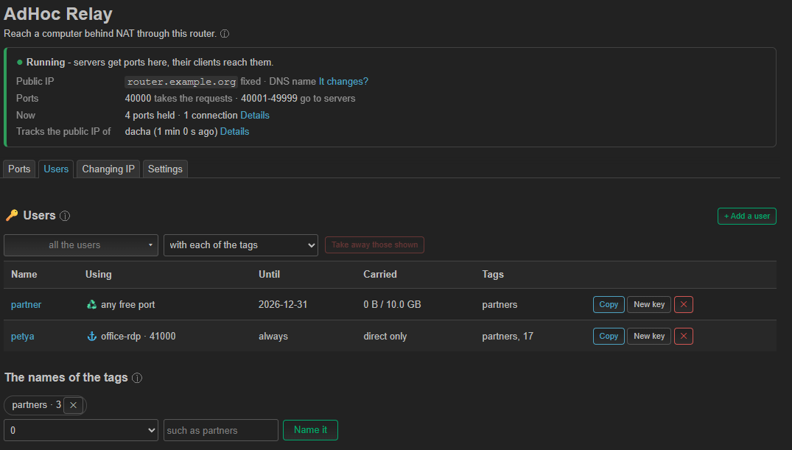
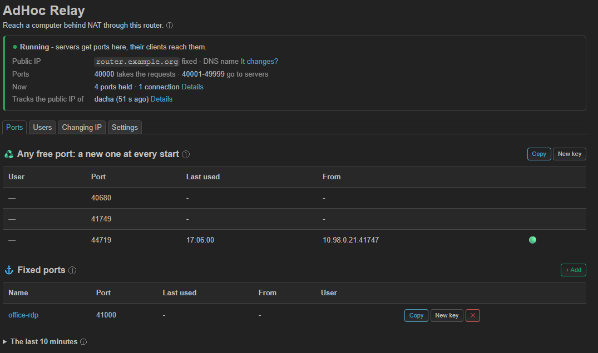
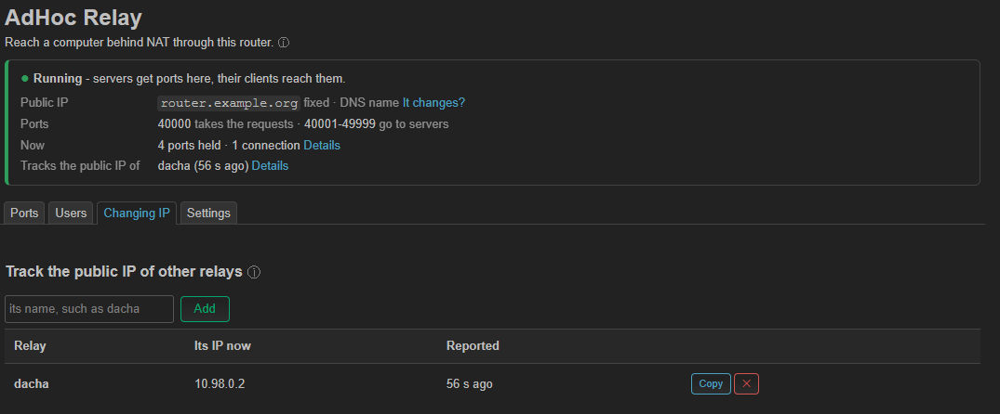

# AdHoc Relay

## TL;DR

**Thousands of connections through a weak home router, at the cost of a forwarded port.** Two computers behind NAT meet at the
relay: its kernel joins their two connections into one - no program carries a byte.

A Xiaomi Mi Router 4C - one core of MIPS at 580 MHz, 64 MB of memory, ports of 100 Mbit/s, OpenWrt 25.12:

| On this router | **AdHoc Relay** | A forwarded port | A proxy, one process | `socat`, a process each |
|:--|--:|--:|--:|--:|
| Memory, a connection | **1 KB** | 1 KB | 5 KB + buffers | 82 KB |
| Connections at once | **7500** | 7500 | about 3000 | under 150 - then the router restarts |
| One connection | **87 Mbit/s** | 89 Mbit/s | 33 Mbit/s | 36 Mbit/s |
| 16 connections, in all | **60 Mbit/s** | 65 Mbit/s | | |
| There and back, 64 bytes | **0.77 ms** | 0.72 ms | 2.5 ms | 1.4 ms |
| A port forwarded at the home of the server | **no** | yes | no | no |

| The same router, servers waiting at once | 6000 | 8000 | 9999 |
|:--|--:|--:|--:|
| Processor | **17 %** | 22 % | |
| Memory left, of 64 MB | **11 MB** | 5-8 MB | none: it restarts |
| A client connects | **4 ms** | | |
| There and back, 64 bytes | **0.73 ms** | | |
| One connection / 16 in all | **82 / 59 Mbit/s** | | |

**The limit is the speed, not the number:** thousands wait and connect for little, and share what the router forwards - as
through a port forwarded on it. [How much a router carries](#how-much-a-router-carries).

- **The client installs nothing:** Remote Desktop Connection, ssh, a browser - it dials an address. The server: one line and a
  small script, or a few lines in its own program. To meet the server directly when the two can, the client runs a small
  [AdHoc Relay Client](#adhoc-relay-client), a small script of this project, beside its program.
- **Only the one with the key waits at a port:** the key is never sent; a stranger never stands in for the server.
- **The address of the relay may change:** another relay keeps it. No DNS, no service of anyone else.
- **Not for WebRTC:** it joins TCP, and the voice and the video of WebRTC go over UDP. For WebRTC, install `coturn`:
  [What meets](#what-meets).

Two computers at two homes cannot connect to each other directly: each sits behind a NAT, its home router, and a NAT lets
nothing in that its own computer did not ask for. AdHoc Relay connects them through a **relay** both can reach: an
OpenWrt router or any Linux computer. The relay joins their two connections once, and from then on passes the traffic
the way a router passes a forwarded port: in the kernel, with no program in between.

What a TURN server or a VPN does for two computers behind NAT, with the load of a forwarded port. Both computers only dial out,
as any program does; AdHoc Relay makes their two dialings one connection.

Not every relay needs an address that never changes: one whose address the provider changes writes it into a
**record** kept by another, of a fixed address, and the server reads it there by itself. Nor does the server get a new port at
each start, when it is not to: a **fixed port** is always the same, for one key. Both need nothing outside AdHoc Relay: no DNS,
no service of anyone else.

**Nothing is copied.** A TURN server or a proxy receives every byte into a program and sends it again; a VPN encrypts and decrypts every
byte. AdHoc Relay does neither: once the two connections meet, the relay does for them exactly what a router does for a
forwarded port - the kernel rewrites the addresses of each packet as it passes, and that is all. No program reads the data, no
buffer holds it, no byte goes up to a program and down again. So the relay costs what a forwarded port costs: a record
of about a kilobyte per connection in the table of the kernel, and the forwarding a router does anyway, at its full speed. A
small home router that forwards ports well serves as many meetings as it would serve forwarded ports.

| | Needs a forwarded port at the home of the server | The traffic passes through a program | Load on the middle |
|:--|:--|:--|:--|
| Port forwarding | yes | no | none |
| A TURN server, a proxy | no | yes: every byte is received and sent again | high: CPU and memory for every byte |
| A VPN | no | yes: every byte is encrypted and decrypted | high: CPU for every byte |
| **AdHoc Relay** | **no** | **no: the kernel forwards it, nothing copied** | **as for a forwarded port** |


| | The server | The client |
|:--|:--|:--|
| What it is | The computer with the service: Remote Desktop of Windows, SSH, a web server, a program of its own | The computer with the program that connects: Remote Desktop Connection, ssh, a browser |
| What it does | Asks the relay for a port, opens it, and waits there | Connects to that port, as to any address |
| What it needs | The password of the relay; the script of AdHoc Relay, or a few lines of code | Only the line: the relay and the port. Nothing installed |

## Which program you need

| The service, the program that connects | On the server | On the client | The way |
|:--|:--|:--|:--|
| Remote Desktop, SSH, VNC, a web server - a client that only dials | [AdHoc Relay Server](#any-port-of-the-server) | nothing: the program dials the line | through the relay, always |
| the same, and the two may be close - one LAN, IPv6, NATs that keep ports | AdHoc Relay Server with a token | [AdHoc Relay Client](#adhoc-relay-client) with the token, the program dials it | directly when the two can, else through the relay |
| a program of your own on both sides | a few lines of its code | a few lines of its code | directly when the two can, else through the relay: [In your own program](#in-your-own-program) |

**Without AdHoc Relay Client** nothing is installed on the client, and every byte goes through the relay: its kernel passes it,
at the speed of the relay's line. Two computers in one LAN that meet at a relay in another city send each byte there and back.

**With AdHoc Relay Client** the two meet directly whenever they can - in their LAN at the speed of the LAN, over IPv6, or at
their public addresses -, and the relay only passes their call: it carries nothing, and its line is free for those who cannot
meet otherwise. When they cannot, they meet through the relay, as without it. The program of the client is not changed: it dials
a port of its own computer, where AdHoc Relay Client listens.

**When to use it:** the client and the server are often in one LAN, or the traffic is large - files, video, Remote Desktop at a
high resolution -, or the relay's line is slow. When it is not worth it: a browser of anyone - a page cannot run it -, or a
client on which nothing may be installed: the server then waits without a token, and its clients dial the line.

The relay never sends a client elsewhere by itself: the direct way is there only when both sides ask for it, by one token - see
[Directly, when the two can](#directly-when-the-two-can).

**No program in between.** AdHoc Relay Server and AdHoc Relay Client each pass the bytes between the connection they met and the
program beside them - by splice on Linux, through one buffer elsewhere: little, but one step more on each side. A program that
speaks the protocol of the relay itself has none: it waits at the relay, or meets its server, on its own socket. How:
[In your own program](#in-your-own-program) - the packets, a few hundred lines -, or the network libraries of
[AdHoc protocol](https://github.com/AdHoc-Protocol/AdHoc-protocol), which do it in C#, Java, TypeScript, Go, Rust, C, C++, Swift,
Dart and Python: the waiting with a token and the meeting of the client, for TCP and WebSocket alike.

## What it does

- **Two NATs, no forwarded port.** The server waits behind its NAT, the client dials it from behind its own; they meet at a port
  of the relay, and get one TCP connection.
- **No program in the traffic, nothing copied.** After the meeting the kernel rewrites the addresses, as for a forwarded port:
  one record per connection, the data never read nor held by a program. The speed is the speed of the router forwarding, its
  load the load of a forwarded port: a weak router carries many connections at once.
- **Small.** A table of nftables rules, and one small script that answers the requests for a port: ucode on OpenWrt, about
  1.5 MB of memory, perl on a Linux computer.
- **Many at once.** Each server waits at a port of its own, and the range has 9999 of them by default. A server that waits
  costs the relay a dozen packets a minute, which the kernel checks, and a few milliseconds of its script every 30 minutes. The [times of the servers](#the-times-of-the-servers) set how often.
- **A password, and guessers stopped.** 16 characters get and open a port; after 5 wrong tries an address is blocked for 10
  minutes, and a wrong one gets no answer at all.
- **No key travels.** Not the password, not a key: the server names its key by an id -
  [SHA-256](https://csrc.nist.gov/pubs/fips/180-4/upd1/final) - and signs what it sends with it -
  [HMAC](https://datatracker.ietf.org/doc/html/rfc2104) -, for the address the relay sees it at. Whoever watches the traffic
  learns no key, and what he caught is of no use from his own address.
- **Guessers of Remote Desktop and SSH stopped too.** A password tried and refused is a short connection: an address with more
  than 5 of them at a port is blocked there, in the kernel. A setting turns it off.
- **Fixed ports.** A port set aside for one key of 16 characters: the server that asks with that key gets that port, and nobody
  else does; the client's line is the same at every start of the server, `router.example.org:41000`.
- **A relay whose address changes.** It writes its address into a record of a relay of a fixed address, every
  60 seconds and at once when it changes; the server reads it there, with a key of its own, and follows it to the new address,
  its port kept. No DNS, no service of anyone else: AdHoc Relay and AdHoc Relay.
- **A page in LuCI.** The lines for the servers, each copied with one button; who is connected, who waits, who is blocked, the
  records and the reports, the tries of the last 10 minutes; the settings; Uninstall.
- **A command on a Linux computer.** `sudo adhoc-relay`: the same as the page, in the console - the lines, what happens, the
  fixed ports, the records, the reports, a new password.
- **For any program.** Only the server needs a few lines for it; the client dials as it always does.

| Section | |
|:--|:--|
| [Quick start](#quick-start) | Install, the password, uninstall |
| [Step by step: Remote Desktop](#step-by-step-remote-desktop) | Two whole examples: through one relay, and through a relay whose address changes |
| [Words used here](#words-used-here) | NAT, the server and the client, relay, ports, knock, hold, keys, records |
| [How it works](#how-it-works) | The meeting step by step, with pictures; what it costs, [how much a router carries](#how-much-a-router-carries) |
| [The lines](#the-lines) | What the server gets, part by part |
| [Fixed ports](#fixed-ports) | The same port at every start, for one key |
| [Users](#users) | Keys given to others in place of the password or a key: until a day, counted, limited, taken away; tags |
| [A relay whose address changes](#a-relay-whose-address-changes) | Records and reports: the server finds it at its new address |
| [Install](#install) | On an OpenWrt router, on a Linux computer |
| [Update](#update) | The installer of the new release, the settings kept |
| [The page in LuCI](#the-page-in-luci) | What the page shows and does |
| [The command adhoc-relay](#the-command-adhoc-relay) | The same on a Linux computer, in the console |
| [Settings](#settings) | Password, ports, times, the block of guessers, fixed ports, records, reports |
| [Uninstall](#uninstall) | Everything erased, the settings too |
| [Any port of the server](#any-port-of-the-server) | Remote Desktop, SSH, VNC, a web server, any port: one script on the server, the program of that service on the client |
| [Directly, when the two can](#directly-when-the-two-can) | The traffic between the two, not through the relay; the relay when that fails |
| [AdHoc Relay Client](#adhoc-relay-client) | Remote Desktop, ssh, a WebSocket client, a browser: directly when the two can, through the relay else - a small script beside the program |
| [In your own program](#in-your-own-program) | The server |
| [API](#api) | `adhoc-relay api get \| set`: the same JSON on a router and on a Linux computer, for a program that sets relays up over SSH |
| [Safety](#safety), [Why nothing is encrypted](#why-nothing-is-encrypted), [When something goes wrong](#when-something-goes-wrong), [By its nature](#by-its-nature) | |
| [Folders](#folders) | What is where; the pictures of this page |

## Quick start

The relay is either of two, with a public address or the range of ports forwarded to it:

| | An OpenWrt router | A Linux computer: Debian, Ubuntu, Fedora, Arch and others |
|:--|:--|:--|
| **1. Install** | By its web page alone: **System > Backup / Flash Firmware > Restore backup** with `adhoc-relay-openwrt.tar.gz`; or download the installer of one file into `/tmp` of the router and run it there: see [Install](#on-an-openwrt-router) | Download the installer of one file and run it with `sudo`: see [Install](#on-a-linux-computer-or-server) |
| **2. The password** | The installer prints it. Later: the web interface of the router, **Services > AdHoc Relay**, with the settings and what happens now: who is connected, who waits, who is blocked | The installer prints it. Later: `sudo adhoc-relay lines`, and `sudo adhoc-relay` for what happens now |
| **3. The server** | Gets one line with everything it needs: **Ports**, **Copy**, on the same page | Gets one line with everything it needs: `sudo adhoc-relay` - its menu, **1** - or `sudo adhoc-relay lines` prints it |
| **4. Uninstall** | **Uninstall AdHoc Relay** at the bottom of the same page | `sudo sh adhoc-relay-linux.sh remove` |

The line is the password, 👉, the public address or a name in DNS, `:`, the port of requests, 👉 - an answer comes:
`Tr7kQ2xZp4Lm9sWd👉203.0.113.7:40000👉`.
Nothing else is to be given or typed: the server takes it where it asks for the relay. The line of a fixed port has its key in
place of the password; a relay whose address changes has a line of its own: see [The lines](#the-lines).

## Step by step: Remote Desktop

Two whole examples, from nothing to the desktop of a Windows computer on another screen. In each there are three computers:

- **the relay** - an OpenWrt router or a Linux computer the internet reaches;
- **the server** - the Windows computer to be reached, behind the NAT of its home, Remote Desktop on;
- **the client** - a laptop anywhere, with Remote Desktop Connection (`mstsc`) of Windows. Nothing is installed there.

Both examples give the server a [fixed port](#fixed-ports): the client keeps the same address in Remote Desktop Connection, once.

### Example 1: one relay, its address does not change

The relay is an OpenWrt router whose public address does not change: `203.0.113.7`, or a name in DNS such as
`router.example.org`.



**On the relay**

1. Install AdHoc Relay: [On an OpenWrt router](#on-an-openwrt-router) - `wget` the installer into `/tmp` of the router and run it.
   It prints the password; the page keeps it too.
2. Open the web interface of the router, **Services > AdHoc Relay**. On top: **Running**, and **Public IP** - the
   address, **fixed**.
3. Tab **Ports**, ⚓ **Fixed ports**: **+ Add**. A name, `office-rdp`, and a free port from the list, `41000`; **Add**: its key is
   made and applied at once.
4. **Copy** in its row. It is in the clipboard:

   ```text
   Fx2pL8wNq7Rk3mZa👉203.0.113.7:40000👉
   ```

   The key of the fixed port, the relay and its port of requests: the relay answers the port 41000 to that key. Send it to the
   owner of the server, privately: the key is in it.

A Linux computer as the relay: `sudo adhoc-relay`, **2**, **a**, Enter for the port it offers, a name; then **Esc** and **1**
shows the line. Or at once: `sudo adhoc-relay fixed add 41000 office-rdp` prints it.

**On the server, the Windows computer**

5. Remote Desktop on: **Settings > System > Remote Desktop** (Windows Pro or above). The account to log in with has a long
   password of its own.
6. Download [`adhoc-relay-server-windows.zip`](https://github.com/AdHoc-Protocol/AdHocRelay/releases/latest/download/adhoc-relay-server-windows.zip),
   unpack it into a folder, and double-click `adhoc-relay-server.cmd`.
7. It asks what to open: **1**, Remote Desktop of Windows. Then the relay: paste the line of step 4, Enter.
8. It shows the line for the client, and copies it: `203.0.113.7:41000`. It waits there, as long as its window is open; the
   computer must not sleep.

Next time: a double click, Enter, Enter - it keeps the answers.

**On the client**

9. Remote Desktop Connection (`mstsc`): **Computer** `203.0.113.7:41000`, **Connect**, then the name and the password of the
   account of the server.

The relay joins the two connections in its kernel, and from then on Remote Desktop Connection talks to the server as through a
forwarded port. The line of the client never changes: save it in Remote Desktop Connection.

✓ No fixed port wanted: in step 4 copy the line **A port given at each start**, `Tr7kQ2xZp4Lm9sWd👉203.0.113.7:40000👉`. The server
then shows another line for the client at each start of the script.

### Example 2: the address of the relay changes, another relay keeps it

The relay **D** is the OpenWrt router of a home: its address is public, but the provider changes it now and then. Another relay,
**S**, has an address that never changes: a small Linux server, a VPS, `198.51.100.9`. D writes its address to S; the server
reads it there. The meetings happen at D, as in example 1: S only keeps the address.



**On S, the Linux server of a fixed address**

1. Install AdHoc Relay: [On a Linux computer or server](#on-a-linux-computer-or-server).
2. `sudo adhoc-relay`, **4** - Changing IP -, **a** - track the IP of a computer -, a name for D: `home`. It prints the line for D:

   ```text
   ✏️Wk3vB9xQm5Tz2Lpe👀Rk8mP2qLx3Vb7NtY👉198.51.100.9:40000
   ```

   ✏️ the write key - D writes its address with it -, 👀 the read key - the servers read the address with it -, 👉 where: S and
   its port of requests. An OpenWrt router as S: **Changing IP > Track the public IP of other relays**, a name, **Add**, **Copy** in its row.

**On D, the router whose address changes**

3. Install AdHoc Relay, as in step 1 of example 1.
4. **Services > AdHoc Relay**, tab **Changing IP**, **On my public IP change, notify the following relays**: paste the line of step 2, **Add**. Within 20 seconds its table
   says **Last answer** - S has the address - and on top **Public IP** says **changes**.
5. Tab **Ports**, ⚓ **Fixed ports**: **+ Add**, the name `office-rdp`, the port `41000`, **Add**.
6. **Copy** in its row: the line looks the address up at S now:

   ```text
   Fx2pL8wNq7Rk3mZa🌐Rk8mP2qLx3Vb7NtY👉198.51.100.9:40000🌐40000👉
   ```

   Between the 🌐: where the address of D is read - the read key, S and its port. After the last 🌐: the port of requests of D.

**On the server**: steps 5-8 of example 1, with this line. The script reads the address of D at S, gets its port at D, shows
`<the address of D now>:41000`, and reads the address again every 30 seconds.

**On the client**: Remote Desktop Connection to the line the server shows. When the address of D changes, D writes the new one
to S at once, the server reads it within 30 seconds, shows the new line and copies it again: the client connects to the new
address, the same port.

✓ D needs a public address, even one that changes: the internet must reach it. Behind the NAT of its provider - an address of
`100.64.0.0/10` on its wan - it is not reachable, and S is the relay to use itself, as in example 1.

## Words used here

| Word | What it means | Example |
|:--|:--|:--|
| **NAT** | A device that hides the computers of a home behind one address. It lets in only answers to what they sent out | A home Wi-Fi router |
| **The server** | The computer with the service. It asks for a port of meeting, opens it, and waits there for the client | A computer with Remote Desktop or SSH |
| **The client** | The computer that connects to the port the server opened: it only dials | Remote Desktop Connection; ssh; a browser |
| **Relay** | The router or computer with AdHoc Relay, reachable by both | An OpenWrt router with a public address, or a rented Linux computer, a VPS |
| **Port of requests** | The first port of the range. The server asks it for a port of meeting | 40000 |
| **Port of meeting** | A port the relay gives the server, one nobody else holds; the server and the client both dial it | 41933 |
| **Password** | 16 letters and digits of the relay: whoever knows them can get and open a port of meeting | `Tr7kQ2xZp4Lm9sWd` |
| **Id of a key** | What the password or a key is named by in a packet: the first 8 bytes of SHA-256 of `AdHoc Relay id` and the key. The key itself is never sent | 8 bytes |
| **Id** | 8 random bytes the server picks for itself at its start and sends in its request: the port of meeting is given to them, and the same id gets it again | 8 bytes |
| **Bind** | The request for a port of meeting, to the port of requests: the id of the key, the id of the server, and 8 bytes of HMAC the key makes of them and of the address the relay sees the server at | 24 bytes |
| **Key of the knocks** | 16 bytes of HMAC the server and the relay both make with the key: of the id, the port of meeting and the address of the server. It opens that port from that address, and nothing else | 16 bytes |
| **Knock** | The UDP packet with the key of the knocks that opens a port of meeting | 16 bytes |
| **Hold** | The key of the knocks and one byte more: the port stays given to the server, closed | 17 bytes |
| **Fixed port** | A port of meeting set aside for one key: the relay gives it to the server that asks with that key, and to no other. The same at every start of the server | 41000 |
| **Key of a fixed port** | 16 letters and digits that get and open that one port, and nothing else | `Fx2pL8wNq7Rk3mZa` |
| **S** and **D** | Two relays: D has an address the provider changes, S one that does not change. D writes its address, S keeps it | |
| **Record** | What S keeps of D: its address, when D wrote it last. Not its ports: they are in the lines of its servers | `dacha`: 198.51.100.20 |
| **Write key** | 16 letters and digits with which D writes its record on S. Only D has it | `Wk3vB9xQm5Tz2Lpe` |
| **Read key** | 16 letters and digits with which a server reads the record on S. A record has one or more | `Rk8mP2qLx3Vb7NtY` |
| **Report** | The setting of D: where it writes its address - S, the write key: the line S gave | |

## How it works



1. **The server gets a port.** It sends a bind to the port of requests: the id of the password, its own id, and 8 bytes of HMAC
   the password makes of them and of the public address of the server. The password itself is not sent. The relay answers with
   a port of meeting nobody else holds, 2 bytes, and the address it sees the server at, 4 bytes, and gives the port to that id.
   A server that does not know its public address yet binds for `0.0.0.0`: the relay answers the address, and the server
   binds again with it. Each answer ends with 8 bytes of HMAC the password makes of it: the server takes no answer without
   them - nobody else tells it its port in the name of the relay. Both then make the key of the knocks of that port, 16 bytes of HMAC with the password: of the id, the
   port and that address. The relay puts it into its rules for two times **Bind again every**, an hour by default: only knocks
   with it, from that address, open the port. The answer tells the server the [times](#the-times-of-the-servers) of the relay
   too: how often to knock, how long a try of dialing is, how often to bind again. No answer means the request or the answer was lost, and the server binds again with the same id: it gets the same
   port. A wrong password gets no answer at all, and an address that sends wrong ones too often is blocked for a while.
2. **The server opens the port: it knocks.** One UDP packet with the key of the knocks, to its port of meeting. A rule of the
   relay compares it, with the address it came from, and opens the port. Anything else opens nothing. A server that shows its
   port to a person and waits for a yes holds the port instead: the key of the knocks and one byte more keep it given to it
   and closed. The relay notes the address the knock came from: only that address may wait at the port. The server knocks from
   the local port it dials from: a NAT that keeps the port - most do - shows the relay one port in both, and the relay knows the
   server by its address and that port. Another computer behind the same NAT is then a client like any other, never taken for
   the server.
3. **The server waits, dialing.** It dials the port - a try waits up to 31 s, the system sends its SYN again within it after
   1, 3, 7 and 15 s -, always from the same local port, and knocks every 20 s. The relay drops these attempts without an
   answer, and notes where they come from. A SYN from an address that did not knock is dropped and noted nowhere: a stranger
   that dials the open port before the server can never take its place. Every 30 minutes the server binds anew, and its key
   of the knocks lives on at the relay. A NAT that gives the server another address does not take the port
   from it: the relay refuses the knock from there - an ICMP, at once -, the server binds again with the same id, and has its
   port back, with the key of the knocks of its address of now.
4. **The client connects.** It dials the same port, as any program dials an address.
5. **The relay sends the attempt of the client on to the server,** with the addresses rewritten so that it comes from
   exactly the address the server is dialing.
6. **The server answers.** It was waiting for an answer from that address, and here it is. TCP is made for this case: two sides that dial
   each other at once get one connection ("simultaneous open").
7. **The connection is set up.** The port of meeting closes for anyone else. It stays given to the server: its next knock opens it for
   the next client. A client that comes in the moment right after, before the server dials again, waits for it at the relay: the
   next SYN of the server is sent to it, the meeting the other way round. Clients one right after another meet at once.
8. **The data flows.** The relay rewrites the addresses of every packet in the kernel, exactly as for a forwarded port.

### Why the NAT of the server lets the connection in

A NAT lets a packet in only if it looks like an answer: it must come from the address the computer behind it sent to. The server
has been sending to the port of meeting all along, so its NAT expects answers from there. The relay gives the attempt of
the client exactly that address:


The NAT of the client needs no trick: the client itself dialed the relay, so whatever comes back from there is an answer.

### What it costs the relay

- **The meetings are a table of nftables rules in the kernel.** One small script, `give`, waits for the requests for a port:
  ucode on OpenWrt, about 1.5 MB of memory, perl on a Linux computer. It does not touch the traffic: it answers a request with a
  port - one of a server at its start, one each **Bind again every** while it waits, 30 minutes by default -, and sleeps otherwise. Only a request with the id of
  a key of the relay reaches it, a few requests a second from an address at most. No program wakes for a knock: the kernel
  compares its bytes.
- **While the server waits:** a few small records per port of meeting, about 1.5 KB of memory, and a SYN every few seconds, dropped.
- **After the meeting:** one connection record, as for any forwarded connection. The CPU work is the work of forwarding.
- **The records of relays whose address changes:** a line of memory each; one packet each 60 seconds from each such
  relay, one each 30 seconds from each server that reads.
- **A meeting [directly](#directly-when-the-two-can):** two STUN answers of `give`, and a call of 38 bytes and its answer of 30
  that the kernel sends on, as it does a meeting: no program of the relay wakes for it. Then nothing: the traffic does not pass
  the relay, and it holds no record of it.
- **The meetings it carries take the fast path of the kernel:** once it is **Short** seconds old - the guard must see a short one
  end; at once with the guard off -, a meeting goes into a flowtable of AdHoc Relay on the devices of the way out, and its packets
  skip the firewall - the work of a router with flow offloading. With **Network >
  Firewall > Software flow offloading** on - or **Hardware flow offloading**, where the router has it -, fw4 carries them in its
  own instead: only the first packet of a meeting passes the rules of AdHoc Relay in its firewall. A kernel without flowtables
  carries them the slow way, as before; the log says so: `no flowtable in this kernel`. The flowtables are `kmod-nft-offload`
  of OpenWrt: firewall4 brings it, so every router of OpenWrt has it; the installer adds it when it is missing.
- **A router of several cores carries more with Packet Steering on:** **Network > Interfaces > Global network options > Packet
  Steering**, or `irqbalance`. It spreads the forwarding of the meetings over the cores; it is a setting of the router for all its
  traffic, so AdHoc Relay leaves it to its owner.

### How much a router carries

The numbers are in the tables of the [TL;DR](#tldr): a Xiaomi Mi Router 4C, one of the weakest routers of OpenWrt, the settings
as they come; the client and the server on two computers of its LAN, each connection through the router and back. Under them:

- **Connections at once: 7500** - the table of connections of the kernel, 8192 on a router of 64 MB. 6000 are set up in 18 s.
  One that sends nothing takes no processor.
- **8000 servers waiting** still wait, with a few MB of memory left: one more thing of weight - the page on **Ports**, a **Save &
  Apply** - may restart the router. All 9999 of the range: more memory than it has.
- **Every speed is the whole processor:** what this router forwards at all, near its ports of 100 Mbit/s.
- **A link that is full** queues: there and back 137 ms through AdHoc Relay, 154 ms through a forwarded port, while the router
  forwards all it can for 16 other connections. The queue of the link, not of the relay.
- **The proxies:** `socat` starts a process for each connection; the other is one process with a loop of events, as a careful
  program is written. Each holds two sockets a connection - to the client and to the server -, and every byte goes up from the
  kernel into it and down again: two copies more, and system calls, for each piece, on a processor that has none to spare.
  AdHoc Relay leaves the connection where a forwarded port leaves it: one record of the kernel.

**What it means.** A session of Remote Desktop or SSH takes next to nothing while nobody types, and a few Mbit/s at most while its
screen changes: a router like this one serves hundreds of them at once, connected all day. A copy of a large file takes all
there is, as it would through a forwarded port.

With 6000 servers waiting:

- **The page** asks what goes on in 2.5 s, and in 14 s on **Ports**, where it lists each port. It asks again after twice that at
  the earliest: a third of the router at most, and nothing while the page is closed.
- **Save & Apply** takes 35 s: every port given and every key of the knocks is carried into the rules loaded. No server loses
  its port.
- **The binds:** `give` takes 6 ms for a server that binds again and changes nothing, 40 ms for a new port - 6000 servers
  binding again every 30 minutes take 2 % of the processor.
- **The [times of the servers](#the-times-of-the-servers)** set the rest: with **Dial try** of 3 s, 5000 waiting servers took a
  third of the processor; of 31 s, a ninth.

A router with more memory has a larger table of connections - OpenWrt sizes it by the memory - and room for more servers. A
router of several cores forwards faster: see Packet Steering above.

## The lines

The server gets one line, and the client one shorter line. The page of the relay, or `sudo adhoc-relay lines` on a Linux
computer, makes them: nothing is put together by hand.


**① A port given at each start**, the address of the relay does not change:

```text
Tr7kQ2xZp4Lm9sWd👉203.0.113.7:40000👉
```

The server asks for a port at 40000 with the password, gets one nobody holds, and knocks there. The client:
`203.0.113.7:41933` - another at each start of the server.

**② A [fixed port](#fixed-ports)**, the same address:

```text
Fx2pL8wNq7Rk3mZa👉203.0.113.7:40000👉
```

The same form, with the key of the fixed port: the server asks at 40000 with it, and the relay answers the port of that key,
41000. The client: `203.0.113.7:41000` - always.

**③ A port given at each start**, the address of the relay [changes](#a-relay-whose-address-changes):

```text
Tr7kQ2xZp4Lm9sWd🌐Rk8mP2qLx3Vb7NtY👉198.51.100.9:40000🌐40000👉
```

The server reads the address of the relay at 198.51.100.9:40000, then does as in ①. The client: `<its address now>:41933`.

**④ A fixed port**, the address changes:

```text
Fx2pL8wNq7Rk3mZa🌐Rk8mP2qLx3Vb7NtY👉198.51.100.9:40000🌐40000👉
```

The server reads the address at 198.51.100.9:40000, then does as in ②. The client: `<its address now>:41000`.

How to read a line - each 👉 says where what is before it goes:

- **The first 16 characters** are the key the server asks with: the password of the relay, the key of a fixed port, or the key
  of a [user](#users). **👉**: where it asks - the relay, `address:port`, the port its first one, the port of requests.
- **🌐 instead of 👉**: the address of the relay is read - between the 🌐 is where: a read key, 👉, S and its port. After the last
  🌐, the first port of the relay. Several S, each between its 🌐, are asked in turn: when the first does not answer, the next.

```text
Fx2pL8wNq7Rk3mZa🌐Rk8mP2qLx3Vb7NtY👉s1.example.org:40000🌐Hx4nT7wAe2Kq9VsM👉s2.example.org:40000🌐40000👉
```

- **👉 at the end**: an answer comes - the port of meeting. It may be left out: the line is the same without it.
- **The port of meeting is not in the line**: the relay answers it - any free one to the password, the fixed one to the key of
  a fixed port.
- **The client's line** is only the address of the relay and the port of meeting: what any program dials.

The first port is in the line, and stays: only the address of a relay changes, and only it is read at S.

The rules every program keeps alike:

| Part | Rule |
|:--|:--|
| password, key, read key | exactly 16 letters and digits |
| relay, S | a name or an IPv4 address: no `:` `@` `=` `,` `!` `?` `>` or space in it |
| port | 1…65535, as a number is written: no zeros in front. None after the relay: 40000. S and a relay whose address is read name their ports |
| signs | 👉, 🌐, 👀 and ✏️ may be typed as `>`, `@`, `?` and `!`; a 👉 of another colour of skin is the same. Every program keeps, shows and copies the emoji. On a command line the line goes in quotes: `>` is a redirection of the shell |
| spaces | around the line and around each `read key👉S:port` between the 🌐 they go; inside a part they are an error |

The line is one form for all who take it: both scripts of the server, and any program of its own.

## Fixed ports

A port given at each start makes a new line for the client at each start of the server. A fixed port does not: the client
keeps `router.example.org:41000` in Remote Desktop Connection, or in the settings of ssh, once.


| | A port given at each start | A fixed port |
|:--|:--|:--|
| Who picks it | The relay, a free one, when the server asks | The owner of the relay, once, in the settings |
| What gets and opens it | The password, or the key of a user of it | Its key alone, or the key of a user of it |
| The line of the server | `password👉relay:40000👉` | `key👉relay:40000👉` |
| The line of the client | New at each start of the server | The same always |
| When the server stops | Given to others a minute later | Kept for its key: nobody else gets it, ever |

To set one up:

| On an OpenWrt router | On a Linux computer |
|:--|:--|
| **Services > AdHoc Relay**, **Ports**, ⚓ **Fixed ports**: **+ Add** - a name, a free port from the list; its key is made and applied at once. **Copy** in its row: its line | `sudo adhoc-relay fixed add`, or `fixed add 41000 office-rdp`: it prints the line. Or the menu: `sudo adhoc-relay`, **2**, **a** |

The server takes the line as any other: the script of [Any port of the server](#any-port-of-the-server), or a program of its own.

✓ The port is one of the range, after the port of requests: 40001-49999 by default.
✓ One key, one server: two servers with the same key take the port from each other.
✗ A port that never changes is easier to find for the programs that try every port of the internet. The [guard](#guard-against-guessing)
stops their guessing, and the password of the service of the server, long and its own, is what keeps them out.

## Users

The password, the keys of the fixed ports and the read keys are the owner's own. To let someone else use the relay for a while, the
owner gives a **user**: a key of 16 of their own, in place of one of them. Its holder uses it as that key - in its line, as it is.

✓ The base keys - the password, the key of a fixed port, a read key - for the services under your own control: your servers,
your computers. To anyone else - a partner, a friend, a program of someone else - give a user. It is the same pass, and yet
yours: it ends on its day, its traffic can be limited, it can be the direct path only, and taken away it opens nothing -
while the base key, and every other user, works on. A base key given away is taken back only by a new one, and then every
server of it needs its new line.

| | |
|:--|:--|
| **Using** | any free port - its holder gets ports with it, as with the password; a fixed port - it gets that port, as with its key; the IP of a record - it reads the address, as with a read key |
| **Until** | its last day, or always. From the day after it opens nothing: the kernel lets it go itself, at its time |
| **Limit** | megabytes, or none: past it the packets of its meetings go nowhere. ✗ A limit is more work for the relay: it counts every packet of the meetings of that user, and they stay out of its fast path. Without a limit nothing is counted, and the user costs the relay no more than the password |
| **Counted** | of a user with a limit: what its meetings carry through the relay, in kilobytes, both ways. Kept through reloads and restarts |
| **Direct only** | its traffic can be passed via a direct connection only: its clients reach its server by a [call](#directly-when-the-two-can); one that dials the relay is refused at once - a reset -, and nothing of it goes through the relay |
| **Taken away** | it opens nothing. Its meetings going on end too when it has a limit; without one they go on until their sides end them - the relay looks at such a user when it knocks, never after. With the package `conntrack` installed - `apk add conntrack` on a router, `apt install conntrack` on a Linux computer - the meetings of any user taken away end at once, and of one past its day at the next load of the settings: the relay deletes its connections once, as the settings load, and still looks at no packet for it. Nothing else needs the package: about 0.3 MB of the flash of a router |
| **Tags** | up to 8 numbers of 0-255, with names if wanted: choose the users by them, take a group away at once |

On the page: the tab **Users** - the users chosen by tags, with each of them or any of them, what each with a limit carried, its line to
copy; **Take away those shown**; their settings; the names of the tags.



In the console:

```text
sudo adhoc-relay user add password 2026-12-31 10240 partner partners,guests     a new key, printed with its line
sudo adhoc-relay user add 41000 - direct petya                                  direct only, at the fixed port 41000
sudo adhoc-relay user with guests                                               those with the tag, what they carried
sudo adhoc-relay user del with any partners,guests                              a group taken away
sudo adhoc-relay tag add 17 guests                                              a name for a tag
```

What it costs the relay - nothing for anyone else:

- **The key** is known to the kernel by its id, one of a set, as the password and every other key: a request with it is looked
  up the same. Its end is the timeout of its
  element: no packet is compared with a date. The timeout is counted from the clock of the relay as the rules load; a router with
  no clock of its own loads them once more when NTP has set it.
- **A knock of the server of a user** notes that server with the number of the user: the number comes with the key of its
  knocks, by the one lookup every knock has. The number goes with that
  server while it waits at the port: a meeting is counted to the user of the server met, whoever knocked at the port before - the
  owner's own key, or another user. A user of the direct path only has one bit more in its number: the SYN of a client that would
  meet its server is refused - one test, at the SYN alone -, whoever else knocks at the port meanwhile, with whatever key.
- **A meeting of a user** carries the number in its mark, and nothing more is done with it: it takes the fast path of AdHoc
  Relay as any other meeting.
- ✗ **A limit is the one thing that costs:** the meetings of a user with a limit have one bit more in their mark, and each
  packet of them is counted by a quota of the kernel, one lookup each. They stay out of the fast path - a flowtable would
  carry them past the count -, so the relay forwards them the slow way for as long as they last. Set a limit where it is
  needed, not for everyone. No other meeting, no other packet of the router is looked at.
- ✗ **Software flow offloading** of the firewall of the router - **Network > Firewall** - takes every connection the router
  forwards onto its own fast path, the meetings of users with a limit too, before any rule of AdHoc Relay is asked: with it on
  they are not counted and not limited, and such a user taken away keeps the meetings it has. The tab **Users** says so, in
  yellow, and the log; and while it is on neither the page nor `api set` sets a limit - each says why, and where to turn it off.
  Turn it off to count them: the other meetings have the fast path of AdHoc Relay then.
- **What they counted** is kept in a file when the rules load, stop, and each hour while a user has a limit, written only
  when it changed: `/etc/adhoc-relay.used` on a router, `/var/lib/adhoc-relay/used` on a Linux computer. A router that loses its
  power loses an hour of it at most.
- **The tags** are of the settings alone: the kernel never sees them. To choose, the tags of a user are one number of 8 bytes, and
  a choice compares bytes.

✓ 255 users of ports at most - of the password and of fixed ports -, one more is refused when set; of read keys, any number.
✓ A user keeps its number while it is there: one taken away or added moves no other, and the number of one taken away comes
back last.

## A relay whose address changes

A home router mostly has a public address that its provider changes: once a day, or at each new connection. A line with that
address stops working when it does. AdHoc Relay solves it with itself only: the router whose address changes, **D**, writes it
into a **record** kept by a relay whose address does not change, **S** - a VPS, the router of a friend, of an office.
The server reads it there and follows D to its new address.



1. **D writes its address.** One UDP packet to S: the id of its write key, and 8 bytes of HMAC the write key makes of the
   address S sees D at - the key itself is not sent. S keeps the address the packet came from when the write was made for that
   address, and answers either way: the address S saw, 4 bytes, and 8 bytes of HMAC the write key makes of it - D shows the
   address on its page, and writes again with it when it wrote for another; an answer the write key did not sign it does
   not take. D writes again every 60 seconds, and at once when its own address changes.
2. **The server reads it.** One UDP packet to S: the id of its read key and 8 random bytes. S answers the address and how many
   minutes ago D wrote, 5 bytes, and 8 bytes of HMAC the read key makes of them and of those random bytes: 13. The server takes
   only an answer the read key signed: nobody else tells it where the relay is.
3. **The meeting, as always**, at that address and the first port of the line.
4. **The address of D changes.** D writes at once; S keeps the new address.
5. **The server reads again**, every 30 seconds while it waits.
6. **It binds and knocks at the new address.** D kept its port: a port given at each start stays given to the id of the server,
   a fixed port to its key. The server shows the client its new line, and puts it in the clipboard again.

Only S needs an address that does not change. One S keeps the records of many D, and any relay can be S and D at once.
S knows nothing of the ports of D: its first port is in the lines of the servers, and stays. One record of D serves every line
of D - that of its password and that of each fixed port.

### To set it up

**1. On S, the relay of a fixed address: keep the address of D.** OpenWrt: **Changing IP > Track the public IP of other relays**, a name, **Add** - the keys
are made, saved, applied -, then **Copy** in its row. Linux: `sudo adhoc-relay record add dacha`, or the menu, **4**, **a**. Either
gives the line for D - ✏️ the write key, 👀 the read key, 👉 where to:

```text
✏️Wk3vB9xQm5Tz2Lpe👀Rk8mP2qLx3Vb7NtY👉198.51.100.9:40000
```

**2. On D, the one whose address changes: paste that line.** OpenWrt: **Changing IP > On my public IP change, notify the following relays**, the line, **Add**. Linux: the
menu, **4**, **p**, or:

```text
sudo adhoc-relay report add '✏️Wk3vB9xQm5Tz2Lpe👀Rk8mP2qLx3Vb7NtY👉198.51.100.9:40000'
```

**3. Both see it work.** S: **Changing IP > Track the public IP of other relays** - the address of D, and how long ago it wrote; `sudo adhoc-relay record`.
D: **Changing IP > On my public IP change, notify the following relays** - when S answered, and the address S sees; `sudo adhoc-relay report`.

**4. On D: the lines for the servers read the address on S now.** **Ports**, **Copy**, and give it to
the server:

```text
…🌐Rk8mP2qLx3Vb7NtY👉198.51.100.9:40000🌐40000👉
```

✓ Two S for one D: a record on each, a report to each. The line names both, in order: when the first does not answer, the
server asks the second.
✓ A read key for each server, or each person: a record takes more than one - a [user](#users) in place of its read key: **Users**, **+ Add a user**, **Using** **the IP of dacha**; or `adhoc-relay record read dacha`. A read key deleted cuts off that one alone.
✗ The write key stays on D: whoever has it can write another address into the record.

### What the server does with an answer



| The answer | What it does |
|:--|:--|
| Written in the last 2 minutes | Takes it at once |
| Older | Asks the next S; when none has a fresh one, takes the freshest |
| None | S does not answer, or D has never written: it tries again in 5 seconds, and says so |

While it waits it reads every 30 seconds. D writes within 2 seconds of a change of an address it has itself, the address of its
wan, and within 60 seconds of any other; so a server finds D at its new address within a minute.

✓ The client's line changes with the address of D: the server shows the new one and copies it. A client whose line must never
change needs a name in DNS for D, and that is what this way does without.
✓ The server dials on from the same local port at the new address: D knows it by that, as the side that waits.
✗ A client that dials in the first 5 seconds after the server moved may get no answer: D still sends it to where the server
was. It tries again, and meets.

## Install

### On an OpenWrt router

**By the web page of the router alone - no SSH:**

1. Download [`adhoc-relay-openwrt.tar.gz`](https://github.com/AdHoc-Protocol/AdHocRelay/releases/latest/download/adhoc-relay-openwrt.tar.gz)
   to your computer, about 60 KB.
2. In the web page of the router: **System > Backup / Flash Firmware**, **Restore backup**, **Upload archive...**, the file.
3. The page lists the files of AdHoc Relay in it: **Continue**. The router restarts, a minute or so.
4. **Services > AdHoc Relay**: the password is made, the settings are there. Right after the restart it may say **Almost ready**:
   the modules `ucode-mod-socket` and `ucode-mod-digest` come from the packages of OpenWrt as soon as the router reaches the
   internet, and AdHoc Relay starts by itself.

It is a backup of AdHoc Relay alone, not of the router: it adds its files and changes nothing else - no setting of the router, none
of AdHoc Relay. The same file again, of a new release, **updates** it, its settings kept. A flash of the firmware keeps AdHoc Relay
too: its files are among those OpenWrt keeps, and the modules come again by themselves. Why not **System > Software > Upload Package**:
OpenWrt 25.12 installs there only packages signed by the keys of OpenWrt.

**Or on the router, download the installer into `/tmp` and run it:**

```sh
ssh root@192.168.1.1
wget -O /tmp/adhoc-relay-openwrt.sh https://github.com/AdHoc-Protocol/AdHocRelay/releases/latest/download/adhoc-relay-openwrt.sh
sh /tmp/adhoc-relay-openwrt.sh
```

The installer is one file of about 200 KB: the script, with the files of the folder [`OpenWRT`](OpenWRT) in it as text, so it can
be read before it runs. Each file is written straight to its place, and at the end the installer erases itself from `/tmp`.

A router without the internet gets it from a computer: download `adhoc-relay-openwrt.sh` from
[the last release](https://github.com/AdHoc-Protocol/AdHocRelay/releases/latest), copy it with `scp -O adhoc-relay-openwrt.sh
root@192.168.1.1:/tmp/` or WinSCP, and run `sh /tmp/adhoc-relay-openwrt.sh` there.

It prints the password and where the page is:

```text
the password of this router: Tr7kQ2xZp4Lm9sWd
LuCI: Services > AdHoc Relay
AdHoc Relay: requests for a port at 40000, ports of meeting 40001-49999
```

That is all. The server gets its line from that page: **Ports**, **Copy**, `Tr7kQ2xZp4Lm9sWd👉203.0.113.7:40000👉`, the password,
the public address of the router and the port of requests in one. The modules of ucode `give` needs are downloaded when the
router has none: `ucode-mod-socket`, 60 KiB, the sockets; `ucode-mod-digest`, the hash of the keys; `ucode-mod-math`, which the snapshots of OpenWrt do not have; `kmod-nft-connlimit`, 24 KiB, the count of the connections of one address - for **Connections per address** alone. nftables, fw4 and ucode are in OpenWrt already. Running the installer
again updates AdHoc Relay and keeps its settings: see [Update](#update).

The folder `OpenWRT` copied into `/tmp` installs the same way: `sh /tmp/OpenWRT/install.sh`, and its files are erased at the end.

For builders of firmware, the folder is also a package of the OpenWrt SDK: put it into `package/adhoc-relay` and run
`make package/adhoc-relay/compile`; the page is the package `luci-app-adhoc-relay` from `OpenWRT/luci`.

### On a Linux computer or server

Debian, Ubuntu, Fedora, Arch and others with systemd, and nftables 1.0.6 or newer: Debian 12, Ubuntu 24.04 and later - the
installer says so on an older one, and installs nothing. Install nftables first (`apt install nftables`, `dnf install nftables`,
`pacman -S nftables`); perl is there already on Debian and Ubuntu, elsewhere `dnf install perl`, `pacman -S perl`.
Then download the installer and run it:

```sh
wget https://github.com/AdHoc-Protocol/AdHocRelay/releases/latest/download/adhoc-relay-linux.sh
sudo sh adhoc-relay-linux.sh
```

The installer is one file of about 180 KB: the script, with the files it installs in it as text, so it can be read before it runs.

It prints the password, as on the router, and installs the service `adhoc-relay`, which loads the rules and starts `give` at every
start of the computer, and the command `adhoc-relay`. It also turns on the forwarding of packets, and lets the meetings and the
requests for a port through the firewall of iptables when there is one: Docker and ufw block them otherwise. The server gets one
line, which `sudo adhoc-relay lines` prints: the password, 👉, the public address of the computer, `:`, the first port, 👉, such as
`Tr7kQ2xZp4Lm9sWd👉203.0.113.7:40000👉`. To remove, with the settings: `sudo sh adhoc-relay-linux.sh remove`; the forwarding of packets it turned on stays on until the
computer starts again, and it says so. The whole folder
`AdHocRelay` installs the same way: `sudo sh Linux/install.sh`, and `sudo sh Linux/install.sh remove`.

### On both

✓ The whole range, the port of requests too, must be reachable from the internet: TCP and UDP. Open it in the firewall of the
hosting provider, if it has one. If the router itself is behind the NAT of its provider, forward the range to it.
✗ Do not choose a range that other services of the relay use.

## Update

An update is the installer of the new release run over the installed AdHoc Relay: the same commands as to install. The settings
stay, the password with them; nothing is to be removed first.

On an OpenWrt router:

```sh
wget -O /tmp/adhoc-relay-openwrt.sh https://github.com/AdHoc-Protocol/AdHocRelay/releases/latest/download/adhoc-relay-openwrt.sh
sh /tmp/adhoc-relay-openwrt.sh
```

The installer prints no password: it has one already. Reload the page of LuCI afterwards, so that the browser takes its new
version.

By the web page alone: **System > Backup / Flash Firmware > Restore backup** with `adhoc-relay-openwrt.tar.gz` of the new release,
as to install; the router restarts, the settings kept.

On a Linux computer:

```sh
wget -O adhoc-relay-linux.sh https://github.com/AdHoc-Protocol/AdHocRelay/releases/latest/download/adhoc-relay-linux.sh
sudo sh adhoc-relay-linux.sh
```

`-O` writes over the installer of the last time, which `wget` would keep beside the new one otherwise.

On both, the connections going on go on, and the ports given stay with their servers: the rules are loaded anew with them,
and `give` starts again with its new code. A Linux computer reloads the service `adhoc-relay` for it, not restarts it: the stop of
a restart would take the rules away.

The releases, and what changed in each: [Releases](https://github.com/AdHoc-Protocol/AdHocRelay/releases).

## The page in LuCI

When the router has LuCI, its web interface, the installer adds the page **Services > AdHoc Relay**. A Linux computer has no
page: the command [`adhoc-relay`](#the-command-adhoc-relay) does the same in the console, as a menu.



**On top, what this router is**, renewed every 5 seconds:

| Row | It says |
|:--|:--|
| the first line | **Running** - servers get ports here, their clients reach them. Or why not - **Not running**, **Turned off**, **Not serving** - and what to do; the colour of the card says the same |
| **Public IP** | The address in the lines, and whether it is **fixed** - its DNS name, or found automatically: the public address of its wan, else STUN - or **changes**: which relay this router reports its IP to, and when last. A router behind another, or behind the NAT of its provider, is told to forward the range there |
| **Ports** | The port that takes the requests for a port, and the ports that go to the servers. The router lets them through its own firewall by itself |
| **Now** | How many ports servers hold, how many connections there are; **Details** opens the tab **Ports** |
| **Tracks the public IP of** | Only when it tracks any: the relays whose changing public IP this one tracks, and when each reported last |
| **Get started** | Until the router serves: the steps there, each ticked when done - **Create a password and start**; forward the range on the router in front, when there is one; give a server its line |

Then the tabs:

| Tab | What is there |
|:--|:--|
| **Ports** | ♻️ **Any free port: a new one at every start** - the ports given now: the user it was given by, when it was used last and from where, 🟢 while a client is connected; **Copy** and **New key** of the password on the right. ⚓ **Fixed ports**, by name: the port, when used last, from where, by which user, 🟢; **Copy**, **New key** and ✕ in each row. **+ Add**: a name, a free port from the list; a name opens it to change. The lines are not shown: **Copy** puts one into the clipboard whole. One that would break when the IP changes says so, in yellow, and what to do. Under them the blocked addresses and the last 10 minutes: see below |
| **Users** | The [users](#users), chosen by tags - with each of them or any of them - and **Take away those shown**: the name, what it is using, until when, what its meetings carried of its limit - nothing is counted without one -, or **direct only**, its tags; **Copy**, **New key** and ✕ in each row. **+ Add a user**, or its name to change it: lists to choose from - in place of what, the limit, the tags -, the last day, **Direct only**. Below, the names of the tags |
| **Changing IP** | **On my public IP change, notify the following relays** - for the router whose public IP changes: the line of a router of a fixed IP pasted, **Add** - see below; then the relays it reports to, and their answers; ✕. One line serves every line of the router: the ports stay in the lines of the servers. **Track the public IP of other relays** - for the router of a fixed IP: a name, **Add** - its keys are made, saved and applied - then **Copy** in its row, for the router whose IP changes; the table says when each reported last |
| **Settings** | Everything of the next section, in three tabs, the choices in lists - **Basic**: on or off, the password, the DNS name; **Ports**; **Protection**. **Uninstall** at the bottom: see [Uninstall](#uninstall) |

The page shows names and values; what each is and does is in its tooltip, ⓘ beside it. **Save & Apply** is on **Settings**
alone: everything else saves and applies at once.

**From one router to another** - the one whose address changes, D, and one of a fixed address, S:

| On S: **Changing IP > Track the public IP of other relays** | On D: **Changing IP > On my public IP change, notify the following relays** |
|:--|:--|
|  |  |
| A name for D, **Add**; then **Copy** in its row | The line pasted, **Add**. In 20 seconds S answers: **Last answer**, and the address S sees. The lines of D now read the address at S: give them to the servers once more |

Each **Add** saves and applies at once. The one line pasted makes every line of D read its address at S: that of the password
and that of each fixed port, each with its own key.

Under the ports, on **Ports**:

| Table | One row is | Columns |
|:--|:--|:--|
| ⛔ Blocked addresses - only while there are any | An address that sent a wrong password too often, or guessed passwords at a port | The address; all ports, or the port it guessed at; how long until the block ends; **Unblock** lets it in again at once, its count of wrong ones forgotten |
| The last 10 minutes - folded, a click opens it; off until **Turn on** there | A request for a port, a knock, a write or a read of a record, that came to the range, or a SYN to a port given | When, from which address and port, to which port, what it was |

What a port does now is in the tooltip of its number, and how long until it is free again unless its server knocks. A port
given is in one of three states: **Closed · held for its server** (it waits for a yes of its person and holds the port, or
has just met), **Open · the server has not dialed in yet**, or **Open · the server is waiting for a client** (from its address and
port).

**The last 10 minutes** is for finding out why something does not work. ✗ It is off unless you turn it on: each line of it is
one more write in the kernel of the relay, at every knock, request and connection - and at each packet of a flood of wrong
knocks. Open it and click **Turn on** when something does not work, **Turn off** when done; on a Linux computer
`sudo adhoc-relay log on` and `sudo adhoc-relay log off`. Turned on, it notes from that moment on. It shows the newest 30, and
how many there are in all:

| What | It means |
|:--|:--|
| Asked for a port | A request with the password or a key of the relay, a bind: it went to `give` |
| Knock by the server of the port | A knock or a hold of the server, with the key of its knocks |
| Reported its IP | A relay of a changing address reported it, with the write key of a record |
| A server looked up an IP | A server read a record, with a read key |
| Wrong password or key | A request, a report or a look-up with a wrong password or key, or a knock that is not the one of its port: an old one, or someone guessing |
| Ignored: a blocked address | Too many wrong ones came from this address |
| Ignored: it guessed passwords at this port | Too many short connections came from this address to this port: see Stop password guessing below |
| The server of the port dialed in | A SYN of the server, from an address that knocked at the port |
| Connection from a client, or a stranger | A SYN of anyone else to a port given: the client, or someone who dials it while it is closed |

Each kind keeps up to 256 entries: a flood of wrong passwords does not push out the tries of the computers that work. A SYN to
a port nobody holds is not noted: the scanners of the internet dial every port of every address all day, and the client dials
only a port given.

A key used twice, or the same as the password, is refused when saving, with the two named. **Save & Apply** loads the settings at
once: the connections going on go on, the ports given stay with their servers, the blocks are lifted.

✓ After a new password, give the new lines to every server at once.
✗ Otherwise a server keeps asking with the old one, and blocks its own address after 5 tries.

## The command adhoc-relay

On a Linux computer the installer puts the command `adhoc-relay`: what the page of LuCI is on a router, in the console. It runs as
root. `sudo adhoc-relay` in a terminal opens its menu: on top, what this computer is - running or not, its address and whether it
stays or changes, the ports, what goes on, whose addresses it keeps -, then a key for each screen, the same as the tabs of the
page: **1** Server lines, **2** Fixed ports, **3** Now, **4** Changing IP, **5** Settings. One key opens a screen, no Enter after it. Each screen is a page of its own: its list, and at the bottom the
keys of what can be done there - **a** to add, **k** a new key, **d** to delete, **Esc** back. It asks what it needs, and offers what it can: the
next free fixed port, the port of the password.

| The menu | Server lines, **1** |
|:--|:--|
|  |  |

From a script, or for one thing at once, the commands - in a pipe or a log, with no colours:

| Command | What it does |
|:--|:--|
| `sudo adhoc-relay` | In a terminal: the menu. In a pipe: `status` |
| `sudo adhoc-relay status` | What this computer is, then what happens now: the connections, the ports servers hold, the blocked addresses, the last 10 minutes while the log is on - `sudo adhoc-relay log on` |
| `sudo adhoc-relay unblock <address> [<port>]` | Lets an address of **Blocked addresses** in again at once; with the port, where it is blocked at that port only |
| `sudo adhoc-relay lines` | The lines to copy, the password and the keys shown: for the servers, and for the computers whose address changes and this one keeps |
| `sudo adhoc-relay settings` | The settings, each with what it is; in the menu, **5**, each changed by its key |
| `sudo adhoc-relay set <setting> <value>` | One of them, checked, saved and loaded: `set wait 120`, `set guard off`, `set password new`, `set address auto` |
| `sudo adhoc-relay password` | The password. `password new`: a new one - give the new lines to every server at once |
| `sudo adhoc-relay fixed` | The fixed ports. `fixed add`: one more, the next free port from the first + 1000 on; `fixed add 41000 office-rdp`: that one - with a new key, it prints the line of its server. `fixed key 41000`: a new key - the old line opens nothing then. `fixed del 41000` |
| `sudo adhoc-relay record` | The addresses this computer keeps for computers whose address changes. `record add dacha`: one more, with a new write key and read key - it prints the line for that computer. `record read dacha`: one more read key. `record del dacha` |
| `sudo adhoc-relay report` | Where this computer reports its own address, and the last answer of each. `report add '<line>'`: the line a computer of fixed address gave - every line of this computer looks its address up there then. `report del 1` |
| `sudo adhoc-relay address [<name> \| auto]` | The address of this computer in the lines: a name in DNS, or an address. `auto`: found - the address an answered report saw, the address of the computer when it is public, or STUN |
| `adhoc-relay help` | Every command |

## Settings

On a router with LuCI, all of them are on its page; on a Linux computer, `adhoc-relay` changes them. Or by hand:

| Setting | Default | What it is |
|:--|:--|:--|
| Password | made by the installer | 16 letters and digits. Whoever knows it can get and open a port of meeting |
| First and last port | `40000`, `49999` | The range: the first port is the port of requests, the others are the ports of meeting |
| Hold, seconds - `wait` | `60` | Seconds a server keeps its port - open, and given to it - after its last knock: 30 or more, and 10 more than **Knock every** at least |
| Knock every, seconds - `knock` | `20` | How often a waiting server knocks. See [the times of the servers](#the-times-of-the-servers) |
| Dial try, seconds - `dial` | `31` | How long a try of dialing of a waiting server is: 3, 7, 15 or 31 |
| Bind again every, minutes - `rebind` | `30` | How often a server binds its port again |
| Wrong tries - `tries` | `5` | Wrong requests an address may make: for a port, or to write or read a record, with a password or a key the relay does not have. One more try comes back each minute. A wrong knock goes nowhere, and is not counted |
| Block, seconds - `block` | `600` | Seconds an address is blocked after its tries run out: its knocks and requests are ignored, even with the right password - but for the knocks of a server at a port it holds: wrong requests sent in the name of its address do not take its port from it. And seconds an address that guessed at a port is kept from that port |
| Stop password guessing - `guard` | on | The guard against guessing passwords: off for a server whose connections are short by nature, a web server of many quick requests |
| Short, seconds - `short` | `20` | Seconds: a connection that the client ends within them is short, a password tried and refused |
| Short connections - `guesses` | `5` | Short connections an address may make to a port. One more comes back each 10 minutes; past them the address is blocked at that port |
| Connections per address - `connections` | `0`, any number | Connections one address may have through the relay at once: one more meets nobody until one of them ends. One address cannot take every place of a server, nor guess its passwords over many connections at a time. Several people behind one public address - an office, a mobile network - count as one address |
| The log of the last 10 minutes - `log` | off | Notes the requests, knocks and connections of the last 10 minutes, for finding out why something does not work: work for the relay at each of them. **Turn on** and **Turn off** in **Ports > The last 10 minutes**; `adhoc-relay log on` on Linux |
| DNS name - `dns`, `ADDRESS` on Linux | empty | Optional: a name of the relay in DNS, for the lines. Empty: its public address, found |
| Fixed ports | none | Each a port of the range and its key of 16 letters and digits, a name for the page |
| Records | none | Each a name, a write key, one or more read keys: a relay whose address changes writes it here |
| Reports | none | Each the line of a relay that keeps a record of this one: where this one writes its address |

### The times of the servers

A server learns them from the relay, in its answer to the bind: a change on the relay reaches each server at its next bind.

| Setting | What it does | Longer | Shorter |
|:--|:--|:--|:--|
| **Dial try** | A waiting server dials its port in tries, one after another. Within a try its system sends the SYN again after 1, 3, 7 and 15 s; the kernel of the relay looks at every SYN, and the SYNs are most of what a waiting server costs it | Fewer SYNs: 31 s sends a quarter of the SYNs of 3 s - a third from Windows, which ends a try at 21 s -, and the relay holds about three times as many waiting servers. A client connects as fast either way: its SYN goes to the server at once. A server started again on the same port takes it back at once, behind a NAT that keeps its port, as most do; behind one that does not, within about half the try | More SYNs, more work for the relay |
| **Knock every** | A knock keeps the port open and given to the server, and keeps the mapping of the NAT of the server for its knocks: a refusal and a call reach the server by it | Fewer knocks. The NAT of the server must remember a knock until the next one: most remember 30 s or more, some less, and a server behind such a NAT loses its port | More knocks. Knocks are a small part of what a waiting server costs |
| **Bind again every** | Each bind is a request the script `give` answers, and an element it adds to the rules: as much work for the relay as a few hundred SYNs. The key of the knocks lives two times this at the relay | Less work for `give`. A server stopped without a word keeps its key at the relay that much longer; nothing else can use it. A server binds again at once when its knock is refused, and after its port refused it three times; a relay whose firewall drops what comes to a closed port, not refuses it, is found to have forgotten the port - after a restart - only at the next bind | More work for `give` |

✓ Hold must be at least 10 s longer than **Knock every**: a knock that comes a little late loses nothing.

On a router they are in `/etc/config/adhoc-relay`:

```sh
uci set adhoc-relay.main.first=20000
uci set adhoc-relay.main.last=29999
uci set adhoc-relay.main.block=300
uci set adhoc-relay.main.guard=0
# a fixed port
uci add adhoc-relay fixed
uci set adhoc-relay.@fixed[-1].name=office-rdp
uci set adhoc-relay.@fixed[-1].port=21000
uci set adhoc-relay.@fixed[-1].key=Fx2pL8wNq7Rk3mZa
# a record, kept for a relay whose address changes
uci add adhoc-relay record
uci set adhoc-relay.@record[-1].name=dacha
uci set adhoc-relay.@record[-1].write=Wk3vB9xQm5Tz2Lpe
uci add_list adhoc-relay.@record[-1].read=Rk8mP2qLx3Vb7NtY
# a report: this router writes its address to that one
uci add adhoc-relay report
uci set adhoc-relay.@report[-1].to='✏️Wk3vB9xQm5Tz2Lpe👀Rk8mP2qLx3Vb7NtY👉198.51.100.9:40000'
# a user: in place of the password, until its last day, 10 GB at most, tags 3 and 17
uci add adhoc-relay user
uci set adhoc-relay.@user[-1].name=partner
uci set adhoc-relay.@user[-1].key=Pa7mL2xR9pTz4WkN
uci set adhoc-relay.@user[-1].of=password
uci set adhoc-relay.@user[-1].expires=2026-12-31
uci set adhoc-relay.@user[-1].limit=10240
uci add_list adhoc-relay.@user[-1].tags=3
uci add_list adhoc-relay.@user[-1].tags=17
# the name of a tag
uci add adhoc-relay tag
uci set adhoc-relay.@tag[-1].id=17
uci set adhoc-relay.@tag[-1].name=guests
uci commit adhoc-relay
/etc/init.d/adhoc-relay reload
```

On a Linux computer, in `/etc/adhoc-relay.conf`; the lists are quoted, their entries separated by spaces:

```sh
PASSWORD=Tr7kQ2xZp4Lm9sWd
FIRST=20000
LAST=29999
WAIT=60
TRIES=5
BLOCK=300
GUARD=1
SHORT=20
GUESSES=5
# port:key[:name]
FIXED="21000:Fx2pL8wNq7Rk3mZa:office-rdp"
# name:write key:read key[,read key...]
RECORDS="dacha:Wk3vB9xQm5Tz2Lpe:Rk8mP2qLx3Vb7NtY"
# ✏️write key👀read key👉relay:port, the line it gave
REPORTS="✏️Wk3vB9xQm5Tz2Lpe👀Rk8mP2qLx3Vb7NtY👉198.51.100.9:40000"
# of:key:until:limit[:name[:tags]] - of: password, a port, @record; until YYYY-MM-DD or -; limit MB or -; tags 3.17
USERS="password:Pa7mL2xR9pTz4WkN:2026-12-31:10240:partner:3.17"
# number:name
TAGS="17:guests"
ADDRESS=
```

then `sudo systemctl reload adhoc-relay`. A fixed port out of the range, or a key used twice or of other than 16 letters and
digits, is left out when the settings load, and the log says so: `journalctl -u adhoc-relay`, on a router `logread -e adhoc-relay`.

The server must use the same password, and the first port as the port it asks for a port of meeting: its line
`Tr7kQ2xZp4Lm9sWd👉router.example.org:20000👉`, as the page copies it.

### Guard against guessing

A port of meeting that leads to Remote Desktop of Windows or SSH is found by the programs of the internet that try every port
of every address, and they guess passwords there. Each guess is one connection: it opens, the password is refused, it closes, a
few kilobytes in a second or two. Someone who works stays minutes and hours. So the relay counts, in the kernel, the
connections that the client ends within **Short** seconds, per address and port of meeting:

| Short connections of one address to one port | What happens |
|:--|:--|
| Up to **Guesses**, 5; one more comes back each 10 minutes | Nothing: someone who mistyped the password, twice or three times, comes in as always |
| Past them | The address is blocked at that port for **Block** seconds: its SYNs to it go nowhere. Other ports of meeting stay open to it |

A guesser gets 5 tries, and then one in 10 minutes: some 150 a day, nothing
against a long password. It is no reason for a short one.

The guard counts short connections alone: someone who keeps each guess open longer than **Short** is not counted by it.
**Connections per address** bounds that - on the page, `uci set adhoc-relay.main.connections=8`, or `CONNECTIONS=8`: an address
has no more connections through the relay at once than that, and one more meets nobody until one of them ends. One address
cannot take every place of a server either. A connection counts until both its sides have closed it: one whose client is gone
without a word - switched off, its network lost - counts for its address until the server closes it too, or the kernel
forgets it. The kernel counts at the first packet of a connection, and looks at no packet after
it. It is 0 by default, any number: several people behind one public address - an office, a mobile network - count as one
address.

✓ The server that waits at the port is never stopped: the guard looks only at the SYNs of clients. A client behind the NAT of
the server has its address; past its tries it is blocked there as a client, and the server waits on.

The guard is on by default. Turn it off - **Guard** on the page, `uci set adhoc-relay.main.guard=0`, or `GUARD=0` - only for a
server whose connections are short by nature: a web server answering many quick requests, a program that connects for a moment
and goes. The page shows the addresses blocked at a port in **Blocked addresses**, the port beside them, and **Unblock** for
one blocked by mistake - several people behind one public address count as one.

## Uninstall

Every way erases everything AdHoc Relay installed: the rules, the service, the page in LuCI, the settings with the password.
Connections that met end at once. Nothing is left to clean by hand.

| Where | How |
|:--|:--|
| A router with LuCI | **Uninstall AdHoc Relay** at the bottom of its page, then confirm. The page goes to the overview of the router |
| A router without LuCI | `/usr/libexec/adhoc-relay/uninstall`: the installer put it there |
| A Linux computer | `sudo sh adhoc-relay-linux.sh remove`, or `sudo sh Linux/install.sh remove` from the folder `AdHocRelay` |

Installed as packages of the SDK, the packages are removed as well. To have AdHoc Relay again, install it once more: it starts
with a new password.

## Any port of the server

**AdHoc Relay Server**, `adhoc-relay-server`: a script of this project for the computer of the service.

When the client needs a service of the server - Remote Desktop of Windows, SSH, VNC, a web server, any TCP port - and nothing
more, the server runs one script, and the client uses the program of that service, as with any address: Remote Desktop
Connection, ssh, a VNC viewer, a browser. Nothing is installed on the client. The script asks for a port of meeting, shows the line, and joins each one who comes to the
server: the bytes go as they are, both ways. The script passes them between the meeting and the service, on the server - a
program of your own needs none of it, and at the relay nothing passes them but the kernel. The server checks who comes, as always.

| The server | Download | Start |
|:--|:--|:--|
| Windows | [`adhoc-relay-server-windows.zip`](https://github.com/AdHoc-Protocol/AdHocRelay/releases/latest/download/adhoc-relay-server-windows.zip): unpack it into a folder | A double click on `adhoc-relay-server.cmd` |
| Linux, macOS | [`adhoc-relay-server.pl`](https://github.com/AdHoc-Protocol/AdHocRelay/releases/latest/download/adhoc-relay-server.pl) | `perl adhoc-relay-server.pl` |

Windows PowerShell of Windows runs the one, the perl of the system the other: nothing to install. The script asks what to
open, then the relay, as its owner gave it, the line of its page:

```text
 🔌 What should the other computer reach through the relay?

    1  🪟  Remote Desktop of Windows  port 3389 · Remote Desktop Connection ( mstsc ): a long, strong password on the account is a must
    2  🔐  SSH                        port 22 · ssh -p <port> <relay>
    3  🖼️  VNC                        port 5900 · a VNC viewer
    4  🌐  A web server               port 80 · a browser: http://<relay>:<port>
    5  ✏️  Another port               of this computer, or address:port of its network: you type which

 Press 1-5 › 1  🪟 Remote Desktop of Windows
 The relay, as its owner gave it, such as Tr7kQ2xZp4Lm9sWd👉router.example.org:40000👉: Tr7kQ2xZp4Lm9sWd👉router.example.org:40000👉
```

Any of [the lines](#the-lines) goes there: with the key of a fixed port the script gets that port, the same at every start; with a read key it reads
the address of the relay first, and again every 30 seconds while it waits. When the address changes, it says so, shows
the new line for the client and copies it again:

```text
 🔀 The relay moved: the line for the client is new
```

The answers are kept beside the script, `adhoc-relay-server.settings`: next time Enter takes each. Then it shows the line for the client,
and puts it in the clipboard:

```text
 💤 To connect later, this computer must stay on and awake while this runs: asleep, it lets nobody in, and a minute later the relay gives its port to others
 🔌 127.0.0.1:3389 answers: whoever comes is joined to it

 📨 Send this line to whoever connects:
    ╭────────────────────────────╮
    │  router.example.org:41933  │
    ╰────────────────────────────╯
 📋 It is in your clipboard already: just paste it into a message
 🖥️ Remote Desktop Connection ( mstsc ) of the other computer: as the computer, router.example.org:41933

 👀 Waiting for whoever connects…
 ✅ Someone came: joined to 127.0.0.1:3389
```

From a console or a script, nothing asked:

```text
powershell -ExecutionPolicy Bypass -File adhoc-relay-server.ps1 -Meet 'Tr7kQ2xZp4Lm9sWd👉router.example.org:40000👉' -Forward 3389
perl adhoc-relay-server.pl --meet 'Tr7kQ2xZp4Lm9sWd👉router.example.org:40000👉' --forward 22
perl adhoc-relay-server.pl --meet 'Fx2pL8wNq7Rk3mZa🌐Rk8mP2qLx3Vb7NtY👉198.51.100.9:40000🌐40000👉' --forward 3389
perl adhoc-relay-server.pl --meet 'Fx2pL8wNq7Rk3mZa@Rk8mP2qLx3Vb7NtY>198.51.100.9:40000@40000>' --forward 3389
```

The last two are the same line: `>` and `@` typed for 👉 and 🌐. `-Forward`, `--forward`: a port of the server, or address:port of a computer of its network, such as `192.168.1.5:80`.

**With a token** the script lets in only the [AdHoc Relay Client](#adhoc-relay-client), and meets it directly when the two can. The
menu asks for it after the relay - `+` makes one, Enter keeps the one of last time, `-` none -; from a console, `-Token`,
`--token`:

```text
powershell -ExecutionPolicy Bypass -File adhoc-relay-server.ps1 -Meet 'Tr7kQ2xZp4Lm9sWd👉router.example.org:40000👉' -Forward 3389 -Token K7QM2XHP9RTA4WZD
perl adhoc-relay-server.pl --meet 'Tr7kQ2xZp4Lm9sWd👉router.example.org:40000👉' --forward 22 --token K7QM2XHP9RTA4WZD
```

Its knocks carry the key of a call of the token. A call the relay sends on is answered with where the server can be reached,
and the client is dialed there too. Each connection, through the relay or directly, must begin with the 16 bytes of the token
within 10 s, or it is cut off. The script shows the token beside the line, and how the client starts the utility with both:

```text
 🎫 The token, with the line: K7QM2XHP9RTA4WZD - only AdHoc Relay Client gets in; a program that dials the line itself is cut off
 🧩 AdHoc Relay Client on the client: adhoc-relay-client.cmd -Meet router.example.org:41933 -Token K7QM2XHP9RTA4WZD -Listen 41933 · Linux, macOS: perl adhoc-relay-client.pl --meet router.example.org:41933 --token K7QM2XHP9RTA4WZD --listen 41933
 🖥️ Remote Desktop Connection ( mstsc ) of the client: as the computer, 127.0.0.1:41933

 👀 Waiting for whoever connects…
 📞 A client called: dialing it, 203.0.113.5:51000 at its public address
 ✅ Someone came directly, 203.0.113.5:51000 at its public address: joined to 127.0.0.1:3389
 🚫 Someone came through the relay without the token: cut off
```

Without a token, as above: any program of the client, through the relay.

After each connection the script waits again at the same port: the client connects again with the same line, after a break
too, a second client as well. A new start of the script gets a new port, and so a new line - unless the port is fixed.

✓ To connect later, the server stays on and awake, the script running: asleep, it stops knocking, and a minute later the
relay gives its port to others. Windows: **Settings > System > Power**, sleep **Never**. Linux: suspend never, or
`systemd-inhibit perl adhoc-relay-server.pl`. The screen may go dark.
✓ For Remote Desktop of Windows: Windows Pro or above, Remote Desktop on, an account with a password. The script says at its
start when nothing answers at the port.
✗ The port of meeting is open the whole time the script waits, and the program of the client does not knock: whoever dials it reaches the
server, as with a port forwarded on a router. Expect guessing: programs of the internet try every port of every address, and on
one that answers as Remote Desktop or SSH they try names and passwords, thousands of them, day and night. The password of that
server is all that stops them:

- a long password of its own, 16 characters or more, or four or five random words, used nowhere else;
- no account named Administrator, admin, root or user to log in with: those are guessed first;
- for SSH, keys rather than passwords;
- for SSH of OpenSSH 9.8 and later: `PerSourcePenaltyExemptList 127.0.0.1,::1` in `sshd_config`. The script joins every
  connection from 127.0.0.1, so to `sshd` all the clients are one address, and its penalties for connections that log in to
  nothing would shut them all out; the relay guards them by the real address;
- the line kept private, and the script stopped when nobody needs it;
- a token: then whoever dials the port of meeting without it is cut off before the service sees a byte - see
  [AdHoc Relay Client](#adhoc-relay-client).

The relay slows the guessers down and blocks them, see [Guard against guessing](#guard-against-guessing): that is the
second line of defense, the password the first.

## Directly, when the two can

When both the server and the client are programs of their own, the traffic need not pass the relay at all. The relay only passes
their call, in its kernel, as it passes a meeting: no program of the relay reads it. They tell each other where they can be
reached, dial each other, and the relay carries nothing. Only when that fails - both behind NATs that change ports and no IPv6, a
firewall in the way - they meet at the relay, as always. The work is theirs; the relay sends on one call and its answer.

The relay never does it by itself: it does not see that the two sit behind one router, and it sends no client elsewhere. Both
programs ask for it, or nothing happens:

| The server knocks | The client | The way |
|:--|:--|:--|
| with the key of a call of a token | calls with the same token, as below | directly when the two can, else through the relay |
| with the key of a call of a token | dials the port of meeting as any address | cut off by the server: every connection of it begins with the token |
| without a key of a call | dials the port of meeting | through the relay, always - two computers in one LAN send every byte to the relay and back |
| without a key of a call | calls with a token | the call goes nowhere; the client meets the server through the relay and writes the token - bytes the server does not expect |

A client that is no program of yours - Remote Desktop, SSH, a browser - can only dial: the [AdHoc Relay Client](#adhoc-relay-client)
calls and dials for it, on its own computer, and the scripts of the server take a token for it.

1. **Each learns where it can be reached:** STUN at the port of requests of the relay, `stun:relay:40000`, from the local port it
   knocks or calls and will dial from - the address and the port the internet sees; useless when that port is not its local port,
   its NAT changes ports -, its address in its LAN, its IPv6 address. 30 bytes: public IPv4 and port 6, LAN IPv4 and port 6, IPv6
   and port 18; zeros where none.
2. **The server knocks with a key of a call:** the knock and 8 bytes more, the first 8 bytes of SHA-256 of `adhoc-relay call` and
   a token the client has in its line already - the token of the program -, so the line stays as it is. It waits at the relay
   as always.
3. **The client calls at the port of meeting:** the key and its 30 bytes, 38. The kernel of the relay checks the key - one of that
   port, else the call goes nowhere -, and sends the call on to the server, from the port of meeting, to where the server
   dials from: its NAT lets that in, as an answer to its knocks. The server answers its 30 bytes the same way back.
4. **Both dial each other** from those local ports: over IPv6 when both have it - no NAT there, the firewalls of their routers let
   in what answers their own SYNs -; in their LAN when both are behind one NAT - one public address -; else at their public
   addresses, when both NATs keep the local port. A new SYN each 300 ms while nothing came back, and at once after a refusal: the
   first SYN of one may reach the router of the other before that router saw the SYN of its own side; the next one meets. Not a
   first SYN with a small TTL: the ICMP of its death ends a dialing socket of Linux at once.
5. **The first bytes are the token:** the client keeps the first connection made and writes the token on it; the server takes the
   first connection that brings it, and cuts off anyone else. Encrypting is the business of the two programs, if they want.
6. **Nothing within ~2.5 s, nothing to call with, or refused:** the client dials the port of meeting, and meets the server there.
   The relay refuses a call - an ICMP, at once - when its server does not dial it this moment.

✓ Right after a meeting the relay sends calls to the local port the server dialed it from before, up to 5 s: the kernel cannot
change that from the path of a packet. The server keeps the socket it knocked from before 6 s more, and answers calls there too.
A client whose call is refused calls again from another local port: the call before is bound to that old port, for conntrack.
✓ A call lives 2 s in conntrack, not the 30 of UDP: two clients that call one server need the same way back, and the second is
let through once the first is gone. A kernel without timeouts of conntrack keeps a call 30 s; the log says so: `no timeouts of
conntrack in this kernel`. Calls of one address: 10 a second at most, apart from the requests and STUN.
✓ The browser has neither raw UDP nor dialing of TCP both ways: a page meets through the relay, and may go on over WebRTC, with the
STUN of the relay - and with a TURN server, not the relay, when the two cannot punch their NATs: [Not WebRTC](#what-meets).
✓ A program in a container of a bridge network - as Docker runs one unless told otherwise - meets through the relay every time,
~2.5 s later than it would: it sees itself at the address of the bridge, `172.17.0.x`, `172.18.0.x`, and has no IPv6, so it tells
the other side addresses nobody outside its own computer can dial, and the SYN of the other side finds nothing there. Measured: a
client in a bridge network met its server in the same LAN through the relay, 3 times of 3, in 2.6 s; the same client in the
network of its computer met it directly, over IPv6 and in the LAN, in 0.1-0.3 s. A server in such a container answers with the
same addresses: the same holds for it. The way: the network of the computer for the program that meets - `network_mode: host`,
`docker run --network host` -, or a program of the computer that meets for it.

## AdHoc Relay Client

**AdHoc Relay Client**, `adhoc-relay-client`: a script of this project for the computer of the client, the pair of
[AdHoc Relay Server](#any-port-of-the-server).

Remote Desktop Connection, ssh, a WebSocket client, a browser: a program of the client can only dial an address. AdHoc Relay
Client does the rest for it. It listens at a port of the client's own computer; the program connects there, and for each
connection the utility meets the server behind the port of meeting - directly when the two can, as in
[Directly, when the two can](#directly-when-the-two-can), through the relay when they cannot -, writes the token first, and then
passes the bytes as they are, both ways. The server runs the script of [Any port of the server](#any-port-of-the-server) with
the same token.

| The client | Download | Start |
|:--|:--|:--|
| Windows | [`adhoc-relay-client-windows.zip`](https://github.com/AdHoc-Protocol/AdHocRelay/releases/latest/download/adhoc-relay-client-windows.zip): unpack it into a folder | A double click on `adhoc-relay-client.cmd` |
| Linux, macOS | [`adhoc-relay-client.pl`](https://github.com/AdHoc-Protocol/AdHocRelay/releases/latest/download/adhoc-relay-client.pl) | `perl adhoc-relay-client.pl` |

Windows PowerShell of Windows or PowerShell 7 runs the one, the perl of the system the other: nothing to install. The menu asks
for the line the server shows, its token, the local port - the port of meeting unless told another -, and, with a token, the
first port of the relay; the answers are kept beside the script, `adhoc-relay-client.settings`, and next time Enter takes each.
From a console, nothing asked:

```text
adhoc-relay-client.cmd -Meet router.example.org:41933 -Token K7QM2XHP9RTA4WZD -Listen 41933
perl adhoc-relay-client.pl --meet router.example.org:41933 --token K7QM2XHP9RTA4WZD --listen 41933
perl adhoc-relay-client.pl --meet router.example.org:41933 --token K7QM2XHP9RTA4WZD --listen 0.0.0.0:41933 --first 40000 --wait 2.5
```

| Argument | What it is |
|:--|:--|
| `--meet`, `-Meet` | The line the server shows for its client: the relay and the port of meeting |
| `--token`, `-Token` | The token of the server, 16 letters and digits. Without it: through the relay, nothing written |
| `--listen`, `-Listen` | Where the program of this computer connects: a port of 127.0.0.1, or address:port - `0.0.0.0:41933` lets the computers of its LAN in too |
| `--first`, `-First` | The first port of the relay, where it answers STUN: 40000 unless given |
| `--wait`, `-Wait` | How long the two dial each other before the relay is taken: 2.5 s unless given |

The program then connects to `127.0.0.1:41933`: Remote Desktop Connection as the computer, `ssh -p 41933 user@127.0.0.1`,
`ws://127.0.0.1:41933/`. The utility says for each connection how it met the server:

```text
 ✅ 127.0.0.1:52344 met the server directly, 203.0.113.7:51000 at its public address
 ✅ 127.0.0.1:52350 met the server directly, 192.168.1.20:51000 in the LAN
 ✅ 127.0.0.1:52361 met the server directly, [2001:db8::20]:51000 over IPv6
 ✅ 127.0.0.1:52377 met the server through the relay - nothing to call with: the NAT of this computer changes the port, and no IPv6
```

| The server waits | The program dials the line itself | AdHoc Relay Client, with the token |
|:--|:--|:--|
| with a token | cut off: no token comes first | directly when the two can, else through the relay; the token first either way |
| without a token | through the relay | the call gets no answer: through the relay after 6 s, and the token written - bytes the service does not expect. Run the utility without a token then |

The utility without a token goes through the relay and writes nothing, as the program would dial the line itself: the program
gets a fixed local address, nothing more.

**The token** is 16 letters and digits, as a key of the relay, the same on both command lines; the script of the server makes
one, `+` in its menu. On each connection it goes as its 16 bytes, first; to the relay only the key of a call of it - the first 8
bytes of SHA-256 of `adhoc-relay call` and the token. The line of the client stays `relay:port`: the token goes beside it, as a
program of its own has its token in its own line beside the address. It is no key of the relay: it opens no port, and the relay
never sees it. It tells the server which connections are of its client, and goes in the clear: it keeps out whoever does not
know it - the programs that try every port of the internet -, not whoever watches the traffic. The service checks who comes,
as always.

**WebSocket, and names.** The program dials `127.0.0.1:41933`, and says so: a WebSocket client sends `Host: 127.0.0.1:41933`,
a browser too. Most WebSocket servers do not look at it; one that does - a virtual host, a check of the origin - is told to take
that name too. `wss://`, WebSocket over TLS, checks the certificate by the name dialed, and 127.0.0.1 is not in it: the client is
given the real name of the server to check by - most TLS libraries take it apart from the address -, or the program uses `ws://`
and encrypts inside its own protocol. A browser opening `https://127.0.0.1:41933` warns for the same reason.

**Several at once.** A browser opens several connections at once, Remote Desktop two or three: each calls the server on its own.
The relay passes one call to a server at a time - a call lives 2 s in its conntrack, and the next waits till it is gone -: the
second meets about 2 s after the first, the third 4 s, and one that has called 6 s goes through the relay.

**The bytes** pass both ways at once, each way on its own: one that waits for its other end to take the bytes holds nothing of the
other. A way that ends ends the sending of its other end only - a program that sends, ends its sending and waits for the answer
gets it. On Linux by splice: from the one socket into a pipe and on into the other, in the kernel, never copied into the script;
on macOS, or where splice cannot, through one buffer of 256 KB a way; on Windows through one buffer of 256 KB a way too, in a few
lines of C# the script compiles at its start. The scripts of the server pass the bytes between the meeting and the service the
same way.

## In your own program

A program that speaks the protocol of the relay itself needs neither AdHoc Relay Server nor AdHoc Relay Client: no step between
it and its connection. The network libraries of [AdHoc protocol](https://github.com/AdHoc-Protocol/AdHoc-protocol) do it in ten
languages and may serve as a pattern; below is the protocol itself.

Only the server needs code for AdHoc Relay; the client dials as usual. The server takes the one line its owner gives - see
[The lines](#the-lines): the 16 characters of its key, 👉, the relay or where to read it, and its first port. The password, the
key of a fixed port, the key of a user: one form, one code. No key is ever sent: a packet names a key by its id, and carries
what the key says of some words. Every packet is UDP, its payload alone; a port is 2 bytes, high first:



| Word | Bytes | What it is |
|:--|:--|:--|
| key | 16 | The characters of the line: the password, the key of a fixed port, of a user; a read key, a write key. Both ends know it; it is never sent |
| id of a key | 8 | The first 8 bytes of SHA-256 of `AdHoc Relay id` + the key. The relay and the rules of its kernel know the keys by these alone |
| what a key says of words | 8 | The first 8 bytes of HMAC-SHA256 of the words, with the key as its key |
| id | 8 | Random bytes of the server, picked once at its start |
| A | 4 | The public IPv4 address the relay sees the sender at. Not known yet: `0.0.0.0` - the relay answers it |
| key of the knocks | 16 | The first 16 bytes of HMAC-SHA256 of ( `knock` + id + the port of meeting + A ), with the key as its key. The server and the relay both make it; `give` puts it into the rules with the port and the address, for two times `rebind` |
| times | 3 | The times of the relay, a byte each: how often to knock, seconds; how long a try of dialing is, seconds; how often to bind again, minutes |

| Packet | To | Payload | Bytes | The answer |
|:--|:--|:--|:--|:--|
| Bind: ask for a port | the port of requests | id of the key + id + what the key says of ( `bind` + id + A ) | 24 | made for the address it came from: the port of meeting + A + times + what the key says of ( `bound` + id + the port + A + times ), 17 bytes - any free port for the password, the fixed port for its key. Made for another address: A + what the key says of ( `seen` + id + A ), 12 bytes - bind again with it. None: a wrong key. An answer the key did not sign is no answer |
| Knock | the port of meeting | key of the knocks | 16 | none: the port opens. An ICMP port unreachable: the key is right, the address is another than it was bound from - bind again |
| Hold | the port of meeting | key of the knocks + 1 byte | 17 | none: the port stays given, closed |
| Read a record | the port of requests of S | id of a read key + 8 random bytes | 16 | the address 4 bytes, the minutes since D wrote 1, what the read key says of ( `read` + those 8 random bytes + these 5 bytes ) 8 - 13 bytes; none while D never wrote |
| Write a record (D) | the port of requests of S | id of the write key + what the write key says of ( `write` + A ) | 16 | A, the address of the sender as S saw it, and what the write key says of ( `seen` + A ), 12 bytes. Written when the write was made for that address; else write again with it |
| Knock, and let clients call | the port of meeting | key of the knocks + key of a call | 24 | none: the port opens. See [Directly](#directly-when-the-two-can) |
| Call (the client) | the port of meeting | key of a call + where it can be reached: public IPv4 + port, LAN IPv4 + port, IPv6 + port | 38 | the answer of the server, 30 bytes: where it can be reached. An ICMP port unreachable: the server does not dial now; none: a wrong key |
| The call, sent on (to the server) | from the port of meeting, to where the server knocks from | the call as it came | 38 | its own 30 bytes, back to the port of meeting |
| STUN Binding Request | the port of requests | RFC 8489, no attributes | 20 | Binding Success Response, XOR-MAPPED-ADDRESS: 32 bytes |

In pseudocode:

```text
kid(k) = the first 8 bytes of SHA-256("AdHoc Relay id" + k)          the id of a key
says(k, words, n = 8) = the first n bytes of HMAC-SHA256(k, words)   what a key says of words
udp = a UDP socket                               for the requests and the reads
id = 8 random bytes                              once: a port given is given to them
A = 0.0.0.0                                      4 bytes: where the relay sees this computer - not known yet
point = where(line)                              the relay and its first port, or read: see below

bind():                                          a port of meeting, and the key of its knocks
    repeat up to 10 times:
        udp.send(point, kid(key) + id + says(key, "bind" + id + A))      24 bytes, nothing else
        udp.receive within 1 s, from point - what the key did not sign is passed over, the wait goes on:
            12 bytes, the last 8 = says(key, "seen" + id + the first 4):
                A = the first 4; again at once   made for another address: the relay says which
            17 bytes, the last 8 = says(key, "bound" + id + the first 9):
                port = the first 2; A = the next 4; stop repeating
                knock every = the next byte, s; try = the next, s; rebind = the next, minutes
    knock = says(key, "knock" + id + port + A, 16)                       the port as its 2 bytes

bind()
show "address:port" to the person who passes it to the client
until the person says yes, every second:         optional: the port stays given, and closed
    udp.send(address:port, knock + 1 byte)
loop:
    local = a free local port, when none yet:    for the knocks and the dialing both
        knocker = a UDP socket bound to local, connected to address:port
    if knocker has a refusal ( ECONNREFUSED ):   the knock is right, its address another: the NAT gave this computer a new one
        bind() at once, and knock
    if `knock every` since the last knock, or none yet:   the port stays open `wait` s, 60, after it
        knocker.send(knock)                      the knock: from the port it dials from
    tcp = a TCP socket with SO_REUSEADDR, bound to local
    if tcp.connect(address:port) succeeds within `try` - knocking meanwhile as each knock is due, and a refusal of the
    knocker heard then - or the system says the socket is meeting
    ( SYN received, or established: TCP_INFO, SIO_TCP_INFO ) and it succeeds within 2 s more:
        the client has come: serve the connection, keepalive on it; the meeting closed the port - knock at once
        to wait for the next client, go on with a new local port - and a new knocker
    it was meeting, and did not succeed: a new local port and a knock all the same - for the relay it was a meeting
    refused: the port is not open - knock at once; 3 times in a row: bind(), the relay may know the port no more
    else wait what is left of 2 s
    every `rebind` minutes: bind()               the key of the knocks lives two times that at the relay
    every 30 s, when the line reads: where(line) again; another address -
        bind() there: the same id, the same port comes back
        show the new "address:port"

where(line): the relay after the first 👉, and its first port; or, after 🌐, each read key👉S:port between the 🌐 in turn -
    nonce = 8 random bytes; udp.send(S:port, kid(read key) + nonce), up to 3 times, 1 s each, a new nonce each
    13 bytes back, the last 8 of them says(read key, "read" + nonce + the first 5): the address, the minutes since D wrote
    anything else is no answer
    written within 2 minutes: take it; else the next S; none fresh: the freshest. The first port: the last of the line
```

✓ Bind, hold and knock with one id, and with the address the relay answered: the key of the knocks is made of both. The same
id gets the port it holds again, from another address too.
✓ Bind anew as often as the relay said, and at once when a knock is refused: the relay keeps the key of the knocks two times
that, and a refusal says the knock came from another public address than the bind.
✓ Take only an answer to a read that the read key signed, with the random bytes of that very read: an address of the relay
from anyone else would send the server to another computer.
✓ Take the id and those random bytes from the random of the system - `/dev/urandom`, `RandomNumberGenerator` -, not from a
generator of the language started by the clock: what can be guessed can be answered ahead.
✓ Compare the bytes your program makes with [docs/vectors.tsv](docs/vectors.tsv): the id of a key, a bind, the key of the
knocks, a read and its answer, for keys given, and what a relay answers them. The scripts print theirs for a case of it:
`perl adhoc-relay-server.pl --vector "kid Tr7kQ2xZp4Lm9sWd"`, `adhoc-relay-server.ps1 -Vector "kid Tr7kQ2xZp4Lm9sWd"`.
✓ Dial from the same local port every time: the NAT of the server then keeps expecting answers at the same place. Knock from
that port too - a UDP socket bound to its number: the relay then knows the server by its address and port, and a client behind
the same NAT is never taken for it.
✓ Knock as often as the relay said, during a try of dialing too, and at once after a meeting, after a bind, or when the port
refuses: it keeps the port open and given.
✓ Only the address that knocked can be the side that waits at a port: the relay drops the SYN of anyone else before the server
dials. Knock and dial from one computer, behind one NAT.
✓ Keepalive on a connection that met - after a minute of silence, a probe each 10 s: a client gone without a word is found, and a
session that is silent stays known to the NATs on the way, which forget a silent connection in minutes.
✓ [Directly](#directly-when-the-two-can), when the client is a program of yours too - the same loop, and:

```text
callkey = the first 8 bytes of SHA-256("adhoc-relay call" + token)   the token the client has in its line
in the loop, knocker sends knock + callkey                           24 bytes: the key of the knocks, the key of a call
here(udp, local):                                                    where one can be reached, 30 bytes
    public = STUN at relay:port of requests by udp; none when its port is not local
    lan = the address of the way to the relay; v6 = the IPv6 address of the way out, none of the link only
    public + port 6, lan + local 6, v6 + local 18                    zeros for none
targets(mine, other):                                                where to dial the other
    v6 of the other, when both have IPv6
    the same public address: the lan of the other; else its public address, when both have one
in the loop, after the knock and the first dial of a new local port: me = here(knocker, local)
on knocker - and on the knockers of the local ports before, 6 s each after their meeting:
    38 bytes from address:port of meeting, callkey first                 a call
        send me back to address:port of meeting, by that knocker
        targets = targets(me, the 30 bytes); until = now + 3 s
    while now < until: for each target, punch from local -
        a TCP socket with SO_REUSEADDR, bound to local, not waiting; a new one each 300 ms while it is in SYN_SENT
        ( TCP_INFO ), and at once after a refusal
    a connection made, by punch or tcp: the first that brings the token is the client; cut off the others

the client:
    local = a free local port; udp = a UDP socket bound to local; me = here(udp, local)
    neither public nor v6: dial the relay at once
    udp connected to relay:port of meeting; up to 6 s: send callkey + me, wait 1 s
        30 bytes back: targets = targets(me, them); punch them all from local, up to 2.5 s; the first connected: the token
        on it, close the others
        refused ( ECONNREFUSED ): wait 1 s, a new local port, here() again, call again
    nothing, or not met: connect(relay:port) from any port, the token first - as any client
```

✗ Do not pause between tries, nor make them longer than the relay said - the next at once: the relay forgets where the server
is a little more than half a try after its last SYN, and gives its port away `wait` seconds after its last knock.

## API

For a program that sets relays up from afar - over SSH, as the page of LuCI and the command `adhoc-relay` do it by hand. The
same command and the same JSON on an OpenWrt router and on a Linux computer: the program needs not know which of the two a relay
is.

| Command | What it does |
|:--|:--|
| `adhoc-relay api get` | Everything, as JSON: the release, the settings, the fixed ports, the records, the reports, and what it does now |
| `adhoc-relay api set` | Reads JSON from the standard input: the parts to change. A part given replaces that part whole, a part left out stays; the settings are taken one by one. All is checked first - the rules of [Settings](#settings) -, then written and loaded: the meetings going on go on, the ports given stay with their servers. Answers as `api get`; when something is wrong, or the rules do not load with it, `{ "error": "..." }` and the code 1, nothing kept: the settings of before stay, written back and loaded where they were replaced |
| `adhoc-relay api users [any] <tags>` | The [users](#users) with each of the tags - with `any`, with one of them -, and the kilobytes their meetings carried - 0 for one without a limit, nothing of it is counted -: a list of JSON. A tag by its number or its name, commas between; no tags - all |

```json
{
  "api": 1, "system": "openwrt", "release": "1.0.0",
  "settings": { "enabled": true, "password": "Tr7kQ2xZp4Lm9sWd", "first": 40000, "last": 49999, "wait": 60, "tries": 5,
                "block": 600, "guard": true, "short": 20, "guesses": 5, "connections": 0, "knock": 20, "dial": 31,
                "rebind": 5, "log": false, "address": "" },
  "fixed":   [ { "port": 41000, "key": "Fx2pL8wNq7Rk3mZa", "name": "office-rdp" } ],
  "records": [ { "name": "dacha", "write": "Wk3vB9xQm5Tz2Lpe", "read": [ "Rk8mP2qLx3Vb7NtY" ] } ],
  "reports": [ "✏️Wk3vB9xQm5Tz2Lpe👀Rk8mP2qLx3Vb7NtY👉198.51.100.9:40000" ],
  "users":   [ { "name": "partner", "key": "Pa7mL2xR9pTz4WkN", "of": "password", "expires": "2026-12-31", "limit": 10240,
                "direct": false, "tags": [ 3, 17 ] } ],
  "tags":    [ { "id": 17, "name": "guests" } ],
  "state": { "running": true, "giving": true, "address": "203.0.113.7", "wan": "192.168.1.2",
             "ports": [], "meetings": [], "blocked": [], "log": false, "tries_all": 0, "tries": [], "records": [], "reports": [],
             "users": [ { "key": "Pa7mL2xR9pTz4WkN", "name": "partner", "kbytes": 1035, "limit": 10240 } ] }
}
```

| Part | What it is |
|:--|:--|
| `api` | The form of this JSON: 1 |
| `system` | `openwrt` or `linux` |
| `release` | The release installed, as in `/usr/share/adhoc-relay/version`: a program updates the relay when its own is newer |
| `settings` | Those of [Settings](#settings); `address` is the DNS name of the lines, empty - found. A Linux computer runs AdHoc Relay as its service: `enabled` is true there always |
| `fixed`, `records`, `reports` | The fixed ports, the records kept for relays whose address changes, the lines this one writes its address to. A report is taken with the signs of the keyboard too, `!` `?` `>`, and kept with the emoji |
| `users`, `tags` | The [users](#users): `of` - `password`, a fixed port, `@` and a record; `expires` - the last day, a day of the calendar, empty - always; `limit` - megabytes, 0 - none; `direct` - true: its traffic can be passed via a direct connection only; `tags` - 8 numbers of 0-255 at most. The names of the tags: `id`, `name`. In `state`, `users` - the kilobytes the meetings of each user of a port carried, its `limit`; a meeting of a user has its `user`; `used` - each port used in the last day: `ago` seconds, `from` - the client, its `user`; `marked` - the user each port given is marked with now |
| `state` | What the page shows of what goes on: `running` - the rules are loaded; `failed`, on a router - the last load of the rules failed, and why: the settings are not applied, the rules of before run on, and `give` answers on by the settings of before; `giving` - `give` runs; `address` - the public address for the lines, `wan` - the address of the relay when the internet sees it otherwise: the range is to be forwarded to it; `ports` - each port given: `port`, `free` - how long until it is free again, `a` - the address of its server, `state` - `held`, `open` or `dialing`, `dials` - from where: on a router the first 1000, and `ports_all` - how many there are; `meetings` - `port`, `b` the client, `a` the server, `state` as conntrack names it, `bytes`: the first 1000, and `meetings_all`; `blocked` - `address`, `ends`, `port` when it is blocked at one port only: the first 100, and `blocked_all` - how many there are; `offloading` - true: a user has a limit, and Software flow offloading of the firewall of the router carries its meetings past the count and the limit; `flow_offloading` - true: that offloading is on, a limit set now would not hold; `log` - true: the log of the last 10 minutes is on; `tries` - its newest 30, `ago` in seconds, `from`, `port`, `what`, and `tries_all` - none while it is off; `records` - `name`, `address`, `ago`; `reports` - `to`, `sent`, `answered`, in seconds since, and `seen` - the address that relay saw. A time to the end of something is as nft writes it, `1m3s` |

```sh
ssh root@192.168.1.1 adhoc-relay api get
echo '{ "fixed": [ { "port": 41000, "key": "Fx2pL8wNq7Rk3mZa", "name": "office-rdp" } ] }' | ssh root@192.168.1.1 adhoc-relay api set
```

An OpenWrt router and a Linux computer give the same JSON; every part of it can be set, and a wrong set is refused whole.

## Safety

- The password only gets and opens a port of meeting. It does not let anyone into the server: the server decides who it talks to,
  by a token of its own or the password of its service.
- Guessing the password is cut short: after 5 wrong requests an address is blocked for 10 minutes (the settings Tries
  and Block). Wrong ones get no answer at all, so a guess is not even confirmed: the kernel drops it before `give` sees it. The
  keys of fixed ports and of records count the same. A key AdHoc Relay makes is 16 letters and digits of the random bytes of
  the system, those mistaken for one another left out: 56^16 ≈ 9·10^27 of them, a million addresses guessing day and night
  would not get through a tiny part. A wrong knock goes nowhere, and is not counted: the key of the knocks is 16 bytes nobody guesses.
- A key is a random secret, not a word to remember. Whoever sees a bind on its way - the provider of the server, a Wi-Fi it
  shares - has what the key said of it, and tries keys against that on a computer of their own, no request to the relay, no
  block: that number holds for a key made at random only. Keep the keys the page and `adhoc-relay` make; one typed in by hand, a name
  or a date among its 16 characters, is found that way.
- Guessing the passwords of the services of the server is cut short too: an address with more than 5 short connections to a port
  of meeting is blocked at that port, see [Guard against guessing](#guard-against-guessing).
- Nobody without the key takes the place of the server. Only the address that knocked at a port can be the side that waits
  there; the SYN of any other address to an open port is dropped while nobody waits, and met with the server once it waits. A
  client that comes before its server dials again in a second or three, as TCP does by itself.
- No key is ever sent. A request names its key by an id - the first 8 bytes of SHA-256 of `AdHoc Relay id` and the key - and
  carries 8 bytes of HMAC-SHA256 made with the key; a knock is 16 bytes of HMAC made the same way, for one port and one
  address. Whoever watches the traffic learns no key from them: to find one he would have to try the 5·10^28 of them himself.
- What a watcher caught is of no use from his own address. A bind is made for the address the relay sees it from: sent again
  from another, it gets that address back, and no port. The key of the knocks opens its port only from the address it was
  bound from: from another it is refused. A write sent again from another address writes nothing. A read is answered for its
  own 8 random bytes: an answer caught before fits no read after it, and nobody without the read key makes one.
- Nobody answers in the name of the relay. Its answer to a bind - the port, the address - and to a write carries 8 bytes of
  HMAC made with the key of the request, and the server takes no other: a packet made up to look like the answer, sent to
  the server before the true one, would give it the port of someone else - and its clients with it. One who watched a true
  answer can send that one again: it says what the relay said.
- What is left to a watcher: a knock he caught can be sent again from the same public address as the server, and from no
  other - by someone in the network of the server itself, behind its NAT, who also sees its packets. He could open its port,
  and wait there in its place; its clients are then warned by the service itself, see the next section. And whoever sits on
  the path can drop packets, and break a meeting so: nothing at a relay helps against that.
- "From his own address" is the limit of it. A request has no number of its own in it - a bind, a write, a knock made for an
  address are the same bytes each time. A watcher who can also send packets in the name of that address - some networks let
  their computers do so - can send again what he caught: a write puts a record back to the address it was written for, until
  the relay of that record writes again, a minute at most; a bind and a knock renew what the server has itself. He disturbs,
  and learns no key and takes no port by it.
- The token of the scripts goes in the clear, the first 16 bytes of each connection: it keeps out whoever does not know it - the
  programs that try every port -, not whoever watches the traffic, who sees it as he sees the meeting. It opens no port: the
  relay never sees it, only the key of a call made of it.
- A call needs the key of a call of its port: without it nothing reaches the server, the call goes nowhere. The relay
  passes the call and the answer as they are, a few a second from an address: what the two tell each other - where they can be
  reached - is theirs, and the server answers only a call with its key. The key is derived from the token, the token never
  travels to the relay.
- The answer of STUN is the one longer than its request, 32 bytes to 20: STUN has a count of its own, a few a second from an
  address and a hundred a second in all, which keeps it useless to multiply anyone's traffic - and what is sent in the name of
  another address spends nothing of what that address may ask with its password.
- Every other answer of `give` is shorter than its request - 4, 6 or 13 bytes: the relay cannot be used to multiply someone's
  traffic. A call and its answer go on as they are, 38 bytes and 30.
- Only what is sent to the relay itself counts as a knock. Computers of the router's LAN reach servers on these ports
  as before, and answers to the router's own requests, DNS among them, pass as before.
- Each key does one thing. The key of a fixed port gets and opens that port and nothing else; a read key reads one record, the address of
  a relay, and nothing else; the write key writes it.
- The base keys stay with the servers under your control; to others give [users](#users): each of them taken away alone, the
  rest working on.
- The requests and the knocks are not encrypted, and no key is in them: someone who watches the traffic sees which address
  holds which port, and the meeting that follows, as at any forwarded port. A password or a key that got out another way - a
  line passed on, a computer lost - gets and opens ports, and gives no access to the computers: change it then. Whoever has a
  write key can write another address into its record, and its servers would ask for their ports there, showing no key to it:
  make a new record then, and give D its new line.
- AdHoc Relay does not encrypt the traffic of the server and the client: they do it themselves. Why: the next section.

## Why nothing is encrypted

AdHoc Relay is a meeting point: it tells the two sides where to find each other, and joins their dialings. It encrypts nothing,
on purpose:

- **Nothing it hands out is a secret.** Whoever watches the line sees the meeting itself a moment later: the addresses and the
  ports are in every packet of it. Encrypted requests and knocks would hide what the next packets show anyway.
- **The traffic is the business of the two sides.** Remote Desktop, SSH and TLS encrypt it already; a program of your own does it
  with its own key. The relay passes what they send, as a router passes a forwarded port.
- **Encryption at the relay would cost it its point.** The relay passes the traffic in its kernel, at the full speed of the
  router, with no program in between. Encryption there is a program reading every byte, or a tunnel that the small processor of
  a home router hardly carries.
- **The password and the keys are not sent, so nothing of them needs hiding.** A request names its key by an id and is signed
  with it; a knock is 16 bytes made with it, for one port and one address. Whoever watches the line learns no key, and what he
  caught opens nothing from his own address. What is left to him gives little:
  - whoever sits on the line can break the meetings anyway, by dropping their packets;
  - someone at the public address of the server itself - in its own network, seeing its packets - could send its knock again
    and wait at its port in its place. The service of the server checks who comes: a false server meets the warning of Remote
    Desktop or SSH about a foreign key, not the password of the account;
  - **New key** on the page of the router, and the old key opens nothing.

So the relay only checks that a knock is the right one for its port and its address - in its kernel, comparing bytes. Who is
who, and the secrecy of what the two say, stays with them.

## When something goes wrong

| What happens | Why | What to do |
|:--|:--|:--|
| The client cannot connect at all | The port is closed: the server does not knock at it - it holds it, waiting for a yes of its person, or it is not running, or it sleeps -, or the client dials a port of an earlier start of the server | Let the server knock: its program runs, and the computer does not sleep. Take the port the server shows now |
| The server gets no port | A wrong password or key, a wrong first port - the line of a fixed port names the first port of the relay too, not the fixed one -, `give` not running, or the address of the server is blocked | Check the password or the key, and the port the server asks: the first of the range; on a router `logread -e adhoc-relay`, on a Linux computer `systemctl status adhoc-relay` |
| The server has its port and knocks, and still the port stays closed | The address of the server is blocked: someone at the same address asked wrong too often, or the server used an old password. Or its knocks leave from another public address than its request for the port: its NAT has several, see [By its nature](#by-its-nature). Or it knocks with another id, or for another address, than it bound with | Wait for the block to end (10 minutes by default); bind, hold and knock with one id, and with the address the relay answered |
| A server at a fixed port: the client cannot connect | The server asks with another key - an old line -, or the port is not fixed in the settings: it gets no port | Copy the line from the page again: **Ports > The last 10 minutes**, turned on, shows a request with the key as **Asked for a port**, one with a wrong key as **Wrong password or key** |
| The server says the relay does not answer the read | S is down, its read key is deleted, or D has never written: S does not list D as written | On D, **Changing IP > On my public IP change, notify the following relays**: did S answer? On S, **Changing IP > Track the public IP of other relays**: when did D write? |
| **Changing IP > On my public IP change, notify the following relays** on D: never answered | A wrong write key, or the line of S of another record; S blocked D for wrong keys; S unreachable | Copy the line of S again: **Copy** in its row of **Changing IP > Track the public IP of other relays** on its page, or `adhoc-relay lines` there |
| The server knocks at the old address of D | It reads every 30 s: a minute at most after the change | Wait; if longer, check **Changing IP > On my public IP change, notify the following relays** on D: D reports its address every 60 s |
| Nothing reaches the relay | Its range is blocked: by the NAT of its provider, or the firewall of the hosting | Forward or open the range of ports |
| The client cannot connect right after a meeting on the same port | The server does not knock and dial again at once after a meeting: a client that comes within 3 s waits for its next try at the relay, one at a time; later, another one meanwhile, or one behind the NAT of the server - its SYN cannot be told from the next SYN of the server -: its SYN is dropped | The client's system sends its SYN again within a second or three, and it meets. A server of your own: knock and dial at once after a meeting |
| Clients one right after another: after five or so, no connection for 10 minutes | Each ended within `short` seconds - a client that connects, reads a banner and closes is what a guesser of passwords does: the [guard](#guard-against-guessing) blocks its address at that port | Keep each connection a while, or turn **Stop password guessing** off for that service |
| It worked, then stopped on a Linux computer | firewalld was reloaded, or `nft flush ruleset` run by hand: they wipe the rules. `nftables.service` restarted or reloaded brings them back by itself | `sudo systemctl restart adhoc-relay` |
| The service does not start; the log says `the password must be 16 characters` | The password is not 16 characters | A new one: **New password** on the page, or `sudo adhoc-relay password new` |
| A fixed port, a record: not there; the log says `left out` | Its key is not 16 letters and digits, is used twice, or the port is out of the range | Fix it as the log says, then reload |
| No **AdHoc Relay** under **Services** after installing | The browser shows the menu it loaded before | Reload the page, or log out of LuCI and in again |
| The column Data is always `-` | The router does not count bytes of connections: OpenWrt has it off by default | Turn it on for the whole router: `sysctl -w net.netfilter.nf_conntrack_acct=1` |
| Two programs of yours in one LAN meet through the relay, and the traffic is slow | One of them does not use the direct way: the server knocks without the key of a call, or the client dials the port of meeting as any address instead of calling | Both use it: the server knocks with the key of a call of the token, the client calls with the same token. See [Directly](#directly-when-the-two-can) |
| Two programs of yours always meet through the relay, never directly | Nothing to dial: a NAT of each changes the local port - a mobile network, a NAT of a provider - and one of them has no IPv6; or the answer comes, and the SYNs do not pass a firewall of the two | Nothing to do: the relay carries them. IPv6 on both makes it direct. **The last 10 minutes** shows **A client called the server** when the call came |
| A client calls, and gets no answer | The key of a call is not of that port - another token -, or the server knocks without one | The server knocks with the key of a call of the same token |
| A call is refused | The server does not dial the relay this moment: it has just met a client, or is gone | The client calls again from another local port, for a few seconds; then it dials the relay, as any client |
| AdHoc Relay Client says `the call got no answer`, and goes through the relay | Another token on the two, or the server waits without one | The same token on both: the script of the server shows it beside the line |
| The script of the server says `Someone came through the relay without the token: cut off` | A program dials the line itself, or someone tries the port: with a token only AdHoc Relay Client gets in | The client runs the utility, and its program dials it; or the server waits without a token |
| A WebSocket client, through the utility: the server refuses it, or TLS fails | The client sends `Host: 127.0.0.1:<port>`, and `wss://` checks the certificate by 127.0.0.1 | The server takes that name too; for TLS the client is given the real name of the server, or `ws://` with encryption inside. See [AdHoc Relay Client](#adhoc-relay-client) |

## By its nature

Nothing here is a fault waiting for a fix. Each follows from what the relay is: the meeting of two TCP connections in the NAT
of a kernel, which sees addresses and ports and never a byte of the data.

### What meets

- **TCP.** The meeting is the simultaneous open of TCP: the SYN of the server is dropped at the relay and remembered, the SYN
  of a client is sent to it as from the relay, and the system of the server makes one connection of the two. UDP has no SYN
  to remember and no end of a connection; and every client of a server would come to it from one address and port - the port
  of meeting, the only one its NAT lets in -: a service of UDP, one socket for all its clients, could not tell them apart.
  Two programs of UDP punch their NATs themselves - it works more often for UDP than for TCP -, and may learn where they are
  from the STUN of the relay. The requests, the knocks and the calls of the relay itself are UDP.
- **Not WebRTC.** AdHoc Relay is no replacement for WebRTC: the voice and the video of WebRTC go over UDP, and a browser can
  neither bind a port nor knock. Two browsers that punch their NATs themselves need only STUN, and the relay answers it -
  `stun:relay:40000`; when they cannot, WebRTC needs a TURN server. Where it is WebRTC that is needed, install the package
  `coturn` - `apk add coturn` on an OpenWrt router, `apt install coturn` on a Linux computer -, beside the relay or in its
  place. It is a program that receives every byte and sends it again, as a proxy does: on a weak router it carries less, at
  more cost - [the proxies](#tldr). Its ports - 3478, and 49152-65535 for what it carries, unless told otherwise - are
  outside the range of the relay, 40000-49999 by default.
- **IPv4.** A relay is for NAT, and NAT is of IPv4. Two computers with IPv6 have no NAT between them - the firewalls of their
  routers let in what answers their own SYNs -, and dial each other directly: the call passes their IPv6 addresses. The kernel
  does not join a connection of IPv4 with one of IPv6, so a relay of IPv6 would serve only those who need it least; and a
  block by address means nothing where each home has a /64 of addresses to send from.
- **The server accepts two connections meeting.** Linux does, and Windows 11 with its firewall on: its firewall takes the SYN
  that comes for its own dialing socket as part of that connection.
- **Directly, or through the relay.** Directly: over IPv6 when both have it, in their LAN when both are behind one NAT, at their
  public addresses when both NATs keep the local port; the relay carries the rest. Directly meet two programs that do the
  direct way: programs of their own, or a script of the server with a token and the [AdHoc Relay Client](#adhoc-relay-client).
  A client that only dials - Remote Desktop Connection, ssh, a browser - meets through the relay, unless the utility dials
  for it.
- **One call at a time.** The calls to one server go back one way - from the port of meeting to the port the server dials
  from -, and conntrack keeps one connection of a way: AdHoc Relay Client calls once a connection, connections opened at once
  meet one after another, about 2 s apart, and those that wait 6 s go through the relay.

### Whom the relay knows

- **By the address it sees.** The key of the knocks is of the public address of the server - a knock caught on the wire is of
  no use from another address -: its request for a port and its knocks must reach the relay from one address. A NAT that
  sends them out from different public addresses - a pool of them, not paired to the computer behind it - cannot hold a
  port: the knock is refused, the server binds again, and so on.
- **By the address and the port, or by the address alone.** A server is known by its address and the port it knocks and dials
  from, when its NAT keeps that port - most do. Behind a NAT that changes the source ports it is known by its address alone:
  a client behind the same NAT that dials while nobody waits stands in its place, and meets the server at its next try all
  the same. Two servers of one fixed port behind such a NAT, of one public address, with keys of two users: by the address
  alone the relay cannot tell them, and a meeting there is of the user whose server knocked last - its count, its limit,
  its direct path only.
- **The block is by address.** Computers that share one public address with someone who guesses passwords are blocked with
  them - as clients: a server waiting at a port waits on.
- **The server in the LAN of the relay** uses the same line: it asks at the public address, and `give` answers from that
  address, not from the one of the LAN. On Linux, `give` learns the addresses of the computer at its start and at
  `systemctl reload adhoc-relay`; one added later is answered from the address the kernel picks.

### How many

- **A port a waiting server.** The range has 9999 by default, and no more servers wait at once than it has ports; `give` finds
  a free port while there is one - a few picks at random, then, the range nearly full, by the list of the ports given. A port
  is asked and the rules are loaded under one lock: a load - Save & Apply - loses no port given in its moment. How many a
  relay carries is of its memory and its processor, not of the range: each waiting server keeps a few records, sends a few
  SYNs a try of dialing and a knock now and then, which the kernel checks, and binds again - `give` adds its key of knocks
  to the rules. The [times of the servers](#the-times-of-the-servers) set how often; [How much a router
  carries](#how-much-a-router-carries) has the numbers of a small one.
- **A flood takes bounded memory.** The sets anyone can fill by sending packets from made-up addresses - who asked, who
  knocked wrong, who is blocked, who guesses - have a size by the memory of the relay: full, all of them take about 6 MB of
  the kernel on a router of 64 MB, 13 MB with 128 MB, 26 MB with 256 MB, some 50 MB on a computer with more. A set that is
  full notes no new address until its old ones end, a minute for most: requests from addresses not noted are dropped
  meanwhile. The servers that hold their ports knock on, and bind again as always: an address whose knock the kernel has
  checked asks among the servers, counted apart, and no made-up address gets among them. A server that starts while such a
  flood lasts gets its port when the flood is over.

### What it counts

- **The guard sees the ends, not the bytes.** It counts only the connections the client ends: the service of the server
  ending it first, the client ends it a moment later, and that is counted. The data of a meeting passes the kernel without
  the rules looking at it: a connection of a few seconds that sent megabytes counts as short.
- **The limit of a user is a guard against overuse, not a meter to bill by.** With Software flow offloading of the firewall on
  the packets pass by the rules, and it does not hold; the count is kept in memory and saved each hour, so a router that
  loses its power loses up to an hour of it; a meeting that began before the limit was set goes on uncounted.

### Records

- **Kept in memory,** `/tmp/adhoc-relay` on a router and `/run/adhoc-relay` on a Linux computer: a restart of `give` keeps
  them, a restart of S does not - D writes again within 60 seconds.
- **The client's line follows D's address:** it changes when the address does, and the server shows the new one. Only a name
  in DNS would keep it the same, and AdHoc Relay needs no service of anyone else.
- **D behind the NAT of its provider:** S sees, and keeps, the address of that NAT. The range must be forwarded to D there, as
  for any relay behind a NAT.

### The kernel it shares

- **The mark of a connection.** The relay marks the connections it carries in the kernel: the bits 0x1fff0000 of the
  connection mark, `ct mark`. Another program of the same computer that sets these bits on its own connections - a VPN, a
  policy of routing - clashes with it: such a connection is taken for one of the relay, and dropped. Through the firewall
  the relay lets only what it sent on itself - marked, and with its destination changed.

## Folders

| Folder | What is there |
|:--|:--|
| [`OpenWRT/`](OpenWRT) | For an OpenWrt router: the installer, the package, in `files/` the rules every relay uses, `give.uc` and the uninstaller, in `luci/` the page of LuCI |
| [`pack.sh`](pack.sh) | Makes the installers of one file: `sh pack.sh openwrt adhoc-relay-openwrt.sh`, `sh pack.sh linux adhoc-relay-linux.sh`; the archive the page of LuCI restores: `sh pack.sh openwrt-web adhoc-relay-openwrt.tar.gz` |
| [`.github/`](.github) | A tag `v…` pushed: GitHub makes both installers of one file and puts them into the release, with the scripts of `Server/` |
| [`Linux/`](Linux) | For a Linux computer: the installer, `give.pl`, the command `adhoc-relay`, the service of systemd, the settings |
| [`Server/`](Server) | The server: `adhoc-relay-server.ps1` and the `.cmd` that starts it for Windows, `adhoc-relay-server.pl` for Linux and macOS. See [Any port of the server](#any-port-of-the-server) |
| [`Client/`](Client) | AdHoc Relay Client: `adhoc-relay-client.ps1` and the `.cmd` that starts it for Windows, `adhoc-relay-client.pl` for Linux and macOS. See [AdHoc Relay Client](#adhoc-relay-client) |
| [`docs/`](docs) | The pictures of this page. They are drawn by hand by a script, in [`docs/draw/`](docs/draw): `npm install`, then `node draw.mjs` there draws them again |
